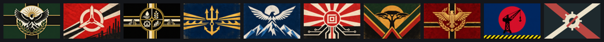

# 2100 Meganations

> *"2100. Los viejos Estados nacionales ya no existen. Ocho meganaciones se reparten lo que queda
> del planeta, cada una construida alrededor del recurso, equilibrio o sistema sin el que no puede
> vivir."*

**2100 Meganations** es una conversión total de *Hearts of Iron IV*. El mundo se deshiló en los
años 2040: se perdieron las cosechas, las máquinas se quedaron con el trabajo y el agua decidió
quién vivía. De lo que quedó salieron ocho meganaciones, dos potencias que esperan su momento y
un puñado de tierras sin ley. La partida va del 1 de enero de 2100 al 1 de enero de 2120.

---

## Las potencias

| | Nación | En una línea |
|---|---|---|
| 🌿 | [**Imperio Ecofascista**](docs/cronicas/EFE.md) | Un emperador coronado con lapacho, un bosque que es soberano y cubas donde crece el acero vivo. |
| ⚙️ | [**Comuna Socialista Automatizada**](docs/cronicas/ASC.md) | Las fábricas que nadie rompió, un consejo sorteado y un sistema que no duerme. |
| 💼 | [**Unión Libre de Capital Corporativo**](docs/cronicas/FCU.md) | Una república comprada en un remate: cuatro corporaciones y un dividendo. |
| ⚓ | [**Nación de Mercado de Alta Mar**](docs/cronicas/HSN.md) | Un país que flota: estrechos, seguros y capitanes. |
| ☀️ | [**Reino Celeste Neoandino**](docs/cronicas/NAS.md) | El hijo del Sol, templos de luz y soldados nacidos a cuatro mil metros. |
| 🌊 | [**Directorio Sino-Armónico**](docs/cronicas/SHD.md) | Ingenieros que gobiernan una sociedad como se gobierna un río. |
| 🌍 | [**Federación de los Pueblos Africanos**](docs/cronicas/APF.md) | Mil doscientos consejos de aldea y una maestra rural como portavoz. |
| 🦅 | [**Neo Imperio Romano**](docs/cronicas/NRE.md) | Un Imperator alzado sobre un escudo y tres legados que quieren su trono. |
| 🏯 | [**Shogunato de los Astilleros**](docs/cronicas/ZJP.md) | Japón se levanta contra la Alta Mar: tres Casas, el Giri y el Mecha. |
| 👑 | [**Albión**](docs/cronicas/ZAL.md) | Los que rompieron las máquinas eligen entre volver al pasado o saltar al futuro. |

Y entre ellas, [**las Tierras Sin Ley**](docs/cronicas/TIERRAS_SIN_LEY.md): los atamanes de
Eurasia, la Rani del Raj, los emires de los pozos muertos, el coronel de la Amazonia y una unidad
censal que camina desde 2042.

---

## Qué trae

- **Diez naciones jugables con mecánicas propias.** Cada una tiene su moneda (Bioacero, Cómputo,
  Dividendos, Peaje, Inti-Soma, Mandato del Cielo, Ubuntu, Gloria, Giri, Pompa o Sincronía), su
  árbol de focos con varios destinos posibles y su unidad única: el Gliptodonte, el Centinela, el
  Ala de Obsidiana, el Leviatán de Malaca, los Hijos del Cóndor, el Dragón del Gran Canal, el
  Kiboko, el Onagro y el Mecha.
- **El Líder.** Carisma, Astucia, Prestigio y Salud. Los ministros los cambian, uno de cada cinco
  eventos los toca y los fundadores envejecen.
- **Aventuras de "elegí tu propia aventura".** Catorce historias con decenas de finales, para las
  anarquías, para el mundo en 2110 y para Japón y Albión. Los momentos grandes se abren en **la
  Lámina**, una ventana con una pintura de museo y un relato largo.
- **Un siglo inestable.** Ultimátums de los generales y guerras civiles con bandera propia, la
  crisis del siglo, el Gigante que despierta una coalición en Ginebra y la Crisis del Sucesor.
- **Arte propio.** Retratos, banderas, pines de metal y esmalte para cada foco, azulejos de
  cerámica para cada espíritu, una interfaz de cristal y cobre y pantallas de carga.

---

## La Biblioteca

Para leer antes, durante o después de una partida:

| | |
|---|---|
| 📖 [**Breve historia del fin del mundo**](docs/lore/el_mundo_en_2100.md) | De 2040 a 2100, y lo que se ve venir. |
| 📜 [**Las crónicas**](docs/README.md#las-crónicas) | La historia de cada nación, contada. |
| 🗂️ [**La Enciclopedia**](docs/enciclopedia/README.md) | Todo lo que el mod sabe de cada nación: líderes, gabinete, espíritus, focos, aventuras y eventos. |
| 🎮 [**Cómo jugar**](docs/guia/como_jugar.md) | Qué es distinto a HOI4, qué nación elegir y cómo no perder en 2102. |
| 🧭 [**Guía de aventuras**](docs/guia/aventuras.md) | Las catorce historias, sin spoilers. |
| ✒️ [**Cuentos de 2100**](docs/README.md#cuentos-de-2100) | Cinco cuentos del mundo del mod. |
| 💬 [**Frases**](docs/literatura/frases.md) | Lo que dicen los personajes en las pantallas de carga. |
| 🛍️ [**Merch**](docs/merch/catalogo.md) | El catálogo de los puertos francos de Malaca, y lo que se podría fabricar de verdad. |

---

## Instalar y jugar

1. Bajá este repositorio (botón verde **Code** → **Download ZIP**) o cloná la rama del mod.
2. Seguí [EMPEZAR.md](EMPEZAR.md): instala lo que falta, arma el mod a partir de tu copia de
   *Hearts of Iron IV* y lo deja en la carpeta de mods.
3. En el launcher del juego, activá **2100 Meganations** y arrancá una partida nueva.

El mod está en castellano y en inglés.

---

## Para quien quiera meterse en el código

El mod no se escribe a mano: se **genera** desde `spec/` (el lore y las reglas, en YAML) con un
programa en Python. Cómo funciona, cómo se prueba y por qué está hecho así:

- [README técnico](docs/desarrollo/README_tecnico.md): el generador, la estructura y las reglas.
- [DISENO_OCHO_POTENCIAS.md](DISENO_OCHO_POTENCIAS.md): la bitácora de diseño, cambio por cambio.
- [PROGRAMA.md](PROGRAMA.md) y [SIMULADOR_IA.md](SIMULADOR_IA.md): el programa de trabajo y el
  simulador que tira los dados de la IA.

La Enciclopedia y la guía de aventuras se regeneran desde el spec con
`python -m tools.docs.biblioteca`, así que nunca quedan atrás del juego.
