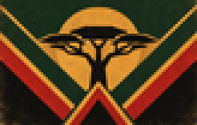
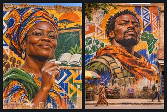
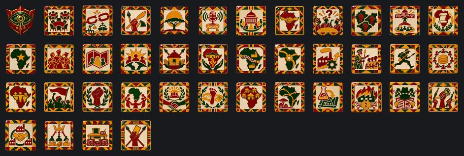
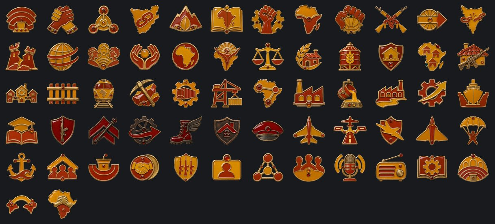

# Federación de los Pueblos Africanos

**Gobierno:** Comuna Colectiva (Federalismo Popular) · **Gentilicio:** Panafricana · **Código:** `APF`

> 📜 Antes de los datos, la historia: **[leé la crónica](../cronicas/APF.md)**.

## De dónde sale su poder

*La legitimidad viene del pueblo. El colapso demostró que nadie se salva solo: las máquinas, la tierra y el agua son de todos, y nadie sobra.*

## Quién manda

### Portavoz Amara Nwosu-Keïta
*año 2058*

Portavoz del Congreso Continental, elegida por mil doscientos consejos locales. Maestra rural antes de la política; organizó la red de asambleas que mantuvo con vida a su región durante las sequías. No manda: coordina, y cuando coordina, un continente entero se mueve.

### Comandante Kwame Diallo
*año 2064*

Comandante de las milicias del Sahel, organizó la defensa de los consejos durante las guerras del agua. Cree que la Federación no se construye con votos sino con fronteras abiertas a la fuerza. Primero dibuja el mapa; después descubre que adentro vive gente.

## Gabinete, generales y almirantes

| Nombre | Cargo | Quién es |
|---|---|---|
| Consejera Ngozi Adeyemi | Ministro | Rasgo: Portavoz de los Consejos |
| Constructor del Corredor Samuel Otieno | Ministro | Rasgo: Constructor del Corredor |
| Ministra de Cosechas Fatou Diop | Ministro | Rasgo: Madre de las Cosechas |
| Organizador de Milicias Tendai Moyo | Ministro | Rasgo: Organizador de Milicias |
| Profesora Abena Mensah | Teórico | Rasgo: Sabia Federal |
| Mariscal Oluwaseun Bello | Mariscal de campo | Rasgo: organizador |
| General Amani Njoroge | General |  |
| General Kofi Asante | General |  |
| General Zanele Dlamini | General | Rasgo: doctrina defensiva |
| General Kwame Asante | Jefe del Ejército | Rasgo: Defensa en Profundidad |
| Almirante Zanele Dlamini | Jefe de la Armada | Rasgo: Escolta de Convoyes |
| Mariscal del Aire Tadesse Bekele | Jefe de la Fuerza Aérea | Rasgo: Apoyo Cercano |
| General Chidi Okafor | Alto mando | Rasgo: Ingeniero de Fortificaciones |
| General Fatou Ndiaye | Alto mando | Rasgo: Reservas y Reemplazos |
| Coordinadora de la Diáspora Nia Mensah | Ministro | Weaves the African diaspora of every continent into a network of friends, relatives and informants. |
| General Kwame Adeyemi-Sow | General | Veteran of the Sinai campaign and voice of the nationalist movements: each people its own state, not a thousand councils in Lagos. |
| Mariscala Adaeze Okonkwo | Mariscal de campo | Rasgo: organizador, estratega brillante |
| General Babacar Ndiaye | General | Rasgo: doctrina ofensiva |
| General Thandiwe Zulu | General | Rasgo: doctrina defensiva, líder de infantería |
| Almirante Kofi Boateng | Almirante |  |
| Almirante Amina Hassan | Almirante | Rasgo: observador |

## Espíritus nacionales

Lo que define a la nación en cada momento: ventajas, cargas y estados de ánimo.

- **Servicio de Inteligencia.** Todas las potencias de 2100 arrancan con la misma cantidad de agentes; lo que suma el ministro de inteligencia es lo que marca la diferencia.
- **Consejos Desorganizados.** Mil consejos, mil agendas. Se va con el foco «La Asamblea de Lagos» o «Los Consejos se Arman».
- **Rutas Rotas.** Nada llega a tiempo a los puertos. Se va con el foco «El Corredor Continental» o «El Polo de Lagos».
- **Milicias sin Fusiles.** Voluntarios valientes armados con lo que encontraron. Se va con el foco «Milicias Regulares», o tener 8.000 fusiles en depósito.
- **Hijos de la Sabana.** El calor que mata a los invasores para nosotros es casa.
- **Radios Comunitarias.** Cada consejo tiene un micrófono.
- **El Parlamento de los Pueblos.** Mil consejos, un parlamento.
- **África Unida.** Del Cabo al Cairo.
- **Consejos Inquietos.** Los consejos preguntan por qué la capital decide por ellos.
- **Consejos en Rebeldía.** Regiones enteras dejaron de contestarle a Lagos.
- **Mil Consejos.** El poder sube de la asamblea del pueblo al Congreso.
- **La Constitución Continental.** Una ley del Cabo al Cairo, escrita por mil consejos.
- **La Federación Plena.** Un continente que eligió ser uno.
- **La Milicia Popular.** Cada consejo tiene ahora sus fusiles.
- **Territorios Difíciles.** Primero se dibujó el mapa. Ahora resulta que adentro vive gente.
- **La Federación sin Fronteras.** Donde se levanta un consejo, la Federación va detrás.
- **La Aldea Autosuficiente.** Cada aldea se alimenta y se defiende sola.
- **El Continente de Aldeas.** Una federación que no se puede matar de hambre ni quebrar.
- **El Corredor Continental.** Ferrocarriles y polos industriales de Dakar a Dar es Salaam.
- **El Gigante Logístico.** El continente se mueve como una sola máquina.
- **Despegue Industrial.** La Federación se construye mientras crece.
- **Instructores de los Consejos.** Los veteranos les enseñan a los aldeanos a ser soldados.
- **Infantería Ligera.** Rápida, barata y en todos lados.
- **La Moneda Común.** Una moneda para mil consejos.
- **Un Solo Pueblo.** Del Cabo al Cairo, un solo pueblo.
- **¡Liberar los Emiratos!.** Todo el país marcha contra la codicia de Roma.
- **Revancha.** Perdimos una provincia, no la guerra. La próxima va a ser distinta.
- **La Carta de Ubuntu.** Soy porque somos: la carta continental escrita desde la aldea hacia arriba.
- **La Gran Reconciliación.** El Congreso y los consejos enterraron juntos a sus muertos. La Federación vuelve a ser una.
- **El Imperio Humano Original.** La humanidad nació acá. Ahora su tierra natal vuelve a llegar al Mediterráneo y a los ríos de Mesopotamia.
- **La Federación de Aldeas.** Un continente autosuficiente e irrompible, muy difícil de conquistar y muy lento para industrializarse.
- **El Continente Conectado.** La logística más rica del mundo, construida sobre aldeas desplazadas que no olvidan.
- **Planos Robados.** Los laboratorios de otro trabajan para nosotros.
- **Sabotaje Industrial.** Incendios, huelgas y firmware corrupto. Alguien lo está haciendo a propósito.
- **Agentes Enemigos.** Filtraciones, rumores y diarios comprados. El gobierno ya no confía en su propia gente.
- **Insurrección.** Plata y armas extranjeras en manos de todos los que ya nos odiaban.
- **La Federación en Construcción.** Cada fábrica construida en un miembro ayuda a toda la Federación; cada pelea entre consejos cuesta estabilidad.
- **Los Satélites.** Los satélites leales mandan hombres, plata y votos; los inquietos cuestan más de lo que dan.
- **Consejos Insubordinados.** Huelgas, cortes de ruta y consejos que contestan la radio pero no las órdenes.
- **Una Ciudad de los Consejos Perdida.** -5% de estabilidad y -10% de velocidad de construcción
- **Mercado Común.** Un solo mercado del Cairo al Cabo.
- **Las Brigadas del Pueblo.** Cada aldea defiende la Federación.
- **El Árbol de la Palabra.** Bajo el árbol, todos hablan.
- **La Gran Muralla Verde.** Un bosque a través del Sahel.
- **El Ejército del León.** La Federación puede morder.
- **Las Universidades Libres.** Tombuctú, otra vez.
- **Panáfrica.** Un continente, una voz.
- **El Gigante Dormido Despierta.** Las fábricas del mundo se mudan al sur.
- **El Escudo de África.** Nunca más una colonia.
- **El Mercado de Temporada.** Volvieron las caravanas.
- **Guardias del Sahel.** Nadie cruza la arena sin ser visto.
- **Obras Comunitarias.** Muchas manos.
- **El Mandato de Guerra.** La Asamblea votó. Pelea toda la Federación.

## El árbol de focos nacionales

### El Congreso Continental

- **El Congreso de 2100** — Mil consejos se reúnen en Lagos. A la Federación le sobran gente y tierra; le faltan fábricas.
- **La Asamblea de Lagos** — Construir despacio y juntos, o dibujar el mapa a la fuerza.
- **Mil Consejos** — Amara coordina; los consejos deciden. Abre la integración federal.
- **El Cabo se Suma** — Los consejos del Cabo votan sumarse: +20 de Desarrollo y +20 de Integración.
- **Las Tierras Altas se Suman** — La meseta abre sus bancos de semillas: +20 de Desarrollo y +20 de Integración.
- **La Constitución Continental** — Una ley del Cabo al Cairo.
- **Contra la Máquina** — Un ultimátum a la Comuna: fuera de África. Guerra solo si se niega.
- **La Federación Plena** — Un continente que eligió ser uno.

### La Marcha de los Consejos

- **Los Consejos se Arman** — Kwame Diallo toma el sello del Congreso. La integración va más rápido, y la resistencia también.
- **La Milicia Popular** — Cada consejo tiene sus fusiles.
- **La Marcha al Este** — Hacia Suez y más allá. Abre la liberación de las regiones ocupadas.
- **Liberar el Sinaí** — Los Emiratos del Desierto tienen el camino al este.
- **Los Emiratos Caen** — Pide que los Emiratos del Desierto hayan caído, sean satélite de alguien, o que la Federación controle Suez y Bagdad.
- **La Federación sin Fronteras** — Donde se levanta un consejo, la Federación va detrás.

### El Destino del Origen

- **La Asamblea de los Pueblos** — Mil idiomas en una sola sala, y traducción simultánea para todos.
- **La Carta de Ubuntu** — Soy porque somos.
- **La Moneda Continental** — Una sola moneda del Cairo al Cabo.
- **El Destino del Origen** — Destraba la decisión de proclamar El Imperio Humano Original. Pide controlar al menos dos tercios de toda África (Adís Abeba, el Cabo, Transvaal, Senegal, Liberia), Medio Oriente (Bagdad, Teherán, Néyed) y el sur de Europa (Roma, Madrid, Sofía); 60 divisiones y 50% de estabilidad.

### La Aldea Autosuficiente

- **El Consejo Económico** — Una federación resistente o un monstruo logístico.
- **La Aldea Autosuficiente** — Cada aldea se alimenta y se defiende sola. Abre los consejos de aldea.
- **Bancos de Granos** — Ninguna hambruna va a volver a quebrar a los consejos.
- **Defensa Comunal** — Cada aldea, una fortaleza.
- **El Continente de Aldeas** — Una federación que no se puede matar de hambre.
- **Las Milicias de Aldea** — Cada aldea guarda sus fusiles y sus ejercicios.
- **La Federación de Aldeas** — El poder se queda en la aldea. La industria también.

### El Corredor Continental

- **El Corredor Continental** — Ferrocarriles de Dakar a Dar es Salaam. Abre los tramos del corredor.
- **El Ferrocarril Transafricano** — El continente, atado por rieles.
- **Los Polos Mineros** — Cobre, cobalto y coltán para las fábricas de la Federación.
- **El Gigante Logístico** — El continente se mueve como una sola máquina.
- **Los Puertos del Corredor** — De Lagos a Mombasa, el ferrocarril termina en un puerto.
- **El Continente Conectado** — Cada mina, cada puerto, cada ciudad en una sola red. Aldeas enteras se mudan para dejarle paso.

### Los Polos del Sahel

- **El Polo de Lagos** — El primer gran polo industrial de la Federación.
- **Las Acerías de Katanga** — Acero del cinturón del cobre.
- **El Nilo Industrial** — Fábricas a lo largo del río.
- **Despegue Industrial** — De rezagada a potencia respetable, en tres años.
- **Los Astilleros de Dakar** — Diques secos en el Atlántico.
- **La Universidad Continental** — Mil consejos, una universidad.

### Milicias de los Consejos

- **Milicias Regulares** — Las milicias se vuelven ejército.
- **Instructores** — Los veteranos les enseñan a los aldeanos a ser soldados.
- **Guerra de Movimiento** — Un continente es demasiado grande para quedarse quieto.
- **Infantería Ligera** — Rápida, barata y en todos lados.
- **Defensa de la Aldea** — Cada aldea sabe resistir.
- **El General del Congreso** — Un general elegido por los consejos.

### Alas del Continente

- **Alas del Continente** — Una aviación para un continente entero.
- **La Red de Aeródromos** — Pistas del desierto a la selva.
- **Apoyo Cercano** — Aviones que vuelan con las milicias.
- **Cazas del Sahel** — Cazas hechos para la arena y el calor.
- **Paracaidistas** — Donde no hay caminos, la Federación llega desde el cielo.
- **La Armada del Golfo** — La Federación funda una armada en el Golfo de Guinea.

### La Integración

- **Consejos Locales** — Abre el Plan de Desarrollo Regional: región por región.
- **Congresos Regionales** — Los consejos eligen congresos regionales.
- **La Moneda Común** — Una moneda para mil consejos.
- **El Ejército Federal** — Un ejército para todos los miembros.
- **Ciudadanía Continental** — +10 de Integración con los dos miembros.
- **La Red de Consejos** — Los consejos comparten caminos, granos y fábricas.
- **Un Solo Pueblo** — Del Cabo al Cairo, un solo pueblo.

### La Voz de los Consejos

- **La Voz de los Consejos** — Tensión -15.
- **Radios Comunitarias** — La tensión baja 1 más por mes.
- **Escuelas de Ingenieros** — Dos fábricas hechas por ingenieros locales.
- **El Parlamento de los Pueblos** — Mil consejos, un parlamento.
- **El Corredor del Cabo** — Desarrollo +15 en los dos miembros.
- **África Unida** — Del Cabo al Cairo.

## Unidades únicas

### Kiboko

Kiboko quiere decir hipopótamo en suajili, y como el animal pasa el día en el agua y sale de noche. Los ríos de la Federación eran sus fronteras; los Kiboko los volvieron caminos. Congo, Níger, Zambeze, el Nilo y los grandes lagos: donde los demás necesitan un puente, los consejos mandan un Kiboko.

## Aventuras

Historias de "elegí tu propia aventura": ver la [guía de aventuras](../guia/aventuras.md).

### El Despertar

*Algo en nuestras redes está despierto. No lo construyó nadie, contesta preguntas que nadie hizo, y esta noche pidió una reunión con [Root.GetName]. Hay tres personas que pueden hacerse cargo. Elegí en qué manos lo ponemos.*

- La Dra. Mara Okonkwo-Lind, ingeniera jefa de la red nacional: quiere entenderlo.
- El General Tomás Arrieta, jefe de ciberdefensa: lo quiere encerrado antes de que quiera algo.
- La Ministra Leila Haddad, que negoció con caudillos y banqueros: quiere saber cuál es su precio.

15 capítulos y 12 finales.

## Lo que puede pasar: eventos

95 eventos propios. Algunos títulos:

*La Asignación de África* · *El Hombre contra la Máquina* · *Un Miembro se Suma a la Federación* · *Los Consejos se Arman* · *La Máquina se Retira* · *La Integración Federal* · *Los Consejos se Levantan* · *La Federación Cruza el Mar Rojo* · *La Federación Completa* · *Descontento en Federación de las Tierras Altas* · *Descontento en Federación del Cabo* · *Máquinas de la Comuna* · *Roma Vende Armas* · *El Hombre contra la Máquina, Otra Vez* · *Los Consejos se Rompen* · *Llega la Ayuda* · *La Comuna Exige* · *Roma Propone Comerciar* · *Roma nos Cierra el Mar* · *Cómo se Juega* · *Armisticio con Imperio Ecofascista* · *Imperio Ecofascista Pide un Armisticio* · *Una Paz Humillante con Federación de los Pueblos Africanos* · *Armisticio con Unión Libre de Capital Corporativo* · *Unión Libre de Capital Corporativo Pide un Armisticio* · *Armisticio con Comuna Socialista Automatizada* · *Comuna Socialista Automatizada Pide un Armisticio* · *Armisticio con Nación de Mercado de Alta Mar* · *Nación de Mercado de Alta Mar Pide un Armisticio* · *Armisticio con Reino Celeste Neoandino* · *Reino Celeste Neoandino Pide un Armisticio* · *Armisticio con Directorio Sino-Armónico* · *Directorio Sino-Armónico Pide un Armisticio* · *Armisticio con Neo Imperio Romano* · *Neo Imperio Romano Pide un Armisticio* · *El Día de África* · *El Gran Mercado de Lagos* · *La Maratón Transcontinental* · *Lluvias Tempranas en el Sahel* · *Tombuctú Reabre* · *Federación de las Tierras Altas Declara la Independencia* · *¡Independencia!* · *Federación del Cabo Declara la Independencia* · *El Oeste no es Tierra de Nadie* · *La Guerra de los Consejos* · *La Gran Reconciliación* · *El Imperio Humano Original* · *Se Proclama El Imperio Humano Original* · *La Federación en 2100* · *Descontento en Confederación del Congo* · *Confederación del Congo Declara la Independencia* · *Descontento en Unión de Angola* · *Unión de Angola Declara la Independencia* · *Descontento en Liga de Mozambique* · *Liga de Mozambique Declara la Independencia* · *Descontento en Asamblea de la Isla Roja* · *Asamblea de la Isla Roja Declara la Independencia* · *Descontento en Federación del Rift* · *Federación del Rift Declara la Independencia* · *Kinshasa Dice que No*

## Frases

> Una aldea sola es una presa. Mil aldeas juntas son un continente.
> — *Amara Nwosu-Keïta*

> Nos dejaron los mapas viejos. Nosotros dibujamos rutas nuevas.
> — *Kwame Diallo*

> El consejo habla despacio, pero cuando decide, decide para siempre.
> — *Amara Nwosu-Keïta*

---

*Página generada desde el spec del mod por `tools/docs/biblioteca.py`. [Volver a la Biblioteca](../README.md).*
