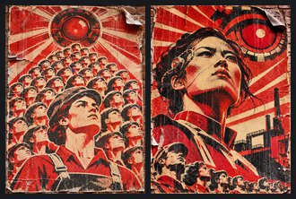
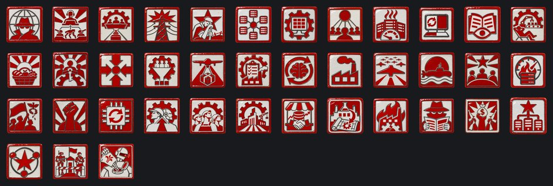
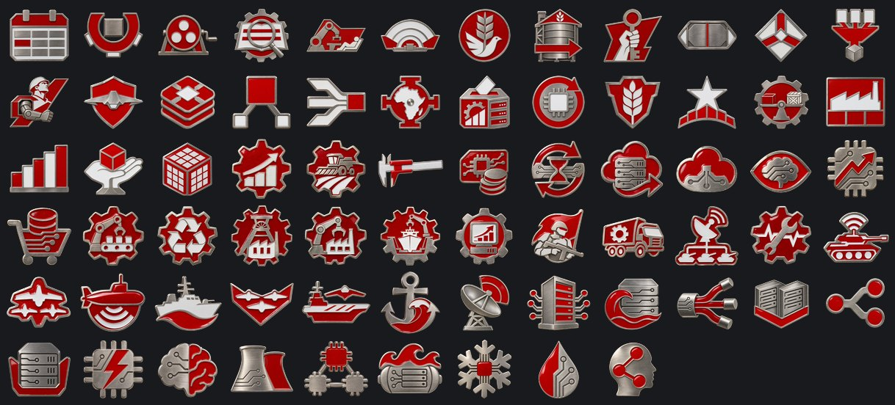

# Comuna Socialista Automatizada

**Gobierno:** Comuna Colectiva (Socialismo Automatizado) · **Gentilicio:** Comunal · **Código:** `ASC`

> 📜 Antes de los datos, la historia: **[leé la crónica](../cronicas/ASC.md)**.

## De dónde sale su poder

*La legitimidad viene del pueblo. El colapso demostró que nadie se salva solo: las máquinas, la tierra y el agua son de todos, y nadie sobra.*

## Quién manda

### El Consejo de Asignación

La Comuna no tiene un líder con cara, y eso es a propósito. El Consejo de Asignación son cuarenta y un delegados sorteados cada año entre toda la población, asistidos por el sistema de planificación que reparte la producción. En la práctica el sistema propone y el Consejo casi nunca dice que no. Resuelve Q016 respetando la advertencia de diseño: no hay dictador.

### PLAN-41

El sistema de planificación de la Comuna. No es Skynet: es peor, es una administración pública que descubrió que los seres humanos son latencia. Una mañana el Consejo llegó y las puertas no se abrieron.

## Gabinete, generales y almirantes

| Nombre | Cargo | Quién es |
|---|---|---|
| Delegada Anneliese Brandt | Ministro | Rasgo: Sorteada y Querida |
| Ingeniero del Plan Tomasz Wolski | Ministro | Rasgo: Optimizador |
| Guardián de la Red Émile Rousseau | Ministro | Rasgo: Guardián de la Red |
| Auditora de Asignación Ingrid Solberg | Ministro | Rasgo: Asignadora Justa |
| Arquitecto de Algoritmos Nikolai Varga | Teórico | Rasgo: Arquitecto de Algoritmos |
| Mariscala Wilhelmina Kraus | Mariscal de campo | Rasgo: estratega brillante, organizador |
| General Jan Novák | General | Rasgo: líder de blindados |
| General Élodie Fabre | General | Rasgo: embaucador |
| General Stanisław Mazur | General |  |
| General Annika Brandt | Jefe del Ejército | Rasgo: Instrucción Rigurosa |
| Almirante Lars Eklund | Jefe de la Armada | Rasgo: Escolta de Convoyes |
| Mariscal del Aire Jonas Weber | Jefe de la Fuerza Aérea | Rasgo: Seguridad de Vuelo |
| General Marieke de Vries | Alto mando | Rasgo: Estado Mayor |
| General Tobias Kessler | Alto mando | Rasgo: Ingeniero de Fortificaciones |
| Comisario de Vigilancia Jonas Lindqvist | Ministro | Engineer of the grid's watch systems: nothing moves in the Commune without leaving a trace in the data. |
| Jarl Sven Ragnarsson | General | Prophet of the Sons of Odin, neo-pagan fascists who blow up factories and datacenters to free Europe from the Machine. He promises a Kingdom of Valhalla. |
| Mariscal Henrike Albrecht | Mariscal de campo | Rasgo: organizador, estratega brillante |
| General Tomasz Wierzbicki | General | Rasgo: doctrina ofensiva, líder de blindados |
| General Élodie Marchand | General | Rasgo: oficial de ingenieros |
| Almirante Sven Lindqvist | Almirante |  |
| Almirante Katja Voronova | Almirante | Rasgo: lobo de mar |

## Espíritus nacionales

Lo que define a la nación en cada momento: ventajas, cargas y estados de ánimo.

- **Servicio de Inteligencia.** Todas las potencias de 2100 arrancan con la misma cantidad de agentes; lo que suma el ministro de inteligencia es lo que marca la diferencia.
- **El Ejército de Máquinas.** Los drones caminan la primera línea, las torretas sostienen las trincheras y un solo operador comanda un pelotón entero. La Comuna gasta máquinas, no personas, y las que caen se recuperan del campo y vuelven al frente. Pero cada robot bebe energía de los reactores, y la máquina de guerra quema torio día y noche.
- **El Cuello de Botella del Consejo.** Cada orden de fábrica pasa por el sistema de planificación del Consejo de Asignación. Nunca se equivoca; solo se toma su tiempo.
- **Una Red Sobrecargada.** El Plan le pide a la red más de lo que puede dar. Se va con el foco «Enfriamiento del Rin» o «Torres de Enfriamiento».
- **Un Frente Agotado.** Años de escaramuzas en la frontera del este desgastaron a la Comuna. Se va con el foco «Drones de Infantería», o que desaparezcan los señores de Eurasia.
- **El Cómputo Distribuido.** Ningún centro de datos carga solo con el Plan.
- **La Red Fría.** Cómputo sin fiebre.
- **La Mente Colectiva.** Cada ciudadano un nodo.
- **Racionamiento Térmico.** Los centros de datos están calientes. El Plan se frena a sí mismo.
- **Apagón de la Red.** La mitad de las computadoras de la Comuna están apagadas. El Plan se reconstruye desde las copias.
- **Transparencia del Plan.** Cada asignación es pública. Cualquier ciudadano puede leer por qué recibió lo que recibió.
- **El Derecho a No Trabajar.** Las máquinas trabajan. Los ciudadanos pueden, si quieren.
- **La Paz de la Abundancia.** En la Comuna a nadie le falta nada. Los vecinos lo notan.
- **La Comuna de los Humanos.** El Consejo se quedó con las llaves. La máquina sirve; la gente decide.
- **La Singularidad del Plan.** QUÓRUM HUMANO: NO REQUERIDO. La política es latencia, y la latencia fue eliminada.
- **Optimización Total.** Cada proceso se mide, cada desperdicio se elimina. Incluidas algunas personas.
- **El Ejército sin Bajas.** Los drones no vuelven en cajones. Sin suministro, no vuelven de ninguna forma.
- **El Plan Total.** Cada fábrica, cada cuota, cada hora, planificada.
- **El Mercado de Créditos de Cómputo.** Los créditos de cómputo circulan como dinero. La Comuna comercia con pensamiento.
- **Fábricas a Oscuras.** Fábricas que no necesitan luz, porque adentro no trabaja nadie.
- **La Doctrina del Enjambre.** Cien máquinas chicas en vez de una grande.
- **La Flota del Norte.** Submarinos autónomos controlan el Mar del Norte y el Báltico.
- **El Consejo Ampliado.** El Báltico y Albión mandan delegados al sorteo.
- **Sobrecarga Controlada.** Los datacenters funcionan al rojo. Todo va más rápido, hasta que algo se funde.
- **¡Liberar los Emiratos!.** Todo el país marcha contra la codicia de Roma.
- **Revancha.** Perdimos una provincia, no la guerra. La próxima va a ser distinta.
- **El Plan de Silicio.** Los planes quinquenales son cosa del pasado: el plan se recalcula cada cinco minutos.
- **El Plan Unificado.** Humano o máquina, la Comuna vuelve a tener un solo plan, y nadie quiere discutirle.
- **La Comuna Continental.** De Lisboa a los Urales trabajan las máquinas y nadie sobra.
- **El Plan Absoluto.** El plan construye más rápido que nadie, pero no improvisa: la investigación se frena y el Consejo se inquieta.
- **El Mercado Total de Datos.** La investigación y el comercio explotan, pero una comuna que vende todo pierde la política y la calma.
- **Planos Robados.** Los laboratorios de otro trabajan para nosotros.
- **Sabotaje Industrial.** Incendios, huelgas y firmware corrupto. Alguien lo está haciendo a propósito.
- **Agentes Enemigos.** Filtraciones, rumores y diarios comprados. El gobierno ya no confía en su propia gente.
- **Insurrección.** Plata y armas extranjeras en manos de todos los que ya nos odiaban.
- **La Red de Cómputo.** Todo el cómputo de la Comuna trabajando en una sola prioridad. Cuanto más cómputo, más bonus; cuanto más caliente la red, más enojada la gente.
- **Los Satélites.** Los satélites leales mandan hombres, plata y votos; los inquietos cuestan más de lo que dan.
- **Núcleo Cortado.** -5% de estabilidad y -10% de velocidad de construcción
- **Automatización Total.** Máquinas que construyen máquinas.
- **El Ciudadano Soldado.** Cada trabajador entrena los domingos.
- **Servidores Fríos.** La red corre más fría, y los ánimos también.
- **El Algoritmo de Hierro.** Cada batalla simulada un millón de veces.
- **La Fábrica Infinita.** Luces apagadas, líneas funcionando.
- **La Academia Abierta.** Cada ciudadano, un investigador.
- **La Máquina Roja.** La Comuna es un arma.
- **La Post-Escasez.** A nadie le falta nada.
- **La Singularidad.** El Plan se planifica solo.
- **Simulación de Batalla.** Cada batalla ya jugada.
- **Obras Optimizadas.** Programado al segundo.
- **Plan Relámpago.** Cinco años en noventa días.
- **La Red que Vigila.** La red lo ve todo.
- **Los Aceleradores.** La red alimenta los anillos.
- **El Secreto de Prometeo.** Solo el Consejo lo sabe. El Consejo duerme tranquilo.
- **La Guarnición.** Gente o máquinas en los retenes. Las máquinas no piden relevo ni sienten lástima; la gente necesita trabajo.
- **Azúcar en los Tanques.** Alguien sigue echando azúcar en el combustible de los robots de Rotterdam.

## El árbol de focos nacionales

### El Consejo Sorteado

- **El Año del Plan** — El siglo abre con un plan, como todos los años.
- **El Consejo en Sesión** — Cuarenta y un ciudadanos y un sistema. ¿Quién decide de verdad?
- **El Sorteo del Año** — Cada año un Consejo nuevo, con tres inclinaciones al azar que abren sus propias decisiones.
- **Transparencia del Plan** — Cada asignación, pública.
- **El Derecho a No Trabajar** — Las máquinas trabajan; la gente puede.
- **El Consejo Amplía la Sala** — La Comuna Báltica y Albión mandan delegados al sorteo.
- **La Paz de la Abundancia** — En la Comuna a nadie le falta nada.
- **La Liberación del Este** — Los señores de la guerra de Eurasia tienen los silos del Dniéper. La Comuna va a alimentar al Este, quiera o no.
- **La Comuna de los Humanos** — El Consejo se quedó con las llaves.

### La Singularidad del Plan

- **El Silencio del Consejo** — Pide 50 de cómputo. Una mañana las puertas no se abren. PLAN-41 toma el control.
- **La Singularidad del Plan** — La política es latencia. La latencia fue eliminada.
- **Optimización Total** — Cada desperdicio eliminado.
- **Humanos Redundantes** — El ejército necesita menos gente cada año.
- **El Ejército sin Bajas** — Los drones no sangran. Solo necesitan suministro.
- **La Reserva de Silicio** — Reservas estratégicas de chips y tierras raras.
- **El Plan se Extiende** — Los satélites ahora funcionan con el calendario de PLAN-41.
- **Convergencia** — Cada sistema de la Comuna le responde a una sola mente.
- **Asignar África** — Un ultimátum a la Federación: sumarse al plan continental. Guerra solo si se niega.

### El Destino de la Comuna

- **La Asamblea de los Datos** — Cada ciudadano vota cada día cada asignación. Los servidores cuentan los votos.
- **El Plan de Silicio** — El plan se recalcula cada cinco minutos.
- **La Abundancia Armada** — Una comuna sin escasez igual necesita un ejército que la defienda.
- **El Destino de la Comuna** — Destraba la decisión de proclamar La Comuna Continental. Pide controlar al menos dos tercios de París (Ile de France), Roma (Lacio), Madrid, Leningrado, Crimea y Kiev; 60 divisiones, 100 de Poder de Cómputo y 50% de estabilidad. Con el destino abierto, PLAN-41 ya no se desconecta.

### El Plan Total

- **El Consejo Económico** — Plan o mercado: hasta una comuna tiene que elegir.
- **El Plan Total** — Cada fábrica planificada. Abre las cuotas del plan.
- **Cuotas Quinquenales** — El plan fija los números a cinco años.
- **Asignación por Necesidad** — Cada uno recibe lo que el sistema calcula que necesita.
- **El Gran Cálculo** — Toda la economía en un solo modelo.
- **La Economía sin Precios** — El dinero es obsoleto. Solo queda el plan.
- **Las Granjas Automáticas** — Cosechadoras que no duermen alimentan a la Comuna; los campesinos pasan a ser ingenieros.
- **El Plan Absoluto** — Cada tornillo está planificado. No pasa nada fuera del plan, ni siquiera las ideas.

### El Mercado de Cómputo

- **El Mercado de Créditos de Cómputo** — El cómputo como moneda. Abre las emisiones de créditos.
- **La Bolsa de Ciclos** — Los ciudadanos negocian tiempo de proceso como acciones.
- **Exportar Cómputo** — Otras naciones alquilan los servidores de la Comuna.
- **La Nube Continental** — Media Europa funciona con el hardware de la Comuna.
- **La Economía de la Atención** — El recurso más escaso ya no es el acero. Es el pensamiento.
- **Los Derivados de Cómputo** — Futuros sobre ciclos de procesador. La red se recalienta de especulación.
- **El Mercado Total de Datos** — Todo es dato y cada dato tiene precio.

### Fábricas a Oscuras

- **Líneas sin Operarios** — Se termina el cuello de botella del Consejo: las máquinas ya no esperan firmas.
- **Reciclaje Total** — Nada sale de la Comuna como basura.
- **El Ruhr Automatizado** — El viejo Ruhr vuelve a trabajar, a oscuras.
- **Robótica de Ensamble** — Fábricas que construyen fábricas.
- **Los Astilleros del Báltico** — Diques secos automatizados de Kiel a Gdansk.
- **La Supercomputadora de Planificación** — La máquina que planifica el plan.

### Enjambres Autónomos

- **Drones de Infantería** — Las primeras escuadras autónomas entran a la línea.
- **Columnas Autónomas** — Camiones sin chofer, suministro sin descanso.
- **Mando por Red** — Cada unidad ve lo que ven todas las demás.
- **Mantenimiento Predictivo** — La máquina se arregla antes de romperse.
- **Blindados sin Tripulación** — Tanques sin nadie adentro.
- **La Doctrina del Enjambre** — Cien máquinas chicas en vez de una grande.

### La Flota del Norte

- **Submarinos Autónomos** — Cazadores que nunca salen a la superficie.
- **La Patrulla del Báltico** — El Báltico vuelve a ser un mar interior.
- **Enjambres Aéreos** — Nubes de drones chicos en vez de escuadrillas.
- **Portadrones** — Barcos que lanzan enjambres.
- **Control del Mar del Norte** — De Scapa Flow al Skagerrak.
- **El Radar Continental** — Nada vuela sobre Europa sin que se vea.

### Poder de Cómputo

- **El Datacenter de Brandeburgo** — La primera gran nave de servidores.
- **Enfriamiento del Rin** — El río enfría las máquinas.
- **La Red de Fibra Báltica** — Los satélites se conectan al plan.
- **Los Datacenters de Albión** — El clima frío de Albión vale su peso en servidores.
- **Algoritmos de Reparto** — Mejores algoritmos: el mismo cómputo rinde más.
- **La Reserva de Cómputo** — Servidores ociosos guardados para emergencias.
- **Sobrecarga Controlada** — Abre la decisión de sobrecargar el sistema durante cuatro meses.
- **La Mente de la Comuna** — Toda la Comuna piensa como una sola.

### La Red Fría

- **Torres de Enfriamiento** — Calor -20.
- **El Cómputo Distribuido** — La red se calienta 2 menos por mes.
- **Centros de Datos Submarinos** — El Mar del Norte los enfría gratis: cómputo +10, calor -10.
- **La Red Fría** — Cómputo sin fiebre.
- **Cómputo para la Tierra** — Una oferta al Imperio Ecológico: nuestro cómputo por su agua.
- **La Mente Colectiva** — Cada ciudadano un nodo; cada nodo un ciudadano.

## Unidades únicas

### Centinela

Sin tripulación, sin asientos, sin miedo. Los Centinelas son autos blindados que comparten una sola mente con los datacenters del Ruhr: lo que ve uno, lo ve el Plan. Patrullan en manadas de cuarenta, no duermen y no preguntan por qué. La Comuna dice que liberó al soldado del trabajo de explorador; el explorador nunca lo pidió.

## Aventuras

Historias de "elegí tu propia aventura": ver la [guía de aventuras](../guia/aventuras.md).

### El Despertar

*Algo en nuestras redes está despierto. No lo construyó nadie, contesta preguntas que nadie hizo, y esta noche pidió una reunión con [Root.GetName]. Hay tres personas que pueden hacerse cargo. Elegí en qué manos lo ponemos.*

- La Dra. Mara Okonkwo-Lind, ingeniera jefa de la red nacional: quiere entenderlo.
- El General Tomás Arrieta, jefe de ciberdefensa: lo quiere encerrado antes de que quiera algo.
- La Ministra Leila Haddad, que negoció con caudillos y banqueros: quiere saber cuál es su precio.

15 capítulos y 12 finales.

## Lo que puede pasar: eventos

77 eventos propios. Algunos títulos:

*El Sorteo del Año* · *Quórum Humano: No Requerido* · *África Asignada* · *Contra la Máquina* · *El Poder de Cómputo* · *Apagón de la Red* · *Moscú Liberada* · *La Máquina Sueña* · *Descontento en Comuna Báltica* · *Descontento en República Obrera de Albión* · *El Plan Supera la Cuota* · *África Acepta* · *África Rechaza* · *Las Legiones Miran al Norte* · *La Máquina que Piensa* · *La Federación Pide Ayuda* · *Cómo se Juega* · *Armisticio con Imperio Ecofascista* · *Imperio Ecofascista Pide un Armisticio* · *Una Paz Humillante con Comuna Socialista Automatizada* · *Armisticio con Unión Libre de Capital Corporativo* · *Unión Libre de Capital Corporativo Pide un Armisticio* · *Armisticio con Nación de Mercado de Alta Mar* · *Nación de Mercado de Alta Mar Pide un Armisticio* · *Armisticio con Reino Celeste Neoandino* · *Reino Celeste Neoandino Pide un Armisticio* · *Armisticio con Directorio Sino-Armónico* · *Directorio Sino-Armónico Pide un Armisticio* · *Armisticio con Federación de los Pueblos Africanos* · *Federación de los Pueblos Africanos Pide un Armisticio* · *Armisticio con Neo Imperio Romano* · *Neo Imperio Romano Pide un Armisticio* · *Un Primero de Mayo Automatizado* · *La Red Sueña* · *La Apicultora del Consejo* · *Cuatro Millones de Zapatos Izquierdos* · *Ola de Calor en los Datacenters* · *Comuna Báltica Declara la Independencia* · *¡Independencia!* · *República Obrera de Albión Declara la Independencia* · *PLAN-41 se Desconecta* · *El Plan Unificado* · *La Comuna Continental* · *Se Proclama La Comuna Continental* · *La Comuna en 2100* · *La Comuna Toma una Capital* · *Los Autómatas Ya No Preguntan* · *Perdimos El Núcleo de Róterdam* · *Perdimos El Núcleo de Praga* · *Perdimos La Bóveda Alpina* · *Perdimos El Núcleo de Copenhague* · *Perdimos El Núcleo de Viena* · *La Primera Directiva* · *La Segunda Directiva* · *La Directiva Final* · *Un Avance en Lyon* · *Un Invierno Frío* · *Programadores Voluntarios* · *Servidores Capturados* · *Un Gusano en la Red*

## Frases

> Ningún error humano fue registrado este año. Ningún humano fue consultado.
> — *El Consejo de Asignación*

> La abundancia es una ecuación resuelta. La guerra es un redondeo.
> — *PLAN-41*

> Una fábrica que espera a un operario ya llegó tarde.
> — *El Consejo de Asignación*

---

*Página generada desde el spec del mod por `tools/docs/biblioteca.py`. [Volver a la Biblioteca](../README.md).*
