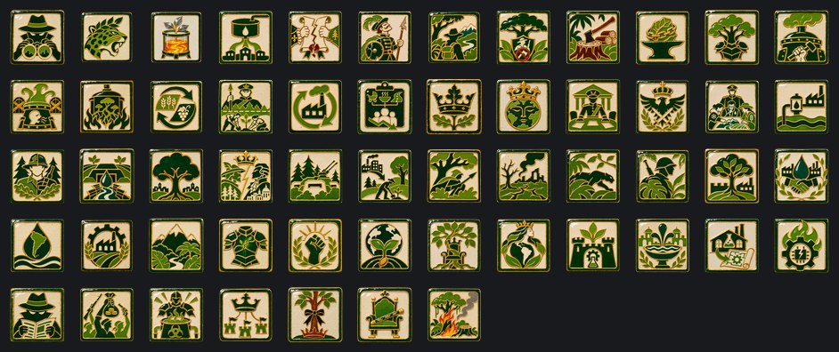
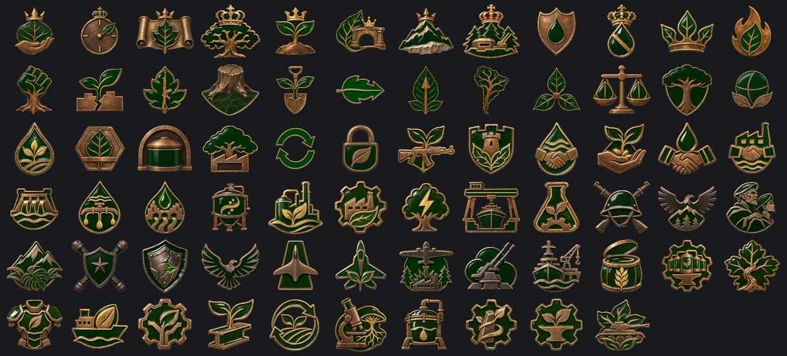

# Imperio Ecofascista

**Capital:** Buenos Aires · **Gobierno:** Régimen de Restauración (Ecofascismo) · **Gentilicio:** Ecofascista · **Código:** `EFE`

> 📜 Antes de los datos, la historia: **[leé la crónica](../cronicas/EFE.md)**.

## De dónde sale su poder

*La legitimidad viene de lo que existía antes del colapso: la Tierra viva, el imperio perdido, la vieja nación. Alguna vez hubo un orden. Se lo va a restaurar, cueste lo que les cueste a los vivos.*

## Quién manda

### Emperador Aurelio IV
*nacido/a Aurelio Benítez-Araújo, año 2046*

Hitos: Milicias Verdes → Batalla de Iguazú → Golpe de Estado (2079) → Proclamación imperial (2081)

### Anahí Quiroga, la Voz del Monte
*año 2068*

Guardaparques de las Yungas, hija de los comuneros que replantaron el Chaco con las manos. Nunca creyó en la corte de Buenos Aires: para ella el Imperio traicionó al bosque el día que puso cubas donde había árboles. Cuando el monte se levanta, ella habla por él.

### Emperador Tupã I, del Agua
*nacido/a Tupã Benítez Ortiz, año 2068*

El sobrino de Aurelio, que gobernó la gran agua del norte desde Asunción. Cuando el Emperador lo nombró heredero, el Paraguay dejó de ser un satélite y pasó a ser la casa.

### Custodia Electa Yara Pereira

Jefa de Guardaparques. Custodio de la Tierra fue un cargo antes de ser una corona; ella lo devuelve a la elección de los que cuidan el monte.

### Regente Bruno Etchegaray
*año 2049*

El único oficial que tuteaba al Emperador. Gobierna desde el cuartel de la Guardia Verde, de uniforme, y no se pone la corona.

## Gabinete, generales y almirantes

| Nombre | Cargo | Quién es |
|---|---|---|
| Mariscal Bruno Etchegaray | Mariscal de campo | Comandante de la Guardia Verde. Estuvo en Iguazú al lado de Aurelio, cuando las Milicias todavía peleaban con fusiles de caza. Es el único oficial que tutea al Emperador en público, y el único al que el Emperador no se atreve a retirar. |
| Ministra de Aguas Celeste Arriagada | Ministro | Rasgo: Guardiana de los Acuíferos |
| Maestro de Cubas Ramiro Vidal | Ministro | Rasgo: Maestro de las Cubas |
| Jefa de Guardaparques Yara Pereira | Ministro | Rasgo: Voz de los Guardaparques |
| Canciller Octavio Luján | Ministro | Rasgo: Canciller del Imperio |
| Doctora Sofía Kaltenbach | Teórico | Rasgo: Bióloga de la Guerra |
| General Lautaro Quiñones | General | Rasgo: doctrina ofensiva |
| General Matilde Rojas | General | Rasgo: doctrina defensiva |
| General Joaquín Ferrero | General | Rasgo: mago de la logística |
| General Ignacio Beltrán | Jefe del Ejército | Rasgo: Maestro de la Maniobra |
| Almirante Florencia Ocampo | Jefe de la Armada | Rasgo: Escolta de Convoyes |
| Mariscal del Aire Tomás Lagos | Jefe de la Fuerza Aérea | Rasgo: Apoyo Cercano |
| General Renata Sosa | Alto mando | Rasgo: Doctrina Blindada |
| General Mateo Ferreyra | Alto mando | Rasgo: Logístico |
| Directora del Ojo Verde Silvina Acosta | Ministro | Former ranger who turned the forest patrols into the Empire's eyes and ears; every ranger station is a listening post. |
| General Martín Arregui | General | Commander of the Rosario garrison and voice of the Liberal Movement of the Southern Cone: elections, free trade and the Union's friendship instead of the Forest's empire. |
| Mariscal Celestino Arambarri | Mariscal de campo | Rasgo: organizador, doctrina defensiva |
| General Iara Moura | General | Rasgo: doctrina ofensiva |
| General Facundo Leiva | General | Rasgo: líder de blindados |
| Almirante Teodoro Brandsen | Almirante |  |
| Almirante Lucía Irigoyen | Almirante | Rasgo: observador |

## Espíritus nacionales

Lo que define a la nación en cada momento: ventajas, cargas y estados de ánimo.

- **Servicio de Inteligencia.** Todas las potencias de 2100 arrancan con la misma cantidad de agentes; lo que suma el ministro de inteligencia es lo que marca la diferencia.
- **El Mandato Verde.** La supervivencia ecológica se proclama por encima de los derechos individuales y de la política convencional. La obediencia no se pide; se da por supuesta.
- **Las Cubas de la Pampa.** El Imperio es chico al lado de la Unión o de la Comuna. Lo que le falta en fábricas lo compensa con las cubas: cada taller cultiva sus propias herramientas, cada depósito sus propias paredes.
- **Ciudades Sedientas.** Las cubas se toman el agua que necesitan las ciudades. Se va con el foco «Ministerio de la Restauración» o «La Diplomacia del Agua».
- **Una Corte Dividida.** Cortesanos y guardaparques se sabotean los decretos. Se va con el foco «La Corte de los Bosques» o «El Monte se Levanta».
- **Una Guardia Mal Equipada.** La Guardia Verde desfila bien y pelea mal. Se va con el foco «La Guardia Verde Movilizada», o tener 20 divisiones.
- **La Selva es Nuestra.** Cada guardaparque conoce cada sendero, del Chaco a la Patagonia.
- **El Santuario Amazónico.** La selva está cerrada a las hachas y abierta a la Guardia.
- **La Selva Explotada.** Cada árbol tiene un precio, y el Imperio lo cobra.
- **El Bioacero Domesticado.** El metal vivo obedece.
- **La Selva de Acero.** Bosques que crían blindaje.
- **Cubas Forzadas.** Las cubas trabajan por encima de su límite. Más blindaje, obreros más enojados.
- **Fiebre de las Cubas.** El metal vivo crece más rápido de lo que se lo puede moldear. Se sellan naves; la gente se enferma.
- **La Plaga del Micelio.** Una plaga en las cubas. Hay que quemar naves enteras antes de que llegue a los bosques.
- **Rotación de Cultivos.** Las cubas descansan por turnos, como los campos.
- **Conservación Coercitiva.** La reforestación y la restauración ecológica son trabajo obligatorio. La Guardia Verde custodia la línea de árboles como si fuera una frontera.
- **Autarquía Estratégica.** La dependencia económica se trata como una vulnerabilidad estratégica. El Imperio prefiere fabricarlo mal antes que comprarlo bien.
- **Control de Población y Consumo.** Los nacimientos, las calorías y los kilómetros los asigna el mismo ministerio. La población es una variable a administrar.
- **El Trono del Bosque.** La corona ahora es hereditaria. El Imperio va a sobrevivir a su Emperador, y todos saben quién sigue.
- **El Trono Eterno.** Aurelio IV ya no es un gobernante sino un símbolo: la Tierra con cara y corona.
- **El Estado Guarnición.** La Guardia Verde se sienta en la mesa de cada ministerio. Las órdenes llegan más rápido; las discusiones, nunca.
- **La Junta de la Tierra.** El Emperador reina; el Mariscal gobierna. El Imperio se volvió un ejército con un país adentro.
- **El Consejo de Custodios.** Glaciólogos, hidrólogos y agrónomos de uniforme. La Guardia da las órdenes; el Consejo le dice cuáles van a funcionar.
- **La Red Hídrica Guaraní.** El acuífero ahora alimenta a las fábricas: bombeado, filtrado y racionado por el Ministerio de Restauración.
- **La Guardia Movilizada.** Todo guardabosques es reservista y todo reservista es guardabosques.
- **Defensa del Acuífero.** Búnkers bajo los campos de soja, minas a lo largo de los ríos. El que quiera el agua va a tener que tomarla desde una trinchera.
- **El Mandato del Monte.** Ahora gobierna el monte. Las ciudades apenas se toleran.
- **La Crisis del Monte.** Guardaparques contra cortesanos, reservas contra ciudades. El Imperio está eligiendo un bando.
- **La Gran Muralla Verde.** Un cinturón de bosque, búnkeres y antiaéreos sobre la frontera norte.
- **Desurbanización.** Las ciudades se vacían hacia el campo. Menos fábricas, más manos para el bosque.
- **El Bosque es el Ejército.** Cada guardaparques es un soldado y cada árbol es una trinchera.
- **Tierra Arrasada.** El que invade el Imperio no encuentra nada que comer, nada que reparar y nadie a quien gobernar.
- **La Selva Avanza.** La ofensiva avanza a la velocidad del bosque: despacio, y nunca retrocede.
- **La Ofensiva Verde.** La selva marcha con el ejército, y el ejército con la selva.
- **Un Continente Vivo.** Cada región reforestada es un muro más y una fábrica más que crece sola.
- **Diplomacia del Agua.** El Acuífero Guaraní como embajada: agua dulce a cambio de fábricas y amigos.
- **La Potencia Hídrica.** La mitad de la sed del mundo pasa por el Cono Sur.
- **Autarquía Total.** No entra nada, no sale nada. Las cubas alimentan al Imperio.
- **Montaña y Selva.** La Guardia se entrena donde terminan los mapas.
- **Armadura Viviente.** Placas de Bioacero que cierran sus propias heridas.
- **Revancha.** Perdimos una provincia, no la guerra. La próxima va a ser distinta.
- **La Ley de la Semilla.** Cada ciudadano planta, cada cosecha se registra, cada semilla es de Gaia.
- **La Paz Verde.** El monte y el trono pelearon, y uno ganó. Gaia no recuerda el nombre del que perdió.
- **El Dominio de Gaia.** Del Caribe al Cabo de Hornos, un solo bosque, una ley, un imperio de la Tierra viva.
- **La Fortaleza Verde.** Autosuficiencia total: cada recurso y cada fábrica en casa, al precio del aislamiento y la investigación.
- **El Agua de la Vida.** El agua es la diplomacia y la salud del Imperio: ciudades que crecen, cubas limpias y vecinos agradecidos. La Guardia, en cambio, se ablanda.
- **Planos Robados.** Los laboratorios de otro trabajan para nosotros.
- **Sabotaje Industrial.** Incendios, huelgas y firmware corrupto. Alguien lo está haciendo a propósito.
- **Agentes Enemigos.** Filtraciones, rumores y diarios comprados. El gobierno ya no confía en su propia gente.
- **Insurrección.** Plata y armas extranjeras en manos de todos los que ya nos odiaban.
- **El Metal Vivo.** El Bioacero de las cubas se vuelve blindaje para la Guardia. Las cubas forzadas enferman a la gente.
- **Cubas Quemadas.** Cayó una región productora y sus cubas ardieron con ella.
- **Raíces Hondas.** La Guardia se atrinchera donde crece el monte.
- **Savia Fabril.** Aleación viva en cada máquina del Imperio.
- **Hijos de las Cubas.** Las cubas alimentan las ciudades y las ciudades mandan a sus hijos a la Guardia.
- **El Bosque que Marcha.** Donde avanza la Guardia, avanza el monte.
- **Cubas sin Fondo.** Las cubas respiran más hondo: la saturación baja 3 más por mes.
- **Cosecha Doble.** Cada región productora da dos brotes por mes en vez de uno.
- **El Gliptodonte Rey.** Cada casco del Imperio se cultiva, no se forja.
- **El Corazón de Gaia.** El metal vivo late bajo el trono de Gaia.
- **La Semilla del Mundo.** El Imperio vende la vida misma: cada laboratorio del mundo quiere una cepa.
- **Savia de Guerra.** Savia viva en las raciones.
- **Corteza Viva.** Las trincheras crían su propia corteza.
- **Hojas en las Líneas.** Máquinas que se curan mientras trabajan.
- **Raíz en las Obras.** Andamios que crecen solos.
- **Fervor del Monte.** Divisiones ungidas con metal vivo.
- **Ofrenda a Gaia.** Una estatua viva en cada plaza.
- **Los Satélites.** Los satélites leales mandan hombres, plata y votos; los inquietos cuestan más de lo que dan.
- **Luto Imperial.** Las cubas trabajan en silencio. Cintas negras en cada árbol de Gaia.
- **La Regencia Militar.** El Mariscal gobierna desde el cuartel. Las órdenes son cortas; la corte, callada.
- **La Selva Arde.** Cada árbol talado es un guerrillero más. El Amazonas devuelve los golpes.

## El árbol de focos nacionales

### La Dinastía Verde

- **Custodio de la Tierra** — Cambia el siglo. El Emperador que alguna vez fue el Custodio mira lo que el bosque devolvió, y lo que todavía reclama.
- **La Hora de Gaia** — La corte quiere continuidad. Las reservas quieren que mande el monte. El Imperio tiene que decidir de quién es.
- **El Mandato Renovado** — Aurelio IV renueva el Mandato Verde frente a toda la corte. Los guardaparques miran desde el fondo del salón.
- **La Corte de los Bosques** — Ministros del Agua, de la Semilla y del Silencio. La corte crece como un bosque: despacio, y tapa la luz.
- **Heredero de la Tierra** — Aurelio se nombra heredero de la tierra misma. Las cubas trabajan doble turno para la celebración.
- **Las Misiones Guaraníes** — Yvytu Ykua Guasu va a ser integrada, paso a paso, gobernador por gobernador. Abre las decisiones de integración.
- **Integrar la Patagonia Austral** — Autonomía, después guarniciones, después núcleos. Los glaciares van a ser imperiales. Abre las decisiones de integración.
- **La Gran Muralla Verde** — Un cinturón de bosque, búnkeres y antiaéreos sobre la frontera norte.
- **Guardián del Acuífero** — El Acuífero Guaraní se custodia como una joya de la corona. Castellane manda un enviado igual.
- **El Agua no se Vende** — Un ultimátum a la Unión: renunciar al acuífero y pagar el agua que ya se llevó. Guerra solo si se niega. Pide Bioacero nivel 2.
- **La Corona de Gaia** — El Emperador y la Tierra son una sola corona.

### El Monte se Levanta

- **Los Incendios de Gaia** — Arden las plantaciones y las reservas toman partido. Abre las decisiones del Monte: cuando los guardaparques controlen lo suficiente, el golpe está a un foco.
- **El Monte se Levanta** — Pide el control de las reservas por los guardaparques (60). Cae Aurelio; Anahí Quiroga habla por el monte.
- **Desurbanizar** — Las ciudades se vacían hacia el campo. Menos fábricas, más Bioacero.
- **El Bosque es el Ejército** — Cada guardaparques es un soldado y cada árbol es una trinchera.
- **Tierra Arrasada** — El invasor no va a encontrar nada que comer, nada que reparar y nadie a quien gobernar.
- **Sembrar la Conquista** — La tierra conquistada se replanta: ocupada, en reforestación, núcleo ecológico. Abre las decisiones de reforestación.
- **La Selva Avanza** — La ofensiva avanza a la velocidad del bosque: despacio, y nunca retrocede.
- **La Ofensiva Verde** — Los Caudillos del Amazonas queman la selva para vender la tierra. La selva contesta.
- **Un Continente Vivo** — Cada región reforestada es un muro más.

### El Destino de Gaia

- **El Concilio Verde** — Druidas, generales e ingenieros de las cubas en una misma mesa: el Imperio gobierna como un solo bosque.
- **La Ley de la Semilla** — Cada semilla se registra y cada cosecha es de Gaia.
- **Los Guardianes del Bosque** — La Guardia Verde jura un nuevo voto: el bosque antes que el trono.
- **El Destino de Gaia** — Destraba la decisión de proclamar El Dominio de Gaia. Pide controlar al menos dos tercios de Lima, La Paz, el Amazonas (o el Santuario bajo su garantía), São Paulo, Río de Janeiro, Bogotá (Cundinamarca) y Caracas (Miranda); 45 divisiones, 12 de Bioacero guardado y 50% de estabilidad.

### La Autarquía del Bioacero

- **Ministerio de la Restauración** — Dos modelos para la economía del Imperio: cerrar las fronteras y cultivarlo todo, o venderle agua al mundo.
- **La Autarquía del Bioacero** — No entra nada, no sale nada. Abre los proyectos de Bioacero. Una fábrica civil y 150 de poder político.
- **Cubas Profundas** — Las cubas se van bajo tierra, donde no llegan los bombarderos.
- **Bosques-Fábrica** — Fábricas que crecen donde había bosques.
- **La Economía Circular** — Nada se desperdicia. Todo vuelve a las cubas.
- **La Autarquía Total** — El Imperio no necesita a nadie.
- **El Bioacero Soberano** — Cada arma crece en casa. Las cubas trabajan a pleno y las libretas de racionamiento adelgazan.
- **La Fortaleza Verde** — El Imperio no necesita a nadie. Y nadie quiere comerciar con el Imperio.

### La Diplomacia del Agua

- **La Diplomacia del Agua** — El Acuífero Guaraní como embajada. Abre los contratos de agua.
- **Bancos de Semillas** — El Imperio les presta semillas a los hambrientos, con sus condiciones.
- **Tratados de Agua** — Cada tratado que firma el Imperio ahora tiene una cláusula de agua.
- **El Acuífero como Embajada** — La plata extranjera construye las fábricas del Imperio.
- **La Potencia Hídrica** — La mitad de la sed del mundo pasa por el Cono Sur.
- **Los Acueductos del Continente** — Acueductos del acuífero Guaraní hacia cada vecino que firma.
- **El Agua de la Vida** — Las ciudades sedientas beben, las cubas se lavan y el continente nos debe su agua.

### Las Cubas de la Pampa

- **Cubas de Segunda Generación** — Cultivos más rápidos, cubas más hondas.
- **Las Biorrefinerías de Rosario** — Las orillas del Paraná se vuelven verdes e industriales.
- **El Polo Industrial de Gaia** — Fábricas de armas crecidas de Bioacero.
- **Energía de Biomasa** — El bosque alimenta la red eléctrica.
- **Los Astilleros del Plata** — Diques secos en el Río de la Plata.
- **El Laboratorio de Gaia** — Donde nació el Bioacero, está creciendo lo que viene.

### La Guardia Verde

- **La Guardia Verde Movilizada** — La Guardia que ganó en Iguazú vuelve a ponerse el uniforme.
- **La Doctrina del Cóndor** — Golpear desde la montaña, desaparecer en el bosque.
- **Las Legiones de Iguazú** — Los veteranos de Iguazú entrenan a una generación nueva.
- **Montaña y Selva** — La Guardia se entrena donde terminan los mapas.
- **El Mariscal Etchegaray** — El único oficial que tutea al Emperador toma el mando de la Guardia.
- **Armadura Viviente** — Placas de Bioacero que cierran sus propias heridas. Pide Bioacero nivel 2; gasta 3.

### Los Cóndores

- **Alas del Cóndor** — La aviación del Imperio toma al cóndor como emblema.
- **Los Aeródromos de la Pampa** — Pistas de pasto, escondidas bajo los árboles.
- **Cazas de Bioacero** — Fuselajes más livianos y duros, cultivados en las cubas.
- **Bombardeo de Precisión** — Quemar las fábricas, salvar los bosques.
- **El Cielo de Gaia** — Baterías antiaéreas alrededor de la capital.
- **La Flotilla del Plata** — El Imperio funda una armada: pocos barcos, y astilleros para más.

### El Ciclo del Bioacero

- **La Primera Cosecha** — Se abren las primeras cubas del siglo.
- **Carrera del Bioacero: Nivel 1** — Cinco unidades en las cubas: las primeras aplicaciones llegan a las fábricas de armas.
- **La Cepa Endurecida** — Un cultivo que resiste la helada y el fuego.
- **Carrera del Bioacero: Nivel 2** — Diez unidades: blindaje de Bioacero para la Guardia.
- **Exportar las Semillas** — Otras naciones pagan por semillas estériles de Bioacero.
- **Carrera del Bioacero: Nivel 3** — Quince unidades: el metal vivo.
- **El Metal que Crece** — El Bioacero ya crece solo. A las cubas solo hay que alimentarlas.

### Las Cubas Sanas

- **Rotar los Cultivos** — Las cubas descansan por turnos: la saturación baja 3 más por mes.
- **Laboratorios del Micelio** — Conocer la plaga antes de que ella nos conozca.
- **Cubas de Contención** — Naves selladas donde el metal vivo no puede escaparse.
- **El Bioacero Domesticado** — El metal vivo obedece.
- **Exportar el Bioacero** — Una oferta a la Unión Corporativa: blindaje vivo, a un precio.
- **La Selva de Acero** — Bosques que crían blindaje.

## Unidades únicas

### Gliptodonte

Hace diez mil años un armadillo del tamaño de un auto caminaba por la Pampa. El Laboratorio de Gaia rehízo su caparazón en Bioacero: un tanque moderno cultivado de una sola pieza en las cubas, cubierto de placas hexagonales que cierran sus propias heridas. Sobre el mismo casco vivo el Imperio monta cañones, torretas antiaéreas o lanzacohetes. Solo el Imperio Verde sabe cultivarlo; los demás solo pueden capturarlo.

## Aventuras

Historias de "elegí tu propia aventura": ver la [guía de aventuras](../guia/aventuras.md).

### El Despertar

*Algo en nuestras redes está despierto. No lo construyó nadie, contesta preguntas que nadie hizo, y esta noche pidió una reunión con [Root.GetName]. Hay tres personas que pueden hacerse cargo. Elegí en qué manos lo ponemos.*

- La Dra. Mara Okonkwo-Lind, ingeniera jefa de la red nacional: quiere entenderlo.
- El General Tomás Arrieta, jefe de ciberdefensa: lo quiere encerrado antes de que quiera algo.
- La Ministra Leila Haddad, que negoció con caudillos y banqueros: quiere saber cuál es su precio.

15 capítulos y 12 finales.

## Lo que puede pasar: eventos

90 eventos propios. Algunos títulos:

*El Imperio Verde en 2100* · *El Aniversario de la Corona* · *La Armadura Viviente* · *La Última Oferta de Castellane* · *La Adquisición del Sur* · *Se Cierran los Grifos del Norte* · *Los Incendios de Gaia* · *El Monte se Levanta* · *La Unión Reconoce el Agua* · *Las Misiones Guaraníes Vuelven* · *El Sur es el Imperio* · *Los Guardaparques Están Listos* · *Los Andes Bajan* · *Roma contra la Tierra* · *Hispania es Roma* · *La Carrera del Bioacero* · *La Plaga del Micelio* · *Cómputo para la Tierra* · *El Amazonas es del Imperio* · *La Primera Legión Viviente* · *Descontento en Patagonia Austral* · *Descontento en Yvytu Ykua Guasu* · *El Mundo Mira las Cubas* · *Espías en las Cubas* · *El Sol Propone un Pacto* · *Roma en Hispania* · *Nuestros Sembradores, Expulsados* · *Los Templos del Sol Ofrecen Luz* · *La Gran Sequía* · *Cómo se Juega* · *La Frontera de los Andes* · *El Sol Cede Arequipa* · *El Sol se Niega* · *El Imperio Exige Arequipa* · *Armisticio con Unión Libre de Capital Corporativo* · *Unión Libre de Capital Corporativo Pide un Armisticio* · *Una Paz Humillante con Imperio Ecofascista* · *Armisticio con Comuna Socialista Automatizada* · *Comuna Socialista Automatizada Pide un Armisticio* · *Armisticio con Nación de Mercado de Alta Mar* · *Nación de Mercado de Alta Mar Pide un Armisticio* · *Armisticio con Reino Celeste Neoandino* · *Reino Celeste Neoandino Pide un Armisticio* · *Armisticio con Directorio Sino-Armónico* · *Directorio Sino-Armónico Pide un Armisticio* · *Armisticio con Federación de los Pueblos Africanos* · *Federación de los Pueblos Africanos Pide un Armisticio* · *Armisticio con Neo Imperio Romano* · *Neo Imperio Romano Pide un Armisticio* · *La Cosecha de la Pampa* · *Un Jaguar en el Palacio* · *La Fiesta de los Árboles* · *Una Cuba Rajada* · *Los Guardaparques* · *Patagonia Austral Declara la Independencia* · *¡Independencia!* · *Yvytu Ykua Guasu Declara la Independencia* · *El Santuario de Gaia* · *Una Bandera sobre los Ríos* · *El Caucho del Santuario*

## Frases

> El bosque no pide permiso para crecer. Nosotros tampoco.
> — *Emperador Aurelio IV*

> Cada árbol que plantamos es un soldado que nunca deserta.
> — *Emperador Aurelio IV*

> El Monte no se conquista. Se pide prestado, y se devuelve con intereses.
> — *Anahí Quiroga*

---

*Página generada desde el spec del mod por `tools/docs/biblioteca.py`. [Volver a la Biblioteca](../README.md).*
