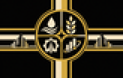
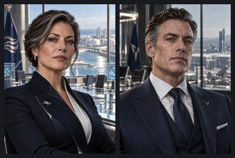
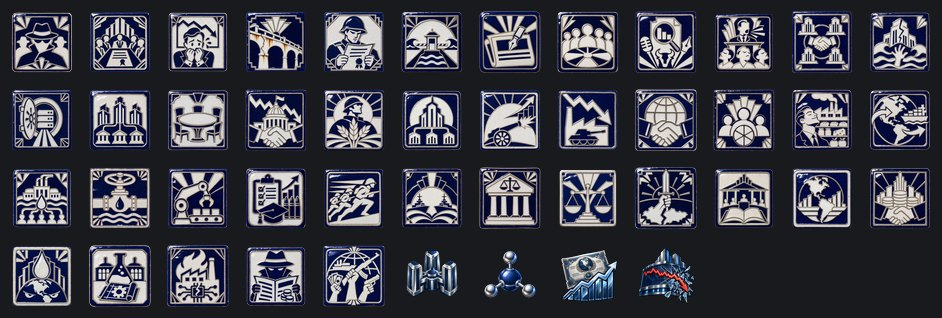
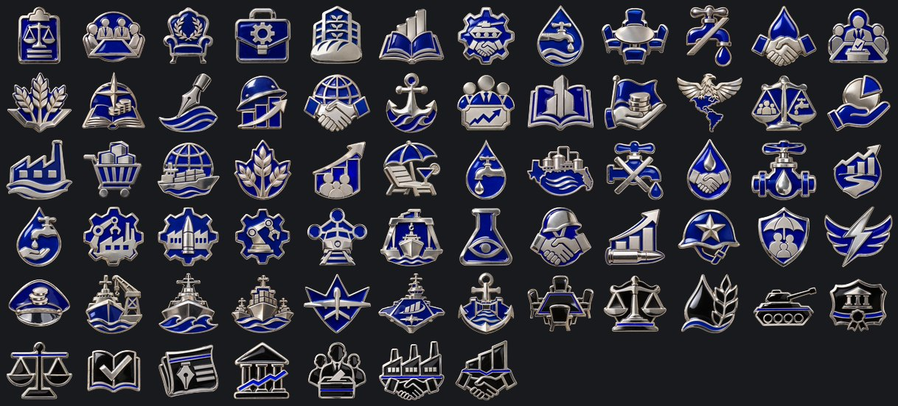

# Unión Libre de Capital Corporativo

**Gobierno:** Orden de Accionistas (Unión Corporativa) · **Gentilicio:** Corporativa · **Código:** `FCU`

> 📜 Antes de los datos, la historia: **[leé la crónica](../cronicas/FCU.md)**.

## De dónde sale su poder

*La legitimidad viene del contrato. Todo el que tiene una participación vota, en proporción a esa participación. El colapso fue una falla de mercado; la respuesta es un mercado mejor.*

## Quién manda

### Presidenta Valeria Castellane
*año 2049*

Presidenta rotativa del Directorio de la Unión, en su segundo mandato de cuatro años. Viene de Castellane Water Trust, la corporación que controla las desalinizadoras, la más chica de las cuatro y la que todas necesitan. Las otras tres son Halvorsen-Ito Agrosystems (comida), Meridian Kinetics (armas y robótica) y Obsidian Ledger (finanzas y datos). Resuelve Q017.

### Director Ejecutivo Marcus Rourke
*año 2052*

Director de Meridian Kinetics. Nunca se presentó a una elección del Directorio: compró las acciones de los que votaban. Cree que un país es una empresa con bandera y que la guerra es la única línea de negocio que siempre crece.

## Gabinete, generales y almirantes

| Nombre | Cargo | Quién es |
|---|---|---|
| Director de Cumplimiento Harold Whitmore | Ministro | Rasgo: Operador del Directorio |
| Vicepresidenta de Logística Dana Okafor | Ministro | Rasgo: Justo a Tiempo |
| Jefe de Riesgo Leonard Voss | Ministro | Rasgo: Gestor de Riesgos |
| Directora de Prensa Chloe Marchetti | Ministro | Rasgo: Maquilladora de Noticias |
| Jefa de I+D Priya Raman | Teórico | Rasgo: Cazadora de Patentes |
| Mariscal Douglas Harrington | Mariscal de campo | Rasgo: organizador, mago de la logística |
| General Grace Kowalski | General | Rasgo: líder de blindados |
| General Mateo Salinas | General |  |
| General Everett Brooks | General | Rasgo: doctrina defensiva |
| General Dwight Harlan | Jefe del Ejército | Rasgo: Organización Impecable |
| Almirante Grace Holloway | Jefe de la Armada | Rasgo: Batalla Decisiva |
| Mariscal del Aire Kenji Walsh | Jefe de la Fuerza Aérea | Rasgo: Dueño del Cielo |
| General Marcus Oyelaran | Alto mando | Rasgo: Logístico |
| General Linnea Carver | Alto mando | Rasgo: Rey de la Artillería |
| Jefe de Riesgo Nathaniel Price | Ministro | Ran corporate security for the Four; now he rents their spies to the state, at a price. |
| Mariscal Theodore Vance | Mariscal de campo | Rasgo: estratega brillante |
| General Dana Kessler | General | Rasgo: líder de blindados, doctrina ofensiva |
| General Marcus Delacroix | General | Rasgo: mago de la logística |
| Almirante Jonah Whitfield | Almirante | Rasgo: control aéreo |
| Almirante Rosa Valdez-Kim | Almirante | Rasgo: táctico superior |

## Espíritus nacionales

Lo que define a la nación en cada momento: ventajas, cargas y estados de ánimo.

- **Servicio de Inteligencia.** Todas las potencias de 2100 arrancan con la misma cantidad de agentes; lo que suma el ministro de inteligencia es lo que marca la diferencia.
- **El Directorio de las Cuatro.** Cuatro corporaciones comparten un directorio. Cada ley es un contrato, y cada contrato tiene un perdedor.
- **Accionistas Nerviosos.** Cada informe trimestral es un pequeño pánico. Se va con el foco «El Segundo Mandato de Castellane» o «Junta de Accionistas de Emergencia».
- **Infraestructura Oxidada.** Un siglo de mantenimiento postergado. Se va con el foco «Zonas Industriales».
- **Un Ejército de Contratistas.** Soldados que leen el contrato antes de cada orden. Se va con el foco «Entrenamiento Corporativo», o tener 18 divisiones.
- **El Canal Abierto.** Dos océanos, una sola cabina de peaje.
- **La Prensa Amiga.** Los titulares se escriben antes que las noticias.
- **La Junta de Accionistas.** Cada ciudadano, un accionista.
- **Bajo Sospecha.** Periodistas, auditores y especuladores huelen sangre.
- **Crisis de Confianza.** Nadie cree una palabra del Directorio, y los accionistas menos que nadie.
- **Sinergia del Directorio.** Las cuatro corporaciones están equilibradas. Por una vez, nadie le hace juicio a nadie.
- **Guerra Corporativa.** Una de las Cuatro se está hundiendo y decidió llevarse a las otras puesta: filtraciones, sabotajes, huelgas tercerizadas y demandas.
- **La Ventanilla de Obsidian.** Obsidian Ledger abrió sus bóvedas de datos a los laboratorios de la Unión. El precio aparece después.
- **Carteras Repartidas.** Cada corporación maneja su ministerio. Nadie maneja el gobierno.
- **La Mesa Redonda.** La obra maestra de Castellane: un directorio donde ninguna silla es más alta que otra.
- **Turbulencia Bursátil.** Una adquisición hostil de un país entero. Los mercados no se lo toman con calma.
- **Raciones Meridian.** Las granjas de Halvorsen-Ito ahora alimentan primero al ejército. Los supermercados pueden esperar.
- **Una Sola Compañía.** Ya no hay Directorio. Está Meridian, y están sus subsidiarias.
- **El Dividendo de Guerra.** Meridian no invade países. Hace adquisiciones verticales con artillería, y los accionistas esperan resultados cada trimestre.
- **Caída de Dividendos.** Un trimestre sin guerra. Los accionistas venden, y una economía militarizada no tiene otra cosa para ofrecerles.
- **Contratistas Globales.** Meridian alquila sus divisiones a quien pague. Los veteranos vuelven con experiencia y facturas.
- **El Dividendo Civil.** Cada ciudadano tiene una acción. Una chiquita.
- **La Economía de la Abundancia.** Góndolas llenas, fábricas en marcha y una población demasiado cómoda para preguntar de quién es cada cosa.
- **El Mercado de Exportación.** Medio continente vuelve a comprar americano. Al otro medio le están vendiendo.
- **El Monopolio del Agua.** Castellane es dueña de las desalinizadoras, y las desalinizadoras son dueñas de todos.
- **El Imperio del Agua.** No hace falta un ejército. Se cierra la válvula y se espera.
- **Robótica Industrial.** Los brazos de ensamble de Meridian trabajan tres turnos y nunca se sindicalizan.
- **Entrenamiento Corporativo.** Evaluaciones de desempeño, objetivos trimestrales y munición real.
- **Divisiones de Respuesta Rápida.** Pocas divisiones, muy caras, siempre primeras.
- **Dos Océanos.** La Unión mira a los dos océanos, y las dos flotas responden al mismo directorio.
- **Arbitraje Corporativo.** Un tribunal permanente donde las Cuatro arreglan sus peleas antes de que lleguen a la calle.
- **El Punto de Equilibrio.** El Directorio aprendió a moverse junto. Costó un siglo y cuatro abogados por ciudadano.
- **Revancha.** Perdimos una provincia, no la guerra. La próxima va a ser distinta.
- **La Constitución Corporativa.** El estatuto es la constitución; la asamblea de accionistas, el parlamento.
- **La Corporación de las Américas.** Dos continentes, un solo balance. Cada ciudadano es accionista del hemisferio.
- **El Sueño Corporativo.** La sociedad más rica de la historia, y la que menos ganas tiene de ir a la guerra.
- **El Cártel del Agua.** El agua como poder: una palanca política enorme y recursos, y un hemisferio que nos odia.
- **Planos Robados.** Los laboratorios de otro trabajan para nosotros.
- **Sabotaje Industrial.** Incendios, huelgas y firmware corrupto. Alguien lo está haciendo a propósito.
- **Agentes Enemigos.** Filtraciones, rumores y diarios comprados. El gobierno ya no confía en su propia gente.
- **Insurrección.** Plata y armas extranjeras en manos de todos los que ya nos odiaban.
- **El Directorio.** Cada corporación por encima de 50 empuja su área para arriba; por debajo de 50, para abajo. Los números cambian cada mes.
- **Los Satélites.** Los satélites leales mandan hombres, plata y votos; los inquietos cuestan más de lo que dan.
- **Sede Perdida.** -5% de estabilidad y -10% de velocidad de construcción
- **Valor para el Accionista.** Cada fábrica se gana lo suyo.
- **El Plan de Acciones para Empleados.** Cada trabajador tiene una acción. Muy chiquita.
- **Contratos de Defensa.** La guerra es un mercado como cualquier otro.
- **Meridian Compra el Ejército.** El ejército ahora es una subsidiaria.
- **Halvorsen-Ito Compra las Universidades.** La matrícula es gratis. Tus datos no.
- **Castellane Compra los Ríos.** Cada gota tiene dueño.
- **La República Corporativa.** Una acción, un voto.
- **Economía de Guerra S.A..** Las ganancias se miden en divisiones.
- **El Mercado Infinito.** No hay nada que no se pueda vender.
- **Los Grifos de Castellane.** Agua limpia, cortesía de Castellane.
- **La Cosecha de Datos.** Todo lo que decís es un dato.
- **Bonos de Guerra Obsidian.** Comprá ahora, ganá después.
- **Disturbios en las Ciudades.** Las ciudades ya no le obedecen al Directorio.
- **La Cotización.** Cuando la acción sube, la Unión es generosa; cuando baja, está nerviosa.
- **El Martes Negro.** Corredores de bolsa en las cornisas, otra vez.

## El árbol de focos nacionales

### El Directorio de las Cuatro

- **El Año Fiscal 2100** — Un siglo nuevo abre con un balance. El Directorio quiere saber quién lo paga.
- **La Junta Anual de Accionistas** — Cada año las Cuatro se reúnen para decidir quién maneja la Unión. Este año el salón está tenso.
- **El Segundo Mandato de Castellane** — Valeria Castellane conserva la Presidencia. Su secreto: no dejar ganar nunca a ninguna de las Cuatro.
- **El Reparto de Carteras** — Cada corporación recibe un ministerio. Castellane se queda con el que firma los presupuestos.
- **Halvorsen-Ito: Comida para Todos** — Las granjas verticales de Halvorsen-Ito alimentan a las ciudades al costo, y ponen su logo en cada pan.
- **Obsidian Ledger: El Libro Mayor** — Cada transacción de la Unión pasa por el libro de Obsidian. Sabe lo que debe cada uno.
- **Meridian Kinetics: Contratos de Defensa** — Meridian se queda con los pedidos del ejército, con la condición de repartir las ganancias con el Directorio.
- **Castellane: Los Grifos de la Unión** — Desalinizadoras nuevas en las dos costas. El agua es de Castellane, y Castellane es la Presidencia.
- **La Mesa Redonda** — Solo posible con las cuatro corporaciones entre 40 y 60. Lo más difícil de la Unión es un directorio donde nadie gana.
- **Cerrar los Grifos del Sur** — Las ciudades del norte del Imperio toman agua de Castellane. Hay que recordárselo.
- **La Adquisición del Sur** — Una oferta formal de adquisición al Imperio Ecofascista: el agua, las cubas y una silla en el Directorio. Si la rechazan, Meridian tiene un plan B.

### La OPA Hostil

- **Junta de Accionistas de Emergencia** — Disponible solo con Meridian por encima de 70 y dos rivales por debajo de 25. Once minutos, un voto, un Director Ejecutivo nuevo.
- **Meridian Absorbe a Halvorsen-Ito** — Las granjas ahora son de Meridian. Primero alimentan al ejército.
- **Obsidian Liquidada** — Los libros de Obsidian se rematan. El comprador es Meridian, con la plata de Obsidian.
- **Castellane Firma** — Valeria Castellane firma la venta de su compañía y se va de la capital. El agua ahora le responde a Meridian.
- **El Dividendo de Guerra** — A los accionistas se les paga cada trimestre, mientras haya una guerra con la cual pagarles.
- **Contratistas Globales** — Meridian alquila divisiones a cualquier país que pague. La experiencia vuelve con las facturas.
- **Adquirir la Alta Mar** — Una oferta hostil a la Nación de Mercado de Alta Mar: una tasa de seguridad por cada carga del Pacífico, o Meridian se encarga de la seguridad.

### El Destino Manifiesto

- **La Asamblea de Accionistas** — La primera asamblea general de la Unión con cada ciudadano como accionista.
- **La Constitución Corporativa** — El estatuto pasa a ser la constitución.
- **El Dividendo de la Nación** — Las ganancias se pagan como patriotismo.
- **El Destino Manifiesto** — Destraba la decisión de proclamar La Corporación de las Américas. Pide controlar la Frontera (Minnesota y Kansas), La Habana (Cuba), Lima, Buenos Aires y Bogotá (Cundinamarca); 50 divisiones, Escándalo por debajo de 30 y 50% de estabilidad.

### El Dividendo Civil

- **El Consejo Económico** — Dos modelos se pelean la economía de la Unión: una acción para cada ciudadano, o un grifo para cada rival.
- **El Dividendo** — Cada ciudadano recibe una acción de la Unión. Chiquita, pero lo bastante real como para defenderla.
- **Zonas Francas** — Parques industriales libres de impuestos sobre los Grandes Lagos.
- **Consumo de Masas** — Las góndolas llenas son la mejor propaganda que el Directorio compró jamás.
- **El Mercado de Exportación** — La Unión vuelve a venderle a medio mundo.
- **La Economía de la Abundancia** — El Dividendo se vuelve el sistema.
- **La Clase Accionista** — Cada familia es dueña de un pedazo de la Unión. Nadie quiere romper lo que le paga.
- **El Sueño Corporativo** — Comodidad, dividendos y un fin de semana muy largo.

### El Monopolio del Agua

- **El Monopolio del Agua** — La Unión no exporta mercancías. Exporta sed, y vende la cura.
- **Las Desalinizadoras del Golfo** — Una cadena de plantas de Texas a Florida.
- **Grifos Cerrados** — El vecino que no firma se queda sin agua. El Imperio Ecofascista es el primero en enterarse.
- **El Agua es Poder** — Cada tratado que firma la Unión ahora tiene una cláusula de agua.
- **El Imperio del Agua** — No hace falta un ejército. Se cierra la válvula y se espera.
- **Las Acciones del Río** — El Mississippi cotiza en bolsa.
- **El Cártel del Agua** — El que bebe, paga. El que no puede pagar, no bebe.

### Los Parques de Meridian

- **Zonas Industriales** — El viejo Cinturón del Óxido, reconstruido por robots.
- **El Parque de Pittsburgh** — El complejo de armamento más grande de Meridian.
- **Robótica Meridian** — Brazos de ensamble que trabajan tres turnos y nunca se sindicalizan.
- **Logística Obsidian** — Los datos de Obsidian rutean cada tren de la Unión.
- **Los Astilleros de los Lagos** — Diques secos en los Grandes Lagos y en el Golfo.
- **Laboratorios Privados** — Las Cuatro financian un campus de investigación conjunto. Cada una espía a las otras.

### Contratistas Profesionales

- **La Fuerza Contratada** — La Unión no recluta. Contrata.
- **Entrenamiento Corporativo** — Objetivos trimestrales y munición real.
- **Equipo de Primera** — Pocos soldados, el mejor equipo que se puede comprar.
- **Seguro de Vida** — La familia de cada contratista está asegurada. Los voluntarios hacen fila.
- **Divisiones de Respuesta Rápida** — Pocas divisiones, muy caras, siempre primeras.
- **El Comandante Contratado** — El mejor general que se puede comprar tiene una cláusula de bonificación por cada ciudad tomada.

### La Flota de Dos Océanos

- **La Flota del Atlántico** — Los muelles de Norfolk vuelven a trabajar.
- **La Flota del Pacífico** — San Diego y Seattle, mirando a la Alta Mar.
- **Escoltas de Convoy** — El comercio es la sangre de la Unión. Navega con escolta.
- **Superioridad Aérea** — Los drones de Meridian son dueños del cielo de la Unión.
- **Portaaviones Corporativos** — Aeródromos flotantes con un logo en la cubierta.
- **El Canal Asegurado** — Dos océanos, un directorio.

### La Sala del Directorio

- **La Sala del Directorio** — Cuatro sillas, una mesa, un siglo de rencores.
- **Arbitraje Corporativo** — Un tribunal permanente para las peleas de las Cuatro.
- **El Presupuesto Civil** — Primero el agua y la comida.
- **El Presupuesto Militar** — Primero las armas. Lo demás puede esperar.
- **Bonos del Directorio** — Deuda, vendida a los ciudadanos como patriotismo.
- **El Punto de Equilibrio** — Solo con las cuatro entre 35 y 65, y un Directorio que todavía exista.

### La Casa de Cristal

- **Oficina de Cumplimiento** — Por fin alguien lee los contratos: escándalo -20.
- **La Prensa Amiga** — El escándalo baja 2 más por mes.
- **El Fondo de Estabilización** — Cada corporación 5 más cerca de 50.
- **La Junta de Accionistas** — Cada ciudadano, un accionista. Cada accionista, un votante.
- **El Contrato del Siglo** — Tres fábricas y un escándalo muy grande (+15).
- **La Unión de Accionistas** — La Unión es una empresa, y la empresa es la Unión.

## Unidades únicas

### Ala de Obsidiana

Obsidian Heavy Aero vende un solo producto: la llegada. El Ala de Obsidiana despega de los Grandes Lagos y aterriza, cuarenta horas después, donde diga el contrato, en cualquier lugar del mundo. Cuatro motores, una bodega donde entra un depósito y una cláusula que le cobra el combustible al objetivo.

## Aventuras

Historias de "elegí tu propia aventura": ver la [guía de aventuras](../guia/aventuras.md).

### El Despertar

*Algo en nuestras redes está despierto. No lo construyó nadie, contesta preguntas que nadie hizo, y esta noche pidió una reunión con [Root.GetName]. Hay tres personas que pueden hacerse cargo. Elegí en qué manos lo ponemos.*

- La Dra. Mara Okonkwo-Lind, ingeniera jefa de la red nacional: quiere entenderlo.
- El General Tomás Arrieta, jefe de ciberdefensa: lo quiere encerrado antes de que quiera algo.
- La Ministra Leila Haddad, que negoció con caudillos y banqueros: quiere saber cuál es su precio.

15 capítulos y 12 finales.

## Lo que puede pasar: eventos

83 eventos propios. Algunos títulos:

*Quórum: No Requerido* · *Meridian Huele Sangre* · *Informe Trimestral a los Accionistas* · *El Imperio Vende* · *La Alta Mar Paga* · *El Agua no se Vende* · *El Bloqueo Legal* · *El Directorio de las Cuatro* · *La Filtración* · *Bioacero en Venta* · *El Árbitro de los Mares* · *El Canal* · *El Directorio en Armonía* · *Descontento en Zona de Recursos Boreal* · *Descontento en Zona Económica del Sur* · *El Bioacero del Imperio* · *Elecciones del Directorio* · *La Flota Controla el Pacífico* · *El Agua del Imperio* · *Cómo se Juega* · *La Guerra de las Aseguradoras* · *La Nación del Mar Vende* · *La Nación del Mar se Niega* · *La Unión Quiere Entrar* · *Armisticio con Imperio Ecofascista* · *Imperio Ecofascista Pide un Armisticio* · *Una Paz Humillante con Unión Libre de Capital Corporativo* · *Armisticio con Comuna Socialista Automatizada* · *Comuna Socialista Automatizada Pide un Armisticio* · *Armisticio con Nación de Mercado de Alta Mar* · *Nación de Mercado de Alta Mar Pide un Armisticio* · *Armisticio con Reino Celeste Neoandino* · *Reino Celeste Neoandino Pide un Armisticio* · *Armisticio con Directorio Sino-Armónico* · *Directorio Sino-Armónico Pide un Armisticio* · *Armisticio con Federación de los Pueblos Africanos* · *Federación de los Pueblos Africanos Pide un Armisticio* · *Armisticio con Neo Imperio Romano* · *Neo Imperio Romano Pide un Armisticio* · *El Día del Accionista* · *La Huelga de Detroit* · *Publicidad en la Luna* · *La Fusión del Siglo* · *Once Minutos* · *Zona de Recursos Boreal Declara la Independencia* · *¡Independencia!* · *Zona Económica del Sur Declara la Independencia* · *La Frontera se Arma* · *La Corporación de las Américas* · *Se Proclama La Corporación de las Américas* · *La Unión en 2100* · *Adquisición Hostil* · *Meridian Deja de Pagar* · *Las Milicias de Meridian* · *La Secesión de Meridian* · *El Martes Negro* · *La Burbuja* · *Perdimos La Torre Obsidian* · *Perdimos El Campus Halvorsen-Ito* · *Perdimos Las Aguas de Castellane*

## Frases

> La libertad tiene precio. Por suerte, nosotros fijamos los precios.
> — *Presidenta Valeria Castellane*

> No hacemos la guerra. Facturamos la paz por adelantado.
> — *Marcus Rourke*

> Un contrato bien escrito vale más que diez divisiones.
> — *Presidenta Valeria Castellane*

---

*Página generada desde el spec del mod por `tools/docs/biblioteca.py`. [Volver a la Biblioteca](../README.md).*
