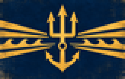
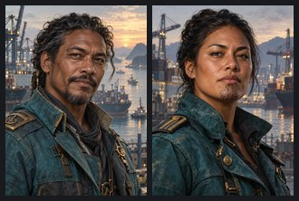
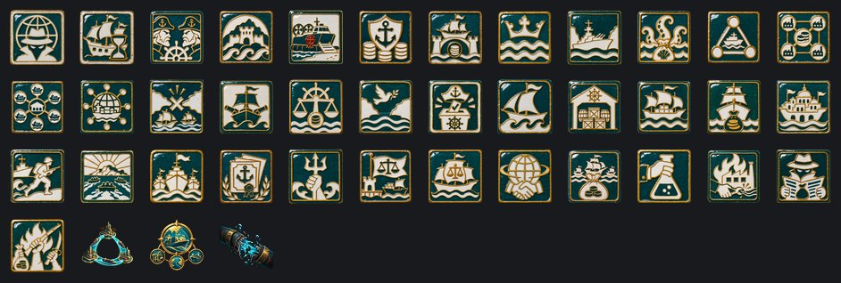
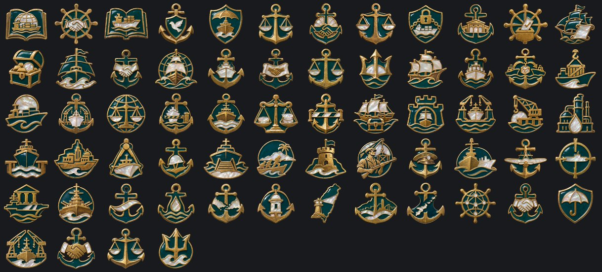

# Nación de Mercado de Alta Mar

**Gobierno:** Orden de Accionistas (Talasocracia Mercantil) · **Gentilicio:** Altamarina · **Código:** `HSN`

> 📜 Antes de los datos, la historia: **[leé la crónica](../cronicas/HSN.md)**.

## De dónde sale su poder

*La legitimidad viene del contrato. Todo el que tiene una participación vota, en proporción a esa participación. El colapso fue una falla de mercado; la respuesta es un mercado mejor.*

## Quién manda

### Capitán General de Puertos Kofi Aldana
*año 2055*

Nació en un carguero y dice que no pisó tierra firme hasta los doce años. La Nación de Alta Mar lo eligió Capitán General de Puertos porque controla la cámara de compensación de fletes: sabe qué barco lleva qué, a dónde y quién lo pagó.

### Capitana Inés Tavake
*año 2066*

Capitana de un carguero de contenedores de Rapa Nui, elegida por su tripulación tres veces seguidas. Cuando la cámara de compensación le cobró el seguro de un barco hundido por la Unión, tomó el puerto de Kanto con cuatrocientos marineros y un megáfono.

## Gabinete, generales y almirantes

| Nombre | Cargo | Quién es |
|---|---|---|
| Capitán de Puerto Rahim Sato-Lee | Ministro | Rasgo: Señor de los Puertos |
| Aseguradora Mele Faleolo | Ministro | Rasgo: Suscriptora de Riesgos |
| Constructor Naval Arjun Mehta | Ministro | Rasgo: Maestro Constructor Naval |
| Cónsul de los Estrechos Lin Xiao | Ministro | Rasgo: Cónsul de los Estrechos |
| Navegante y Sabia Ana Reyes | Teórico | Rasgo: Cartógrafa |
| Mariscal Kenji Arakawa | Mariscal de campo | Rasgo: organizador |
| General Nguyen Thi Lan | General |  |
| General Rizal Santoso | General | Rasgo: experto en desembarcos |
| General Hemi Walker | General | Rasgo: comando |
| Almirante Sione Tupou | Almirante | Rasgo: táctico superior |
| Almirante Mei Ling Tan | Almirante | Rasgo: observador |
| General Rizal Santos | Jefe del Ejército | Rasgo: Organización Impecable |
| Almirante Hana Takeda | Jefe de la Armada | Rasgo: Guerra de Corso |
| Mariscal del Aire Arif Wibowo | Jefe de la Fuerza Aérea | Rasgo: Seguridad de Vuelo |
| General Mele Taufa | Alto mando | Rasgo: Logístico |
| General Chen Wei-lun | Alto mando | Rasgo: Reservas y Reemplazos |
| Capitana de los Susurros Mei Takeda | Ministro | Knows every dock worker, smuggler and customs clerk from Singapore to Yokohama. |
| Almirante Teodoro Salas | General | Commander of the Malacca squadron and leader of the Sea Cross, a religious-military order that wants the fleet to serve God and not the freight market. |
| Mariscal Rizal Pratama | Mariscal de campo | Rasgo: organizador, doctrina ofensiva |
| General Kenji Morimoto | General | Rasgo: experto en desembarcos |
| General Ana Reyes-Cruz | General |  |
| Almirante Hiroshi Kaneda | Almirante | Rasgo: táctico superior |
| Almirante Siosaia Fifita | Almirante | Rasgo: lobo de mar |

## Espíritus nacionales

Lo que define a la nación en cada momento: ventajas, cargas y estados de ánimo.

- **Servicio de Inteligencia.** Todas las potencias de 2100 arrancan con la misma cantidad de agentes; lo que suma el ministro de inteligencia es lo que marca la diferencia.
- **Una Flota Envejecida.** La mitad de la flota es más vieja que sus capitanes. Se va con el foco «Astilleros Flotantes».
- **Capitanes Rivales.** Cada capitán cree que él debería gobernar la Nación. Se va con el foco «La Junta de Capitanes».
- **Gente de Islas.** Cada playa es un puerto y cada puerto una fortaleza.
- **Desembarcos Asegurados.** Cada desembarco tiene su póliza: las aseguradoras pagan los botes y los marines toman la playa. Más desembarcos a la vez, más divisiones por desembarco, menos tiempo para prepararlos y marines que pegan más fuerte.
- **Seguros para las Potencias.** Todos nos pagan para sentirse seguros.
- **Libre Paso.** Toda bandera pasa; toda bandera paga.
- **La Talasocracia.** El mar es el Estado.
- **Bajo Vigilancia.** Cada gran potencia tiene un buque de guerra estacionado frente a alguno de nuestros estrechos.
- **Tributo de los Estrechos.** Les pagamos a las potencias para que dejen tranquilos los estrechos. Les gusta demasiado.
- **La Red de Nodos I.** Dos nodos o más: convoyes asegurados, rutas protegidas.
- **La Red de Nodos II.** Cuatro nodos o más: los peajes pagan fábricas que nadie tiene que construir.
- **La Red de Nodos III.** Seis nodos o más: cada manifiesto de carga de Asia pasa por la cámara de compensación.
- **La Cámara Mundial de Compensación.** Los ocho nodos. La mitad de la carga del mundo le paga a la Alta Mar antes de llegar.
- **Un Nodo Perdido.** Cayó un estrecho. Las aseguradoras entran en pánico, y los capitanes también.
- **Neutralidad Armada.** La Alta Mar no pelea las guerras de nadie, y hunde al que intente obligarla.
- **El Arbitraje de Alta Mar.** Cada disputa marítima de Asia se resuelve en la cámara de compensación, con arancel.
- **El Tratado de los Estrechos.** Los estrechos son neutrales, y la Alta Mar define qué es neutral.
- **Capitanes Electos.** Cada barco elige a su capitán. Cada capitán puede ser votado afuera.
- **La Hermandad de la Cubierta.** Sin peajes, sin aseguradoras, sin patrones. El mar es de quien lo navega.
- **Bodegas Llenas.** El botín está en los galpones. Por un tiempo, nada escasea.
- **El Puerto Libre.** Sin aranceles, solo volumen. Todo pasa por la Alta Mar.
- **El Peaje de los Estrechos.** Cada barco paga. A nadie le gusta; todos pagan.
- **Ciudades Flotantes.** Barrios enteros construidos sobre cascos. La nación está donde estén sus muelles.
- **Infantería de Cubierta.** Infantes que pelean del barco a la playa y de vuelta.
- **Asalto Anfibio.** Las islas se toman desde el mar, en oleadas, antes de que el defensor termine de contar los botes.
- **La Armada de Alta Mar.** La flota más grande del siglo le responde a una cámara de compensación.
- **Bonos del Directorio.** Nuestro tesoro tiene papeles de la Unión. Rinden, mientras la Unión pague.
- **Revancha.** Perdimos una provincia, no la guerra. La próxima va a ser distinta.
- **La Carta de los Puertos.** Cada puerto que firma la Carta comercia bajo la bandera y la ley del Mercado.
- **La Talasocracia de los Siete Mares.** Cada estrecho, cada canal, cada cabo: el que navega le paga al Mercado.
- **La Bolsa del Mundo.** Todos comercian con nosotros y todos son clientes; nadie quiere morir por una cámara de compensación.
- **El Imperio del Peaje.** Los estrechos pagan la flota y la guerra, y el mundo entero nos lo cobra en rencor.
- **Planos Robados.** Los laboratorios de otro trabajan para nosotros.
- **Sabotaje Industrial.** Incendios, huelgas y firmware corrupto. Alguien lo está haciendo a propósito.
- **Agentes Enemigos.** Filtraciones, rumores y diarios comprados. El gobierno ya no confía en su propia gente.
- **Insurrección.** Plata y armas extranjeras en manos de todos los que ya nos odiaban.
- **La Red de Nodos.** Cada estrecho es un peaje y un amigo. Cada estrecho también es un blanco.
- **Los Satélites.** Los satélites leales mandan hombres, plata y votos; los inquietos cuestan más de lo que dan.
- **Un Puerto de Peaje Perdido.** -5% de estabilidad y -10% de velocidad de construcción
- **Puertos Libres.** Todos son bienvenidos. Todos pagan.
- **El Gremio de Carpinteros de Ribera.** Los mejores cascos del mundo.
- **El Juramento de los Marines.** Del barco a la playa a la ciudad.
- **La Armada de Aguas Azules.** Ningún mar queda lejos.
- **El Banco de Compensación.** Cada moneda del Pacífico pasa por nosotros.
- **La Diplomacia Silenciosa.** Las potencias vigilan menos cuando te deben.
- **Talasocracia.** El mar es una nación, y la nación es el mar.
- **El Mercado de los Mercados.** Todo está en venta, y el precio lo ponemos nosotros.
- **La República Pirata.** ¿Para qué cobrar el peaje, si te podés quedar con el barco?
- **Convoyes Blindados.** Cada convoy escoltado.
- **Turnos de Noche en los Astilleros.** Soldadores bajo reflectores.
- **Mareas de Guerra.** Pagado por adelantado.
- **Derechos de Puerto.** Nuestros barcos atracan donde no flamea nuestra bandera.
- **Los Cables Cortados.** Los precios de Tokio llegan tarde, o no llegan. El Mercado odia no saber.

## El árbol de focos nacionales

### La Cámara de Compensación

- **El Libro de Fletes de 2100** — Qué lleva quién, a dónde y quién lo pagó: la cámara de compensación lo sabe.
- **La Junta de Capitanes** — Las aseguradoras quieren orden. Las tripulaciones quieren su parte.
- **El Libro de Fletes** — Kofi Aldana lleva el libro, y el libro mantiene la paz.
- **Neutralidad Armada** — Las guerras de nadie, y víctima de nadie.
- **Seguros Marítimos** — Abre las decisiones de seguros: venderles cobertura a las meganaciones en guerra.
- **El Arbitraje de Alta Mar** — Cada disputa marítima se resuelve acá, con arancel.
- **Los Puertos Francos del Pacífico** — El Pacto del Mar Austral se suma a la cámara de compensación.
- **El Tratado de los Estrechos** — Los estrechos son neutrales; la Alta Mar decide qué significa neutral.
- **El Bloqueo Legal** — Declarar inasegurable la carga de la Unión hasta que pague el peaje. Guerra solo si se niega.

### La Hermandad de la Cubierta

- **El Motín de Kanto** — Las tripulaciones toman los puertos. Inés Tavake toma la cámara de compensación. Desaparecen los peajes; los reemplaza el botín.
- **Capitanes Electos** — Cada barco elige a su capitán.
- **Patentes de Corso** — Abre patentes de corso de 90 días contra enemigos concretos.
- **Botín Compartido** — Abre las decisiones de botín: reparaciones, recursos, equipo, marines.
- **La Flota Libre** — Cada barco con tripulación es un buque de guerra.
- **La Hermandad de la Cubierta** — Sin peajes, sin aseguradoras, sin patrones.
- **Abordaje del Mundo** — La Unión hundió nuestros barcos durante un siglo. Ahora les toca a ellos.

### El Destino de los Mares

- **El Almirantazgo Mercante** — Capitanes y cámaras de compensación bajo un mismo almirantazgo.
- **La Carta de los Puertos** — Cada puerto que firma comercia bajo la ley del Mercado.
- **La Ley del Mar** — En alta mar hay una sola ley, y la escribimos nosotros.
- **El Destino de los Mares** — Destraba la decisión de proclamar La Talasocracia de los Siete Mares. Pide controlar Hong Kong, Cantón, Suez, Panamá, Gibraltar y el Cabo; 30 divisiones, 7 nodos y 50% de estabilidad.

### El Puerto Libre

- **El Consejo Mercantil** — Volumen o margen: la Alta Mar tiene que elegir.
- **El Puerto Libre** — Sin aranceles, solo volumen. Abre puertos francos nuevos.
- **Zonas de Transbordo** — La carga cambia de barco y la Alta Mar se queda con una parte.
- **La Bolsa de Fletes** — Futuros sobre carga que todavía no zarpó.
- **El Mercado del Pacífico** — Cada puerto del Pacífico comercia con crédito de la Alta Mar.
- **El Puerto de los Mil Barcos** — Amarras para todas las banderas, astilleros que no cierran.
- **La Bolsa del Mundo** — Cada carga del mundo se cotiza en nuestras cámaras de compensación.

### El Peaje de los Estrechos

- **El Peaje de los Estrechos** — Cada barco paga. Abre las subas de peaje.
- **Aduanas Flotantes** — Barcos aduaneros anclados en cada estrecho.
- **El Arancel de Guerra** — Los beligerantes pagan el doble.
- **Los Estrechos Cerrados** — El que no paga no pasa.
- **La Flota Aduanera** — Fragatas que cobran antes de preguntar.
- **El Imperio del Peaje** — Cada estrecho es una caja registradora.

### Astilleros Flotantes

- **Astilleros Flotantes** — Diques secos que navegan hasta donde está el trabajo.
- **Los Diques de Kanto** — Los viejos diques de la bahía de Tokio, reconstruidos.
- **Las Refinerías de Borneo** — Combustible para la flota más grande del siglo.
- **Puertos de Aguas Profundas** — Puertos para barcos que ya no entran en ningún otro lado.
- **Ciudades Flotantes** — Barrios enteros construidos sobre cascos.
- **La Oficina de Patentes Navales** — Cada diseño de casco del siglo pasa por acá.

### Infantería de Cubierta

- **Marines de Alta Mar** — Marineros que pueden sostener una playa.
- **Doctrina de Desembarco** — Del barco a la costa en una marea.
- **Asalto Anfibio** — Las islas se toman desde el mar.
- **Guarniciones de Isla** — Cada nodo tiene su guarnición.
- **Fuerzas de Muelle** — Estibadores con fusiles.
- **El Almirante de Tierra** — El único general que aprendió la guerra en una cubierta.

### La Armada de Alta Mar

- **Escoltas de Convoy** — Nadie ataca dos veces un convoy asegurado.
- **Aviación Naval** — Aviones que conocen el mar.
- **Cazadores de Submarinos** — Los submarinos de la ASC son el primer blanco.
- **Grupos de Portaaviones** — La cámara de compensación financia los portaaviones; los portaaviones protegen a la cámara.
- **La Armada de Alta Mar** — La flota más grande del siglo.
- **Dominio de las Rutas** — Cada ruta de Asia es una ruta de la Alta Mar.

### Los Nodos

- **Nodo: Malaca** — El primer nodo: el estrecho por donde pasa la mitad del petróleo del mundo.
- **Nodo: Sunda** — La puerta sur entre dos océanos.
- **Nodo: Manila** — La bahía que vigila el Mar de la China Meridional.
- **Nodo: Taiwán** — El estrecho que el Directorio mira todos los días.
- **Nodo: Hong Kong** — Un nodo en manos de los señores de la guerra. La Alta Mar lo reclama.
- **Nodo: Okinawa** — La cadena de islas que cierra el Mar de la China Oriental.
- **La Red de Alta Mar** — Todos los nodos conectados: una red que ninguna flota puede cortar en un solo lugar.
- **Consulados Navales** — Presión -15.
- **Seguros para las Potencias** — La presión baja 2 más por mes.
- **La Flota de Escolta** — Dos astilleros y tripulaciones de escolta.
- **El Tratado de Libre Paso** — Presión -20 y un tratado que todos firman.
- **El Árbitro de los Mares** — Una oferta a la Unión Corporativa: que la Nación arbitre sus disputas.
- **La Talasocracia** — El mar es el Estado.

## Unidades únicas

### Leviatán de Malaca

Un puerto libre con cañones. El Leviatán fondea en la boca de un estrecho y el estrecho pasa a ser un peaje: lleva su propia aduana, su propia oficina de seguros y cañones de riel de dieciocho pulgadas para resolver los reclamos. El Mercado de Alta Mar los construye de a uno y les pone el nombre de las tormentas que hundieron a sus rivales.

## Aventuras

Historias de "elegí tu propia aventura": ver la [guía de aventuras](../guia/aventuras.md).

### El Despertar

*Algo en nuestras redes está despierto. No lo construyó nadie, contesta preguntas que nadie hizo, y esta noche pidió una reunión con [Root.GetName]. Hay tres personas que pueden hacerse cargo. Elegí en qué manos lo ponemos.*

- La Dra. Mara Okonkwo-Lind, ingeniera jefa de la red nacional: quiere entenderlo.
- El General Tomás Arrieta, jefe de ciberdefensa: lo quiere encerrado antes de que quiera algo.
- La Ministra Leila Haddad, que negoció con caudillos y banqueros: quiere saber cuál es su precio.

15 capítulos y 12 finales.

## Lo que puede pasar: eventos

103 eventos propios. Algunos títulos:

*Asegurar el Conflicto del Plata* · *Una Oferta Hostil por la Alta Mar* · *Asegurar la Guerra del Agua* · *La Unión Paga el Peaje* · *El Motín de Kanto* · *La Red de Nodos* · *Las Potencias Exigen un Estrecho* · *Puertos para el Directorio* · *Los Puertos del Índico* · *Señores de los Estrechos* · *Descontento en Puertos Libres Antillanos* · *Descontento en Pacto del Mar Austral* · *Bonos del Directorio* · *El Directorio Ofrece un Tratado* · *La Unión Propone Negocios* · *La Unión nos Bloquea* · *Corea Duda* · *Puertos en Corea* · *Cómo se Juega* · *El Nodo de Taiwán* · *Taiwán es Nuestro* · *El Directorio se Niega* · *La Nación del Mar Quiere Taiwán* · *Armisticio con Imperio Ecofascista* · *Imperio Ecofascista Pide un Armisticio* · *Una Paz Humillante con Nación de Mercado de Alta Mar* · *Armisticio con Unión Libre de Capital Corporativo* · *Unión Libre de Capital Corporativo Pide un Armisticio* · *Armisticio con Comuna Socialista Automatizada* · *Comuna Socialista Automatizada Pide un Armisticio* · *Armisticio con Reino Celeste Neoandino* · *Reino Celeste Neoandino Pide un Armisticio* · *Armisticio con Directorio Sino-Armónico* · *Directorio Sino-Armónico Pide un Armisticio* · *Armisticio con Federación de los Pueblos Africanos* · *Federación de los Pueblos Africanos Pide un Armisticio* · *Armisticio con Neo Imperio Romano* · *Neo Imperio Romano Pide un Armisticio* · *Tifón en los Estrechos* · *La Subasta de un Puerto* · *Piratas Arrepentidos* · *La Regata de los Siete Mares* · *El Cable Cortado* · *Puertos Libres Antillanos Declara la Independencia* · *¡Independencia!* · *Pacto del Mar Austral Declara la Independencia* · *La Talasocracia de los Siete Mares* · *Se Proclama La Talasocracia de los Siete Mares* · *La Asamblea de Armadores* · *La Alta Mar en 2100* · *El Mercado Compra una Capital* · *Los Capitanes del Sur Murmuran* · *Sídney Cierra el Puerto* · *Nace la República Pirata* · *La Liga contra el Corso* · *Perdimos El Puerto de Malaca* · *Perdimos El Puerto de la Sonda* · *Perdimos El Puerto de la Bahía de Tokio* · *Perdimos El Puerto de Manila* · *Perdimos El Puerto de Osaka*

## Frases

> El mar no tiene dueño. Tiene peaje.
> — *Kofi Aldana*

> Quien controla los estrechos no necesita controlar las capitales.
> — *Inés Tavake*

> Todo barco que pasa paga, en carga o en silencio.
> — *Kofi Aldana*

---

*Página generada desde el spec del mod por `tools/docs/biblioteca.py`. [Volver a la Biblioteca](../README.md).*
