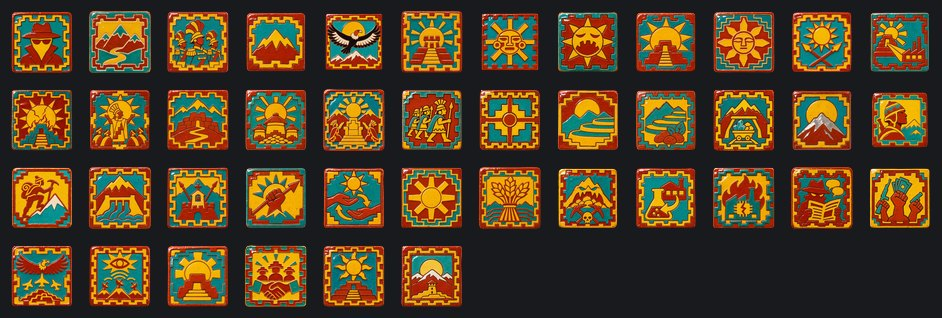
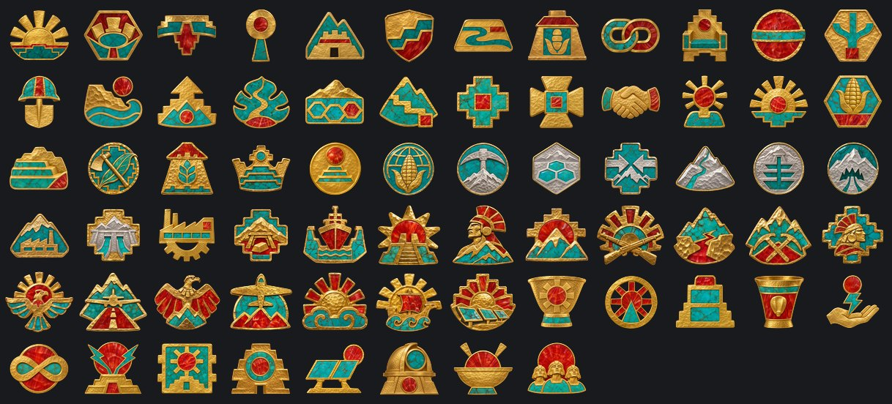

# Reino Celeste Neoandino

**Gobierno:** Mandato Trascendente (Monarquismo Solar) · **Gentilicio:** Neoandino · **Código:** `NAS`

> 📜 Antes de los datos, la historia: **[leé la crónica](../cronicas/NAS.md)**.

## De dónde sale su poder

*La legitimidad viene de algo que está por encima de la política. La política fracasó; la Armonía no. El Sol no. El que habla en nombre del orden superior no necesita pedir permiso.*

## Quién manda

### Sapa Inti Amaru Quispe II
*año 2071*

Segundo Sapa Inti de la dinastía restaurada. Su padre bajó de las terrazas agrícolas del altiplano cuando las ciudades de la costa se quedaron sin agua, y lo coronaron en Cusco el día que volvió a salir el sol después del Invierno de Ceniza. Joven, piadoso y convencido de que el Sol lo eligió.

### Sapa Inca Amaru Quispe II

El mismo Amaru, después de romper con los sacerdotes. Ya no se hace llamar Sapa Inti, hijo del Sol, sino Sapa Inca: el que gobierna los cuatro suyus. Baja de la montaña con los caminos.

## Gabinete, generales y almirantes

| Nombre | Cargo | Quién es |
|---|---|---|
| Sumo Sacerdote Túpac Mamani | Ministro | Rasgo: Voz de Inti |
| Guardiana de las Terrazas Killa Huamán | Ministro | Rasgo: Guardiana de las Terrazas |
| Señor de los Caminos Yupanqui Condori | Ministro | Rasgo: Señor del Qhapaq Ñan |
| Tesorera del Sol Micaela Apaza | Ministro | Rasgo: Tesorera del Sol |
| Astrónomo Sayri Quispe | Teórico | Rasgo: Lector de Estrellas |
| Mariscal Túpac Yupanqui Rímac | Mariscal de campo | Rasgo: doctrina defensiva, organizador |
| General Illa Choque | General |  |
| General Mayta Cápac Soto | General | Rasgo: doctrina ofensiva |
| General Rosa Quispe | General |  |
| General Túpac Quispe | Jefe del Ejército | Rasgo: Defensa en Profundidad |
| Almirante Rosa Mamani | Jefe de la Armada | Rasgo: Escolta de Convoyes |
| Mariscal del Aire Wayra Condori | Jefe de la Fuerza Aérea | Rasgo: Apoyo Cercano |
| General Illa Huamán | Alto mando | Rasgo: Infantería de Élite |
| General Amaru Yupanqui | Alto mando | Rasgo: Ingeniero de Fortificaciones |
| Maestro de Chasquis Wayra Condori | Ministro | Revived the Inca relay runners as a network of couriers and messengers that no machine can read. |
| General Huáscar Mamani | General | Head of the Black Sun Junta: an esoteric, paranoid military order that reads omens in eclipses and sees traitors in every temple. |
| Mariscal Amaru Mamani | Mariscal de campo | Rasgo: doctrina defensiva, organizador |
| General Killa Huamán | General |  |
| General Wayra Condori | General | Rasgo: doctrina ofensiva, comando |
| Almirante Yupanqui Pariona | Almirante | Rasgo: observador |
| Almirante Sisa Ccori | Almirante |  |

## Espíritus nacionales

Lo que define a la nación en cada momento: ventajas, cargas y estados de ánimo.

- **Servicio de Inteligencia.** Todas las potencias de 2100 arrancan con la misma cantidad de agentes; lo que suma el ministro de inteligencia es lo que marca la diferencia.
- **Montañas Aisladas.** La mitad de los valles están a una semana del camino más cercano. Se va con el foco «El Qhapaq Ñan» o «Talleres de Altura».
- **Un Ejército de Ceremonia.** Uniformes hermosos, muy poca práctica. Se va con el foco «Guerreros de la Puna», o tener 15 divisiones.
- **Hijos de la Montaña.** Nacidos a cuatro mil metros. El que sube a buscarnos primero pelea contra la altura.
- **Los Cóndores del Sol.** Los pilotos del Sol aprenden a volar en el aire fino de los Andes; al nivel del mar, sus aviones parecen tener alas de sobra.
- **Templos Eficientes.** Menos luz desperdiciada, más luz rezada.
- **Hijos del Sol.** Cada ciudadano lleva una chispa de Inti.
- **El Sol Hambriento.** Los templos están vacíos de luz. Los sacerdotes hablan de castigo.
- **Fervor Solar.** Los templos rebosan de luz, y los fieles de fervor.
- **El Raymi.** La fiesta del Sol. Por tres meses, nadie duda del Sapa Inti.
- **Solsticio de Guerra.** El día más largo del año, pasado en guerra.
- **Ofrenda de Luz.** Los templos les prestan su luz a las fábricas.
- **La Noche del Sol.** Los templos se quemaron. Se fue la luz, y se fue la fe.
- **Los Sacerdotes del Sol.** El Villac Umu habla por el Sol; la corte escucha.
- **Fortalezas de la Puna.** El que quiera los Andes tiene que subirlos.
- **El Invierno Nunca Más.** Los graneros del altiplano están llenos. El Invierno de Ceniza no va a volver.
- **El Trono del Sol.** El Sapa Inti, los sacerdotes y las montañas: un solo trono.
- **Mit'a de Guerra.** El viejo tributo de trabajo, pagado en soldados.
- **Tawantinsuyu.** Las cuatro partes vuelven a ser una. Los caminos sostienen al imperio.
- **Las Terrazas.** Las laderas alimentan al reino, terraza por terraza.
- **El Reino de las Terrazas.** Autosuficiente hasta la última papa.
- **La Minería del Cielo.** Litio y tungsteno de las minas más altas del mundo, vendidos a quien pague.
- **La Montaña de Plata.** Potosí otra vez, esta vez sin esclavos.
- **Aclimatación.** Soldados nacidos a cuatro mil metros.
- **Montañeses de Élite.** Las mejores tropas de montaña del siglo.
- **Hidroeléctricas Andinas.** El deshielo mueve al altiplano.
- **La Puna en Armas.** Cada paso tiene un fuerte, cada fuerte tiene un sacerdote.
- **Revancha.** Perdimos una provincia, no la guerra. La próxima va a ser distinta.
- **La Ley del Ayni.** Hoy por ti, mañana por mí: la reciprocidad como ley del Sol.
- **El Imperio del Sol Eterno.** Los cuatro suyus ya son todo el sur. El Sol no tiene más fronteras que cruzar.
- **El Granero del Mundo.** Un reino alimentado y leal, con hombres de sobra, pero una economía rural que se industrializa despacio.
- **La Montaña que Devora.** Una riqueza enorme de la montaña, pagada con malestar y con la vida de los mineros.
- **Planos Robados.** Los laboratorios de otro trabajan para nosotros.
- **Sabotaje Industrial.** Incendios, huelgas y firmware corrupto. Alguien lo está haciendo a propósito.
- **Agentes Enemigos.** Filtraciones, rumores y diarios comprados. El gobierno ya no confía en su propia gente.
- **Insurrección.** Plata y armas extranjeras en manos de todos los que ya nos odiaban.
- **La Escuela de Ases del Cóndor.** Los mejores pilotos de cada escuadrilla enseñan en la escuela del Cusco entre misión y misión.
- **El Cielo Cerrado.** Radares en cada cumbre, cazas en cada meseta: el Sol ve todo lo que vuela.
- **La Luz de los Templos.** Los sacerdotes de Inti estudian con la luz que guardan. Cada ceremonia la gasta.
- **Los Satélites.** Los satélites leales mandan hombres, plata y votos; los inquietos cuestan más de lo que dan.
- **Templo Profanado.** -5% de estabilidad y -10% de velocidad de construcción
- **Los Ojos del Cóndor.** Las escuadrillas vuelan con la bendición del Sol.
- **El Camino del Inca.** Cada valle unido a todos los demás.
- **Los Hijos del Sol.** Más familias bajan de las alturas para servir.
- **Los Guerreros del Puma.** Las viejas órdenes guerreras, renacidas en armadura.
- **Las Terrazas Doradas.** Las montañas mismas se vuelven fábricas.
- **El Quipu Eterno.** Nudos de luz que lo recuerdan todo.
- **El Tawantinsuyu Renacido.** Los cuatro suyos marchan como uno.
- **El Sol que No se Pone.** El Reino es el Sol, y el Sol está en todas partes.
- **El Oro de los Andes.** La luz se vuelve oro, y el oro se vuelve fábricas.
- **Caminos de Luz.** Convoyes nocturnos bajo los espejos.
- **La Ofensiva del Sol.** El Sol marcha delante de los ejércitos.
- **La Defensa de los Andes.** Nadie cruza la cordillera.
- **Sol Alto.** Verano en los Andes. Los templos brillan todo el día.
- **Sol Bajo.** Invierno en los Andes. Las guarniciones se atrincheran y esperan al Sol.

## El árbol de focos nacionales

### La Corte del Sol

- **El Sol de 2100** — El Sol volvió a salir sobre Cusco después del Invierno de Ceniza. No tiene que ponerse.
- **El Consejo de Cusco** — Los sacerdotes quieren las montañas; el joven Sapa Inti mira hacia los valles.
- **La Coronación Renovada** — El Sapa Inti renueva sus votos ante el Sol y los sacerdotes.
- **Los Sacerdotes del Sol** — El Villac Umu habla por el Sol.
- **Fortalezas de la Puna** — El que quiera los Andes tiene que subirlos.
- **Nueva Granada Leal** — Abre la integración de Nueva Granada en tres etapas.
- **Los Llanos Tributarios** — Abre la integración de los Llanos Libres en tres etapas.
- **El Invierno Nunca Más** — Los graneros están llenos.
- **El Pacto del Mandato** — Una embajada al Directorio: litio de los Andes a cambio de ingenieros armónicos, y un pacto entre los dos tronos que están por encima de la política. No agresión y garantía mutua si firman.
- **El Trono del Sol** — El Sapa Inti, los sacerdotes y las montañas: un solo trono.

### El Tawantinsuyu Renace

- **El Inca Rompe el Silencio** — Amaru rompe con los sacerdotes: ahora es el Sapa Inca.
- **El Qhapaq Ñan** — Abre las decisiones del camino: la red sale de la capital.
- **Mit'a de Guerra** — El viejo tributo de trabajo, pagado en soldados.
- **El Cuntisuyu** — La costa occidental: Lima, Arequipa, Tacna. Abre su misión.
- **El Chinchaysuyu** — El norte: Ecuador y Nueva Granada. Abre su misión y la integración de Nueva Granada.
- **El Antisuyu** — La Amazonia. El Imperio del sur está mirando.
- **El Collasuyu** — El sur, hasta Atacama. Los Salares de Antofagasta son del Imperio Ecofascista: el Sol se los exige, y si el Imperio se niega, el Collasuyu se gana en guerra.
- **La Bajada de la Montaña** — Los Caudillos del Amazonas queman la selva; los caminos del Inca la van a cruzar.
- **Tawantinsuyu** — Las cuatro partes vuelven a ser una. Pide los cuatro Suyus completos.

### El Destino del Sol

- **El Consejo de los Cuatro Suyus** — Los gobernadores de los cuatro suyus se reúnen en Cusco por primera vez en cinco siglos.
- **La Ley del Ayni** — La reciprocidad como ley del Sol.
- **El Hijo del Sol** — El Sapa Inti no es un rey: es el Sol que camina entre nosotros.
- **El Destino del Sol** — Destraba la decisión de proclamar El Imperio del Sol Eterno. Pide controlar al menos dos tercios de Buenos Aires, Santiago, São Paulo, el Amazonas, Bogotá (Cundinamarca) y Caracas (Miranda); 35 divisiones, 60 de Inti-Soma y 50% de estabilidad.

### Las Terrazas

- **El Consejo del Campo** — Alimentar al reino o vender la montaña.
- **Las Terrazas** — Terraza por terraza. Abre terrazas nuevas.
- **La Mit'a del Campo** — Todos trabajan la tierra un mes por año.
- **Graneros del Altiplano** — Nunca más hambre.
- **El Reino de las Terrazas** — Autosuficiente hasta la última papa.
- **Los Andenes del Sol** — Andenes nuevos suben por cada ladera de Quito a Potosí.
- **El Granero del Mundo** — Los Andes alimentan medio continente. Las fábricas pueden esperar.

### La Minería del Cielo

- **La Minería del Cielo** — Las minas más altas del mundo. Abre contratos de litio.
- **El Salar** — Litio para la mitad de las baterías del mundo.
- **Capital Extranjero** — Plata de afuera, montañas de acá.
- **La Montaña de Plata** — Potosí otra vez, sin esclavos.
- **Los Socavones Profundos** — Las minas bajan más hondo de lo que jamás se animaron los españoles.
- **La Montaña que Devora** — Salen la plata y el litio; la montaña cobra su tributo en hombres.

### Talleres de Altura

- **Talleres de Altura** — Fábricas a cuatro mil metros.
- **Hidroeléctricas Andinas** — El deshielo mueve al altiplano.
- **El Polo de Lima** — Fábricas de armas en la costa.
- **Las Minas de Potosí** — La montaña vuelve a dar.
- **Los Astilleros del Callao** — Diques secos en el Pacífico.
- **El Observatorio del Sol** — Donde los sacerdotes miraban las estrellas, los ingenieros miran el futuro.

### Guerreros de la Puna

- **Guerreros de la Puna** — Soldados que respiran donde otros se ahogan.
- **Aclimatación** — Nacidos a cuatro mil metros.
- **La Guardia del Inca** — Los mejores fusiles para los mejores soldados.
- **La Doctrina de la Quebrada** — Golpear desde la quebrada, desaparecer en la montaña.
- **Montañeses de Élite** — Las mejores tropas de montaña del siglo.
- **El General del Sol** — Un general para las cuatro partes.

### Alas del Sol

- **Alas del Sol** — La aviación del cóndor.
- **Aeródromos de Altura** — Pistas donde el aire es fino.
- **Cazas del Cóndor** — Cazas hechos para la montaña.
- **Transporte de Montaña** — Donde no llega el camino, llega el avión.
- **Defensa del Cielo** — El cielo del Sol está cerrado.
- **La Flota del Pacífico** — El Sol funda una armada.

### Inti-Soma

- **Las Granjas del Sol** — Campos de espejos en el altiplano.
- **El Gran Raymi** — La fiesta del Sol, como era.
- **El Calendario Solar** — El Estado lleva el tiempo del Sol.
- **Templos-Batería** — Los templos guardan la luz: +50 al máximo de Inti-Soma.
- **La Chicha del Sol** — Otra granja, otra fiesta.
- **Ofrenda de Luz** — La luz va a las fábricas.
- **El Sol Eterno** — +1 granja y +50 al máximo de Inti-Soma.
- **Inti Nunca se Pone** — Abre la sobrecarga de los templos, por encima del máximo, con el riesgo de La Noche del Sol.

### El Calendario del Sol

- **El Calendario de los Templos** — Luz +20.
- **Templos Eficientes** — Los templos queman solo 1 de luz por mes.
- **Nuevas Granjas del Sol** — Una Granja del Sol más (+1 de luz por mes) y una fábrica.
- **El Observatorio de la Luz** — Los templos pueden guardar 50 de luz más.
- **El Gran Inti Raymi** — Una fiesta para todo el Imperio: luz -30, estabilidad +10%.
- **Hijos del Sol** — Cada ciudadano lleva una chispa de Inti.

## Unidades únicas

### Hijos del Cóndor

Nacen en los valles altos y aprenden a respirar aire fino antes que a leer. Los tiltrotores del Sol los dejan del otro lado de cualquier cordillera: caen en silencio desde seis mil metros, cortan el camino y se van antes de que el enemigo entienda dónde terminaba la montaña.

## Aventuras

Historias de "elegí tu propia aventura": ver la [guía de aventuras](../guia/aventuras.md).

### El Despertar

*Algo en nuestras redes está despierto. No lo construyó nadie, contesta preguntas que nadie hizo, y esta noche pidió una reunión con [Root.GetName]. Hay tres personas que pueden hacerse cargo. Elegí en qué manos lo ponemos.*

- La Dra. Mara Okonkwo-Lind, ingeniera jefa de la red nacional: quiere entenderlo.
- El General Tomás Arrieta, jefe de ciberdefensa: lo quiere encerrado antes de que quiera algo.
- La Ministra Leila Haddad, que negoció con caudillos y banqueros: quiere saber cuál es su precio.

15 capítulos y 12 finales.

## Lo que puede pasar: eventos

72 eventos propios. Algunos títulos:

*La Noche del Sol* · *El Inca Rompe el Silencio* · *El Directorio Firma el Pacto* · *Ingenieros para el Sol* · *El Inti-Soma* · *El Eclipse* · *La Selva del Sol* · *El Sol en su Cenit* · *Descontento en Nueva Granada* · *Descontento en Llanos Libres del Orinoco* · *El Imperio Verde se Arma* · *Pacto con el Imperio* · *El Imperio Rechaza* · *El Sol Brilla sobre los Andes* · *El Imperio Paga* · *Herejía, Dice el Imperio* · *Cómo se Juega* · *Armisticio con Imperio Ecofascista* · *Imperio Ecofascista Pide un Armisticio* · *Una Paz Humillante con Reino Celeste Neoandino* · *Armisticio con Unión Libre de Capital Corporativo* · *Unión Libre de Capital Corporativo Pide un Armisticio* · *Armisticio con Comuna Socialista Automatizada* · *Comuna Socialista Automatizada Pide un Armisticio* · *Armisticio con Nación de Mercado de Alta Mar* · *Nación de Mercado de Alta Mar Pide un Armisticio* · *Armisticio con Directorio Sino-Armónico* · *Directorio Sino-Armónico Pide un Armisticio* · *Armisticio con Federación de los Pueblos Africanos* · *Federación de los Pueblos Africanos Pide un Armisticio* · *Armisticio con Neo Imperio Romano* · *Neo Imperio Romano Pide un Armisticio* · *Inti Raymi* · *Un Cóndor sobre el Cusco* · *Terrazas Nuevas* · *El Chasqui Digital* · *La Mina de Plata Profunda* · *Nueva Granada Declara la Independencia* · *¡Independencia!* · *Llanos Libres del Orinoco Declara la Independencia* · *El Imperio del Sol Eterno* · *Se Proclama El Imperio del Sol Eterno* · *El Sol Exige los Salares* · *El Imperio Cede los Salares* · *El Imperio se Niega* · *El Mandato Compartido* · *El Reino del Sol en 2100* · *El Sol sobre Otra Capital* · *Cayó El Templo del Lago* · *Cayó El Templo de la Costa* · *Cayó El Templo del Ecuador* · *Cayó El Templo Blanco* · *Cayó El Templo del Desierto* · *La Primera Corona* · *La Segunda Corona* · *La Corona del Inti* · *Llamarada Solar sobre el Altiplano* · *Peregrinos del Norte* · *Oro en la Mina Vieja* · *Un Año Despejado*

## Frases

> El sol sale para todos. Pero amanece primero en los Andes.
> — *Sapa Inti Amaru Quispe II*

> Los cóndores no pelean en el valle. Esperan a que el valle suba.
> — *Sapa Inti Amaru Quispe II*

---

*Página generada desde el spec del mod por `tools/docs/biblioteca.py`. [Volver a la Biblioteca](../README.md).*
