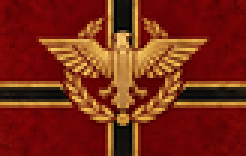
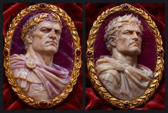
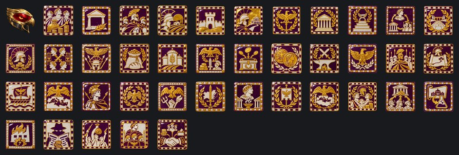
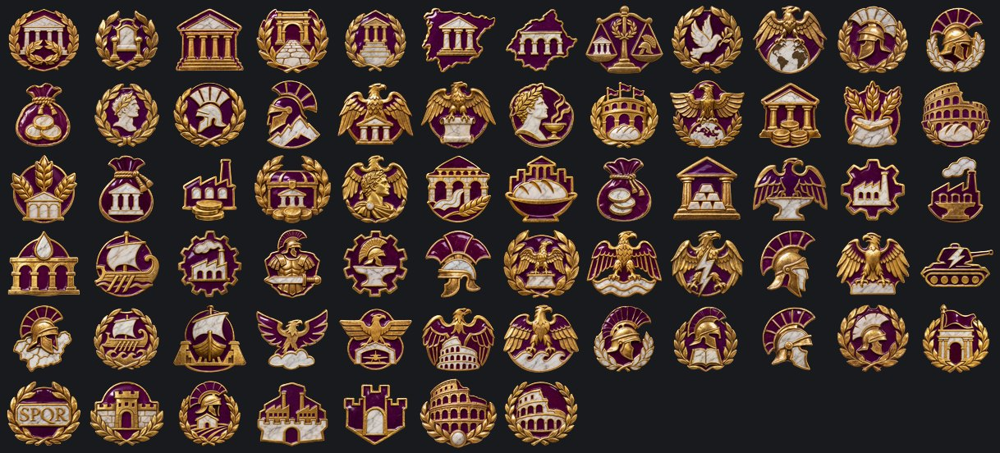

# Neo Imperio Romano

**Gobierno:** Régimen de Restauración (Restauración Imperial) · **Gentilicio:** Neorromana · **Código:** `NRE`

> 📜 Antes de los datos, la historia: **[leé la crónica](../cronicas/NRE.md)**.

## De dónde sale su poder

*La legitimidad viene de lo que existía antes del colapso: la Tierra viva, el imperio perdido, la vieja nación. Alguna vez hubo un orden. Se lo va a restaurar, cueste lo que les cueste a los vivos.*

## Quién manda

### Imperator Lucius Varro
*año 2052*

Comandante de legión elevado a Imperator por aclamación de las tropas, como en los viejos tiempos. Cree que la historia es un ciclo y que a él le tocó la parte de reconstruir. NO es 'Augustus Valerius' (§10.1): ese personaje del borrador de 2023 no se usa.

### Legado Flavius Arbogast
*año 2061*

Legado de la Legio I Italica. Varro lo mandó a pelear al desierto para sacárselo de encima; volvió con la legión entera detrás y la convicción de que el Senado es un lujo que Roma no puede pagar.

### Legada Irina Vasilescu
*año 2066*

Legada de la Legio V Macedonica, acuartelada en el Danubio. Hija de la junta de los búnkeres de Dacia; la primera provincial que las legiones podrían aclamar.

### Legado Kerem Aydın
*año 2058*

Legado de la Legio XII Fulminata, guardiana de Anatolia. Viejo, paciente y popular entre los soldados: les promete tierras en Oriente a todos.

## Gabinete, generales y almirantes

| Nombre | Cargo | Quién es |
|---|---|---|
| Cónsul Marcus Dima | Ministro | Rasgo: Cónsul de Roma |
| Prefecta de la Annona Livia Serrano | Ministro | Rasgo: Guardiana del Grano |
| Curador de las Vías Tiberius Rusu | Ministro | Rasgo: Constructor de Vías |
| Tribuna Cassia Demir | Ministro | Rasgo: Tribuna de las Legiones |
| Filósofo Gaius Stamate | Teórico | Rasgo: Estratega Estoico |
| Legado Flavio Constantin | Mariscal de campo | Rasgo: doctrina ofensiva, estratega brillante |
| Legada Aelia Petrescu | General | Rasgo: líder de infantería |
| Legado Mehmet Yıldız | General |  |
| Legado Andrei Popa | General | Rasgo: mago de la logística |
| Legado Gaio Ottavio Rinaldi | Jefe del Ejército | Rasgo: Moral de Hierro |
| Navarca Elena Stavrou | Jefe de la Armada | Rasgo: Batalla Decisiva |
| Prefecto del Aire Kaan Demir | Jefe de la Fuerza Aérea | Rasgo: Dueño del Cielo |
| Tribuno Julien Moreau | Alto mando | Rasgo: Infantería de Élite |
| Tribuno Aleksandar Petrović | Alto mando | Rasgo: Reservas y Reemplazos |
| Princeps Frumentariorum Aulus Serenus | Ministro | Head of the revived frumentarii, the imperial couriers who were always also spies. |
| Basileus Constantino Láskaris | General | Governor of the eastern provinces, crowned in Constantinople: the East will not take orders from the Senate of Rome. |
| Mariscal Lucio Severo | Mariscal de campo | Rasgo: doctrina ofensiva, organizador |
| General Marco Valerio Strozzi | General | Rasgo: líder de blindados, doctrina ofensiva |
| General Livia Castellani | General |  |
| Almirante Gayo Doria | Almirante | Rasgo: táctico superior |
| Almirante Claudia Morosini | Almirante | Rasgo: acorazado |

## Espíritus nacionales

Lo que define a la nación en cada momento: ventajas, cargas y estados de ánimo.

- **Servicio de Inteligencia.** Todas las potencias de 2100 arrancan con la misma cantidad de agentes; lo que suma el ministro de inteligencia es lo que marca la diferencia.
- **Un Senado Corrupto.** Los senadores venden su voto, y el precio sube. Se va con el foco «El Senado Restaurado» o «La Legión Decide».
- **Graneros Vacíos.** Roma come más de lo que cosecha. Se va con el foco «La Annona».
- **Legiones Indisciplinadas.** Las legiones obedecen primero a sus legados y después a Roma. Se va con el foco «Disciplina de Hierro», o llegar a 60 de Auctoritas.
- **Colonias de Veteranos.** Cada veterano recibe tierra, y se acuerda de quién se la dio.
- **La Disciplina del Limes.** Una frontera que aguanta.
- **Legiones Ociosas.** Las legiones sin guerra buscan una causa. A veces encuentran el Palatino.
- **Legiones Veteranas.** Al menos una legión pasó los 60 de prestigio. Su águila da miedo.
- **El Senado Restaurado.** Trescientos senadores, y cada uno sabe que sirve mientras el Imperator quiera.
- **El Cursus Honorum.** Una carrera de cuestor a cónsul, abierta a quien haya servido.
- **El Equilibrio de Varro.** Senado, Imperator y legiones, cada uno frenando a los otros dos.
- **Pax Romana.** Caminos sin bandidos, provincias sin revueltas, un imperio en reposo.
- **La Guardia Pretoriana.** La legión propia del Imperator. Leal, mientras se le pague.
- **El Año de los Cuatro Imperatores.** Las legiones hacen emperadores. Los emperadores hacen la guerra.
- **El Imperio de las Legiones.** Roma no tiene fuerzas armadas. Las fuerzas armadas tienen Roma.
- **La Annona.** Grano gratis para cada ciudadano de Roma, pagado por las provincias.
- **Los Graneros Imperiales.** Nadie pasa hambre en el Imperio. Nadie se olvida de quién lo alimenta.
- **El Tributo.** Las provincias le pagan a Roma en dinero, acero y hombres.
- **El Fisco Imperial.** Cada moneda del Imperio pasa por el tesoro del Imperator.
- **El Nuevo Aureus.** Una moneda de oro con un águila de un lado y el Imperator del otro.
- **La Economía de Guerra Imperial.** Cada forja del Imperio trabaja para las legiones.
- **El Águila de Oro.** Las águilas volvieron a los estandartes, y las legiones pelean por ellas.
- **Disciplina de Hierro.** La decimación es ilegal. Igual todos se acuerdan.
- **Planes de Campaña.** Los tribunos hicieron los planes. Las legiones saben adónde ir.
- **Nuestro Mar.** El Mediterráneo vuelve a ser un lago romano.
- **El Mediterráneo Romano.** De Gibraltar al Bósforo, cada puerto lleva el águila.
- **Los Tribunos Militares.** Oficiales jóvenes que aprenden la guerra antes que la política.
- **Senatus Populusque Romanus.** Cuatro letras en cada estandarte, cada edificio, cada moneda.
- **Provincia Revoltosa.** La provincia nueva todavía no se siente romana.
- **Revancha.** Perdimos una provincia, no la guerra. La próxima va a ser distinta.
- **El Culto Imperial.** Incienso ante el Genio del Imperator en cada foro, de Lutecia a Dacia.
- **La Paz del Vencedor.** Roma desangró a Roma, y Roma sobrevivió. Las legiones marchan otra vez detrás de un solo estandarte.
- **El Imperio Romano Eterno.** El Mare Nostrum vuelve a ser nuestro, de las columnas de Hércules al Nilo.
- **La Ciudad Alimentada.** Un pueblo contento y que crece, y una legión que recluta menos y gasta más.
- **El Tesoro de Saturno.** Roma se enriquece con las provincias; las provincias refunfuñan.
- **Planos Robados.** Los laboratorios de otro trabajan para nosotros.
- **Sabotaje Industrial.** Incendios, huelgas y firmware corrupto. Alguien lo está haciendo a propósito.
- **Agentes Enemigos.** Filtraciones, rumores y diarios comprados. El gobierno ya no confía en su propia gente.
- **Insurrección.** Plata y armas extranjeras en manos de todos los que ya nos odiaban.
- **Las Legiones de Roma.** Las legiones famosas pelean mejor; un emperador respetado las mantiene en orden. Las que se agrandan demasiado quieren su parte.
- **Los Satélites.** Los satélites leales mandan hombres, plata y votos; los inquietos cuestan más de lo que dan.
- **Una Ciudad del Triunfo Perdida.** -5% de estabilidad y -10% de velocidad de construcción
- **El Arco de las Legiones.** Cada legionario marcha bajo él una vez.
- **El Nuevo Coliseo.** Pan y circo, para siempre.
- **Los Acueductos de Acero.** Agua y caminos a cada provincia.
- **Imperator.** El emperador es primero un soldado.
- **Pater Patriae.** El padre de la patria.
- **Restitutor Orbis.** El restaurador del mundo.
- **Pax Romana.** La paz, por orden de Roma.
- **Roma Invicta.** Roma nunca perdió. Roma nunca va a perder.
- **El Senado Renacido.** La república dentro del imperio.
- **Panem et Circenses.** La multitud ruge.
- **Juegos de Gladiadores.** Sangre en la arena, fuego en los corazones.
- **Via Imperialis.** Todos los caminos llevan a Roma.
- **Testudo.** Escudos arriba.
- **El Triunfo.** Una legión volvió victoriosa.

## El árbol de focos nacionales

### El Principado

- **La Aclamación Confirmada** — Las legiones hicieron Imperator a Varro. Ahora el Senado tiene que confirmarlo.
- **El Consilium** — Senado o legiones: el que se sienta más cerca del Imperator gobierna Roma.
- **El Senado Restaurado** — Varro reabre la Curia. La política se vuelve más barata, y más lenta.
- **Las Vías Imperiales** — Todos los caminos vuelven a llevar a Roma. Abre la construcción de vías.
- **El Cursus Honorum** — Una carrera abierta a quien haya servido.
- **Hispania Provincia** — Abre la provincialización de Hispania en tres etapas.
- **Dacia Provincia** — Abre la provincialización de Dacia en tres etapas.
- **El Equilibrio de Varro** — Senado, Imperator y legiones, cada uno frenando a los otros dos.
- **Pax Romana** — Pide 70% de estabilidad y paz con las otras meganaciones (una guerra contra las anarquías no la rompe). Después vale la pena.
- **Roma contra la Tierra** — Un ultimátum al Imperio Ecológico: abrirle el Atlántico a Roma, o guerra.

### El Año de los Cuatro Imperatores

- **La Legión Decide** — Flavius Arbogast toma Roma. Desde ahora, cualquier legión en 85 puede aclamar a su propio Imperator.
- **La Guardia Pretoriana** — La legión propia del Imperator. Abre llamar a los pretorianos.
- **Los Donativos** — Oro para las legiones. Abre los donativos para calmarlas.
- **Ave Imperator** — Cada legión nombra a su candidato. Cada candidato necesita soldados.
- **El Año de los Cuatro** — Las legiones hacen emperadores. Los emperadores hacen la guerra.
- **La Marcha al Norte** — Las legiones quieren tierras. Los señores de la guerra euroasiáticos tienen de sobra.
- **El Imperio de las Legiones** — Roma no tiene fuerzas armadas. Las fuerzas armadas tienen Roma.

### El Destino de Roma

- **La Lex Imperii** — La ley que hace de la palabra del Imperator la ley.
- **El Culto Imperial** — Incienso ante el Genio del Imperator en cada foro.
- **Los Juegos de la Victoria** — Pan, circo y oficinas de reclutamiento en las puertas de la arena.
- **El Destino de Roma** — Destraba la decisión de proclamar El Imperio Romano Eterno. Pide controlar al menos dos tercios de Hispania (Madrid, Lisboa), Egipto (Alejandría, Suez), Trípoli, Britania (Londres), Crimea y Sofía; 70 divisiones, 50 de Auctoritas y 50% de estabilidad.

### El Erario

- **El Erario** — Alimentar a Roma o hacer pagar a las provincias.
- **La Annona** — Grano gratis para los ciudadanos. Abre repartir la Annona.
- **Pan y Circo** — El Coliseo reabre.
- **Los Graneros Imperiales** — Nadie pasa hambre en el Imperio.
- **El Tributo** — Las provincias le pagan a Roma. Abre cobrar el Tributo.
- **Las Provincias Pagan** — Fábricas hechas con plata de las provincias.
- **El Fisco Imperial** — Cada moneda pasa por el tesoro del Imperator.
- **El Nuevo Aureus** — Una moneda de oro con un águila de un lado y el Imperator del otro.
- **Los Acueductos de Roma** — Agua y pan para la Urbe, como en tiempos de Trajano.
- **La Ciudad Alimentada** — Nadie en el Imperio pasa hambre. Nadie quiere dejar la ciudad por las legiones, tampoco.
- **Los Publicanos** — Recaudadores en cada provincia, y su parte en cada moneda.
- **El Tesoro de Saturno** — El templo de Saturno vuelve a estar lleno. Las provincias, vacías.

### Las Forjas Imperiales

- **Las Forjas Imperiales** — Acero para las águilas.
- **El Polo de Milán** — La vieja industria del norte, reconstruida.
- **Las Acerías de Anatolia** — Acero de Oriente.
- **Los Nuevos Acueductos** — Agua y energía para cada ciudad.
- **Astilleros de Ostia** — El puerto de Roma vuelve a hacer barcos.
- **La Fábrica del Imperio** — Italia se vuelve un solo distrito industrial.
- **El Arsenal de Roma** — Cada legión armada en Roma.
- **La Economía de Guerra Imperial** — Cada forja trabaja para las legiones.

### Las Legiones

- **Las Legiones** — Tres legiones con nombre, historia y ambiciones.
- **Legio I Italica** — La primera legión del Imperio. Prestigio +15.
- **Legio V Macedonica** — La legión del Danubio. Prestigio +15.
- **Legio XII Fulminata** — La Legión del Rayo de Anatolia. Prestigio +15.
- **Disciplina de Hierro** — La decimación es ilegal. Igual todos se acuerdan.
- **El Águila de Oro** — Las águilas volvieron a los estandartes.
- **Los Blindados del Rayo** — Tanques con el rayo pintado en la torreta.
- **El Ejército de las Provincias** — Cada provincia manda a sus hijos a las legiones.

### Mare Nostrum

- **Mare Nostrum** — El Mediterráneo vuelve a ser nuestro.
- **La Flota del Tirreno** — Diques secos de Nápoles a Livorno.
- **Las Águilas del Cielo** — El águila vuelve a aprender a volar.
- **La Aeronáutica Imperial** — Bases aéreas en cada provincia.
- **El Cielo de Roma** — Ningún avión enemigo sobre la Ciudad Eterna.
- **El Mediterráneo Romano** — De Gibraltar al Bósforo, cada puerto lleva el águila.

### Legiones y Oficiales

- **Legiones y Oficiales** — En Roma, los oficiales son la moneda.
- **Los Tribunos Militares** — Oficiales jóvenes que aprenden la guerra antes que la política.
- **Los Centuriones** — La columna vertebral de cada legión.
- **Los Veteranos** — Cada legión +10 de prestigio.
- **El Triunfo** — Las legiones desfilan por Roma con su botín.
- **SPQR** — Cuatro letras en cada estandarte, cada edificio, cada moneda.

### El Limes

- **El Limes** — Auctoritas +10.
- **Colonias de Veteranos** — En paz la Auctoritas baja solo 1 por mes.
- **Los Castra** — Dos fábricas militares detrás de la frontera.
- **La Disciplina del Limes** — Una frontera que aguanta.
- **Los Juegos del Coliseo** — Estabilidad +10%, cada legión +5, Auctoritas +5.
- **Roma Aeterna** — La ciudad que no termina.

## Unidades únicas

### Onagro

Las legiones le pusieron el nombre de la máquina de asedio que pateaba como un asno salvaje. Cada batería Onagro dispara ciento veinte cohetes en nueve segundos y se mueve antes de que llegue la respuesta: la Tormenta de Marte que abre el camino a las cohortes. Solo Roma los construye; solo Roma necesita tanto trueno.

## Aventuras

Historias de "elegí tu propia aventura": ver la [guía de aventuras](../guia/aventuras.md).

### El Despertar

*Algo en nuestras redes está despierto. No lo construyó nadie, contesta preguntas que nadie hizo, y esta noche pidió una reunión con [Root.GetName]. Hay tres personas que pueden hacerse cargo. Elegí en qué manos lo ponemos.*

- La Dra. Mara Okonkwo-Lind, ingeniera jefa de la red nacional: quiere entenderlo.
- El General Tomás Arrieta, jefe de ciberdefensa: lo quiere encerrado antes de que quiera algo.
- La Ministra Leila Haddad, que negoció con caudillos y banqueros: quiere saber cuál es su precio.

15 capítulos y 12 finales.

## Lo que puede pasar: eventos

100 eventos propios. Algunos títulos:

*La Legión Decide* · *Una Legión Exige* · *AVE IMPERATOR* · *La Tierra se Inclina ante Roma* · *Las Legiones* · *La Legión se Amotina* · *Persia a los Pies de Roma* · *Las Legiones Piden un Triunfo* · *Descontento en Provincia de Hispania* · *Descontento en Provincia de Dacia* · *Cayeron los Emiratos* · *Roma se Tragó los Emiratos* · *El Directorio de la Estepa Exige Concesiones* · *Roma Paga* · *Roma se Niega* · *La Comuna Automatizada Exige Concesiones* · *La Federación de los Pueblos Africanos Exige Concesiones* · *Los Señores de la Guerra de Eurasia Exige Concesiones* · *Los Arsenales Rebosan* · *Roma Pide Guerra* · *La Comuna se Suma* · *Árboles en Hispania* · *África ya no es un Mercado* · *Cómo se Juega* · *La Orilla Africana* · *África Paga* · *África se Niega* · *Roma Exige Tributo* · *Armisticio con Imperio Ecofascista* · *Imperio Ecofascista Pide un Armisticio* · *Una Paz Humillante con Neo Imperio Romano* · *Armisticio con Unión Libre de Capital Corporativo* · *Unión Libre de Capital Corporativo Pide un Armisticio* · *Armisticio con Comuna Socialista Automatizada* · *Comuna Socialista Automatizada Pide un Armisticio* · *Armisticio con Nación de Mercado de Alta Mar* · *Nación de Mercado de Alta Mar Pide un Armisticio* · *Armisticio con Reino Celeste Neoandino* · *Reino Celeste Neoandino Pide un Armisticio* · *Armisticio con Directorio Sino-Armónico* · *Directorio Sino-Armónico Pide un Armisticio* · *Armisticio con Federación de los Pueblos Africanos* · *Federación de los Pueblos Africanos Pide un Armisticio* · *Natalis Romae* · *El Vesubio Humea* · *Lupercalia* · *Un Águila en el Foro* · *Los Idus de Marzo* · *Provincia de Hispania Declara la Independencia* · *¡Independencia!* · *Provincia de Dacia Declara la Independencia* · *La Guerra de las Legiones* · *La Paz del Vencedor* · *El Imperio Romano Eterno* · *Se Proclama El Imperio Romano Eterno* · *Roma en 2100* · *Un Triunfo para Roma* · *Cayó Roma* · *Cayó Lutecia* · *Cayó Lugdunum*

## Frases

> Roma no cayó. Se tomó dos mil años de descanso.
> — *Imperator Lucius Varro*

> La legión no cuenta enemigos. Cuenta pasos hasta la próxima frontera.
> — *Legado Flavius Arbogast*

> Toda provincia empieza como una conquista y termina como una costumbre.
> — *Legada Irina Vasilescu*

---

*Página generada desde el spec del mod por `tools/docs/biblioteca.py`. [Volver a la Biblioteca](../README.md).*
