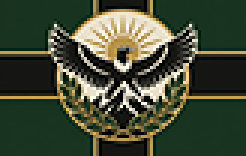
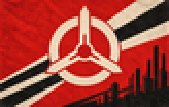
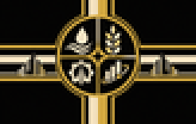
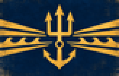
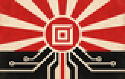
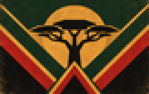
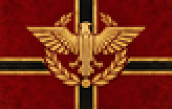
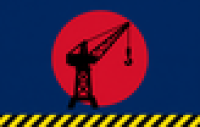

# Enciclopedia

Una página por nación, con todo lo que el mod sabe de ella: quién manda, quién la acompaña, qué la define, qué puede llegar a ser y qué le puede pasar. Se genera desde el spec, así que siempre está al día.

| | Nación | Qué es |
|---|---|---|
|  | [Imperio Ecofascista](EFE.md) | Meganación |
|  | [Comuna Socialista Automatizada](ASC.md) | Meganación |
|  | [Unión Libre de Capital Corporativo](FCU.md) | Meganación |
|  | [Nación de Mercado de Alta Mar](HSN.md) | Meganación |
|  | [Reino Celeste Neoandino](NAS.md) | Meganación |
|  | [Directorio Sino-Armónico](SHD.md) | Meganación |
|  | [Federación de los Pueblos Africanos](APF.md) | Meganación |
|  | [Neo Imperio Romano](NRE.md) | Meganación |
|  | [El Shogunato de los Astilleros](ZJP.md) | Potencia que se levanta |
|  | [República Obrera de Albión](ZAL.md) | Potencia que se levanta |
|  | [Señores de la Guerra de Eurasia](ZWE.md) | Tierra sin ley |
|  | [Señores de la Guerra del Indostán](ZWI.md) | Tierra sin ley |
|  | [Emiratos del Desierto](ZWM.md) | Tierra sin ley |
|  | [Caudillos del Amazonas](ZWB.md) | Tierra sin ley |
|  | [Las Tierras Sin Ley](ZAN.md) | Tierra sin ley |
|  | [La Junta del Sol Negro](JUNTA.md) | Régimen de guerra civil |

Además: [Satélites y países menores](SATELITES.md).

[Volver a la Biblioteca](../README.md)
