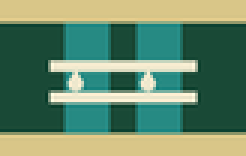
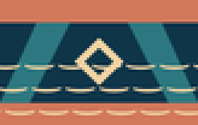
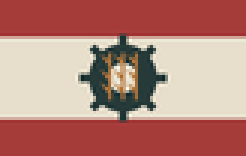
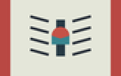
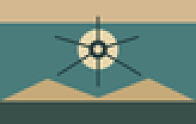
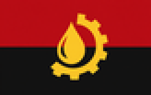
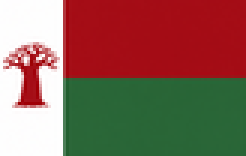
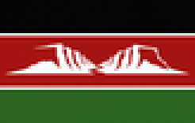

# Satélites y países menores

Los países que viven a la sombra de una meganación (o que todavía no eligieron cuál). Algunos se pueden jugar; casi todos se pueden liberar, anexar o perder.

| | País | Capital | Bajo el ala de |
|---|---|---|---|
|  | **Patagonia Austral** | — | Imperio Ecofascista |
|  | **Yvytu Ykua Guasu** | — | Imperio Ecofascista |
|  | **Nueva Granada** | — | Reino Celeste Neoandino |
|  | **Llanos Libres del Orinoco** | — | Reino Celeste Neoandino |
|  | **Zona de Recursos Boreal** | — | Unión Libre de Capital Corporativo |
|  | **Zona Económica del Sur** | — | Unión Libre de Capital Corporativo |
|  | **Puertos Libres Antillanos** | — | Nación de Mercado de Alta Mar |
|  | **Pacto del Mar Austral** | — | Nación de Mercado de Alta Mar |
|  | **Comuna Báltica** | — | Comuna Socialista Automatizada |
|  | **República Obrera de Albión** | — | Comuna Socialista Automatizada |
|  | **Protectorado Armónico de Corea** | — | Directorio Sino-Armónico |
|  | **Directorio de la Estepa** | — | Directorio Sino-Armónico |
|  | **Federación de las Tierras Altas** | — | Federación de los Pueblos Africanos |
|  | **Federación del Cabo** | — | Federación de los Pueblos Africanos |
|  | **Confederación del Congo** | — | Federación de los Pueblos Africanos |
|  | **Unión de Angola** | — | Federación de los Pueblos Africanos |
|  | **Liga de Mozambique** | — | Federación de los Pueblos Africanos |
|  | **Asamblea de la Isla Roja** | — | Federación de los Pueblos Africanos |
|  | **Federación del Rift** | — | Federación de los Pueblos Africanos |
|  | **Provincia de Hispania** | — | Neo Imperio Romano |
|  | **Provincia de Dacia** | — | Neo Imperio Romano |

[Volver a la Enciclopedia](README.md)
