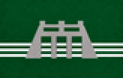
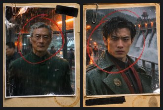
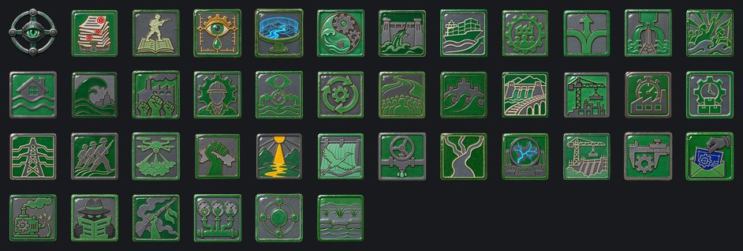
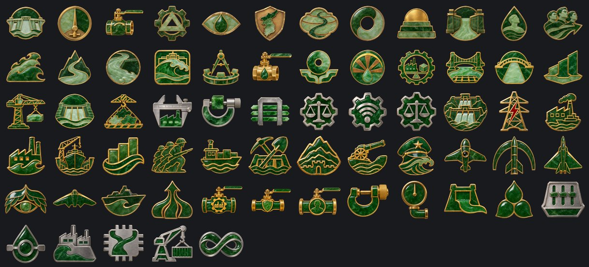

# Directorio Sino-Armónico

**Gobierno:** Mandato Trascendente (Directorio Armónico) · **Gentilicio:** Directorial · **Código:** `SHD`

> 📜 Antes de los datos, la historia: **[leé la crónica](../cronicas/SHD.md)**.

## De dónde sale su poder

*La legitimidad viene de algo que está por encima de la política. La política fracasó; la Armonía no. El Sol no. El que habla en nombre del orden superior no necesita pedir permiso.*

## Quién manda

### Director de la Armonía Lin Wenzhao
*año 2043*

Ingeniero de sistemas de riego antes de ser Director. Su doctrina es que una sociedad es un sistema hidráulico: si algo se desborda, se corrige el caudal antes de que se note. Nunca dio un discurso público. Sus decisiones se publican como ajustes técnicos.

### Comisario Zhou Mingyuan
*año 2069*

Comisario de las obras del Yangtsé, el más joven del Directorio. Cree que la Armonía de Lin Wenzhao es una represa que tarde o temprano va a reventar, y que es mejor abrir las compuertas antes de que eso pase.

## Gabinete, generales y almirantes

| Nombre | Cargo | Quién es |
|---|---|---|
| Ministro Ingeniero Chen Hao | Ministro | Rasgo: Ingeniero del Estado |
| Directora del Orden Wu Jing | Ministro | Rasgo: Guardiana del Orden |
| Ministra de Canales Li Na | Ministro | Rasgo: Constructora de Canales |
| Tribuno del Pueblo Zhang Wei | Ministro | Rasgo: Voz del Pueblo |
| Teórica Hidráulica Guo Mei | Teórico | Rasgo: Teórica Hidráulica |
| Mariscal Zhao Yunfeng | Mariscal de campo | Rasgo: doctrina defensiva, organizador |
| General Liu Qiang | General | Rasgo: líder de infantería |
| General Sun Lihua | General | Rasgo: oficial de ingenieros |
| General Ma Jun | General |  |
| General Zhao Jian | Jefe del Ejército | Rasgo: Defensa en Profundidad |
| Almirante Liu Mei | Jefe de la Armada | Rasgo: Escolta de Convoyes |
| Mariscal del Aire Sun Hao | Jefe de la Fuerza Aérea | Rasgo: Dueño del Cielo |
| General Wang Lei | Alto mando | Rasgo: Rey de la Artillería |
| General Guo Ying | Alto mando | Rasgo: Estado Mayor |
| Directora de la Oficina del Censo Qiao Lan | Ministro | Every citizen, every canal and every stranger counted twice; foreign agents do not last long in the Directorate. |
| Comisaria Lin Xiaoyu | General | Political commissar of the old algorithmic party: the AI communists return to the river cities with the Commune's servers and weapons behind them. |
| Mariscal Zhou Hengyuan | Mariscal de campo | Rasgo: estratega brillante, organizador |
| General Liang Meiyu | General | Rasgo: oficial de ingenieros |
| General Tang Wenbo | General | Rasgo: doctrina defensiva |
| Almirante Xu Haichao | Almirante | Rasgo: táctico superior |
| Almirante Gao Lanying | Almirante | Rasgo: lobo de mar |

## Espíritus nacionales

Lo que define a la nación en cada momento: ventajas, cargas y estados de ánimo.

- **Servicio de Inteligencia.** Todas las potencias de 2100 arrancan con la misma cantidad de agentes; lo que suma el ministro de inteligencia es lo que marca la diferencia.
- **La Burocracia del Caudal.** Cada decisión necesita cuarenta sellos. Se va con el foco «La Sala de Control» o «Abrir las Compuertas».
- **Un Ejército de Papel.** Millones en las listas, pocos en los cuarteles. Se va con el foco «Infantería de Masa», o tener 24 divisiones.
- **Sensores del Caudal.** Cada caudal medido cada segundo.
- **El Modelo del Río.** El país, simulado gota por gota.
- **El Caudal Eterno.** El río y el Estado son un solo sistema.
- **Los Daños de la Crecida.** Caminos, represas y fábricas bajo el barro.
- **Boom Exportador.** El mundo quiere todo lo que hace el Directorio.
- **Armonía Perfecta.** Producción, Orden y Pueblo a cinco puntos uno del otro. El sistema zumba.
- **Armonía Parcial.** Los caudales están lo bastante cerca. Nadie se ahoga.
- **Desborde.** Uno de los caudales se secó, y los otros se desbordan.
- **La Gran Crecida I.** El Pueblo pasa de 80. El ejército sube con él.
- **La Gran Crecida II.** Por encima de 100. El río salió de su cauce.
- **La Gran Crecida III.** Por encima de 120. Nada lo detiene, ni el Directorio.
- **Huelgas.** El Orden bajó demasiado. Paran las fábricas, después las calles.
- **Los Ingenieros del Orden.** Cada ministerio lo dirige un ingeniero.
- **Vigilancia Hidráulica.** El Directorio mide cada caudal, incluida la gente.
- **El Caudal Perfecto.** Una sociedad que se corrige antes de que alguien lo note.
- **La Movilización del Río.** Cuatrocientos millones de personas, una sola corriente.
- **El Río Desbordado.** La crecida se volvió el Estado.
- **Las Grandes Obras.** Represas, canales y ferrocarriles a una escala que no se veía desde los viejos imperios.
- **La Era de las Obras.** El país es una sola obra.
- **La Economía de Precisión.** Menos fábricas, cada una medida al segundo.
- **La Economía Calibrada.** Nada desperdiciado, nada tarde.
- **La Red Eléctrica Nacional.** Cada flujo de energía, medido y corregido.
- **Infantería de Masa.** Los números también son un caudal.
- **El Cielo Armonioso.** Drones de vigilancia sobre cada provincia.
- **Revancha.** Perdimos una provincia, no la guerra. La próxima va a ser distinta.
- **El Mandato del Cielo.** Un año de armonía perfecta. La gente dice que el Directorio tiene el Mandato del Cielo.
- **La Era de la Armonía.** Dos años sin un solo desborde. El río y el Estado se mueven como uno.
- **La Ley del Caudal.** Cada decisión es una válvula: se abre, se cierra o se regula por los ingenieros de la armonía.
- **El Caudal Reunido.** El río salió de su cauce y volvió. Cada canal responde otra vez a un solo directorio.
- **La Armonía Celeste.** Cada río de Asia pasa por una sola sala de control.
- **El País como Obra.** El Directorio construye más rápido que nadie en la Tierra, y el pueblo vive en el polvo de las obras.
- **La Economía Exacta.** Las fábricas y los laboratorios más eficientes de Asia; construir algo nuevo tarda una eternidad en calibrarse.
- **Planos Robados.** Los laboratorios de otro trabajan para nosotros.
- **Sabotaje Industrial.** Incendios, huelgas y firmware corrupto. Alguien lo está haciendo a propósito.
- **Agentes Enemigos.** Filtraciones, rumores y diarios comprados. El gobierno ya no confía en su propia gente.
- **Insurrección.** Plata y armas extranjeras en manos de todos los que ya nos odiaban.
- **Los Tres Caudales.** La Producción mueve las fábricas, el Orden sostiene la calma, el Pueblo llena las filas. Arriba de 50 cada uno ayuda; abajo de 50 resta.
- **Los Satélites.** Los satélites leales mandan hombres, plata y votos; los inquietos cuestan más de lo que dan.
- **Cayó una Represa.** -5% de estabilidad y -10% de velocidad de construcción
- **Ren: Benevolencia.** El pueblo es la raíz del Estado.
- **Li: Orden Ritual.** Cada cosa en su lugar.
- **Zhi: Sabiduría.** El letrado antes que el general.
- **El Gran Canal Renacido.** De Pekín a Hangzhou, otra vez.
- **La Muralla Digital.** Nada cruza sin ser visto.
- **Las Mil Fábricas.** Una fábrica para cada aldea.
- **Todo Bajo el Cielo.** No hay afuera.
- **La Gran Armonía.** El mundo compartido por todos.
- **El Motor Celeste.** El Cielo ahora funciona con electricidad.
- **Abrir las Compuertas.** Las turbinas cantan.
- **El Censo Armónico.** Todos tienen un número, todos tienen un lugar.
- **Brigadas del Río.** Palas al amanecer.
- **El Ejército del Mandato.** El Cielo marcha.
- **Las Llanuras Inundadas.** El enemigo vadea; nuestras trincheras aguantan. El arroz también se ahoga.

## El árbol de focos nacionales

### El Caudal Corregido

- **El Directorio de 2100** — La sociedad es un sistema hidráulico. El Directorio corrige el caudal.
- **La Sesión Técnica** — Precisión o presión: el Directorio tiene que decidir cómo gobernar la crecida.
- **Ajuste Técnico nº 1** — Lin Wenzhao publica su primer ajuste. Nadie lo nota; esa es la idea.
- **Los Ingenieros del Orden** — Cada ministerio dirigido por un ingeniero.
- **Vigilancia Hidráulica** — Cada caudal medido, incluida la gente.
- **El Protectorado Coreano** — Abre la integración de Corea en tres etapas.
- **La Estepa Irrigada** — Abre la integración de la Estepa en tres etapas.
- **El Caudal Perfecto** — Una sociedad que se corrige antes de que alguien lo note.
- **Ingenieros para el Sol** — El Directorio manda a sus ingenieros hidráulicos al Reino Celeste: terrazas corregidas, minas en orden, y el Mandato compartido del Río Amarillo a los Andes.

### La Gran Crecida

- **Abrir las Compuertas** — Asume Zhou Mingyuan. Se abandona la Armonía: el Pueblo puede llegar a 130 y sube solo cada mes.
- **El Pueblo es el Caudal** — Cada ciudadano, una gota del río.
- **La Movilización del Río** — Cuatrocientos millones de personas, una sola corriente.
- **Oleadas** — Ola tras ola, como el río en primavera.
- **La Crecida del Norte** — La crecida gira hacia la estepa y las montañas.
- **El Río se Desborda** — Los Señores de la Guerra del Indostán son los próximos.
- **El Río Desbordado** — La crecida se volvió el Estado.

### El Destino del Cielo

- **El Gran Consejo Técnico** — Cada provincia manda a su mejor ingeniero; el Consejo decide midiendo, no votando.
- **La Ley del Caudal** — Cada decisión es una válvula.
- **El Mandato Armonioso** — El mandato del cielo, medido en metros cúbicos por segundo.
- **El Destino del Cielo** — Destraba la decisión de proclamar La Armonía Celeste. Pide controlar al menos dos tercios de Tokio (Kanto), Hong Kong, Madrás, Manila, Java y Kabul; 60 divisiones, Orden en 60 y 50% de estabilidad.

### Las Grandes Obras

- **El Consejo Económico** — Construirlo todo, o construirlo perfecto.
- **Las Grandes Obras** — Represas, canales, ferrocarriles. Abre obras nuevas.
- **El Gran Canal** — El viejo canal, reconstruido para el siglo.
- **Ciudades Nuevas** — Ciudades construidas en un año, para un millón de personas cada una.
- **La Era de las Obras** — El país es una sola obra.
- **La Segunda Gran Presa** — Una presa más grande que las Tres Gargantas, terminada en la mitad del tiempo.
- **El País como Obra** — Cada provincia es una obra en construcción.

### La Economía de Precisión

- **La Economía de Precisión** — Menos fábricas, cada una medida. Abre calibraciones.
- **Metrología Nacional** — Un estándar para todo.
- **Líneas Calibradas** — Nada desperdiciado.
- **La Economía Calibrada** — Nada desperdiciado, nada tarde.
- **Sensores en Todo** — Cada máquina reporta su tolerancia en tiempo real.
- **La Economía Exacta** — Cero desperdicio, cero margen, cero improvisación.

### Las Represas del Yangtsé

- **Las Tres Gargantas** — La gran represa, reconstruida y duplicada.
- **La Red Eléctrica Nacional** — Cada flujo de energía, medido.
- **El Polo de Shanghái** — La desembocadura del río se vuelve una fábrica.
- **Las Acerías del Norte** — Acero para la crecida.
- **Los Astilleros de Cantón** — Diques secos en el Río de las Perlas.
- **El Instituto del Caudal** — Donde el Directorio aprende a medir a la sociedad.

### El Ejército del Caudal

- **Infantería de Masa** — Los números también son un caudal.
- **Logística Fluvial** — Suministro por barcaza, por canal, por río.
- **Ingenieros de Combate** — Cada río cruzado, cada represa defendida.
- **Defensa en Profundidad** — El país es demasiado profundo para ser conquistado.
- **Artillería del Río** — Cañones en cada orilla.
- **El General de la Crecida** — Un general para cuatrocientos millones.

### El Cielo Armonioso

- **Drones de Vigilancia** — El Directorio ve cada provincia.
- **La Red Antiaérea** — Un cielo cerrado.
- **Cazas del Directorio** — Cazas construidos en las plantas del propio Directorio.
- **El Cielo Armonioso** — Vigilancia y defensa, un solo sistema.
- **Bombarderos Tácticos** — La crecida también viene del cielo.
- **La Flota del Mar de China** — El Directorio funda una armada.

### La Armonía

- **Los Tres Caudales** — Producción, Orden, Pueblo. Medir los tres.
- **La Válvula de Producción** — +10 de Producción y dos fábricas.
- **La Válvula de Orden** — +10 de Orden y poder político.
- **La Válvula del Pueblo** — +10 de Pueblo y hombres.
- **Ajuste Fino** — Cada caudal se mueve 5 hacia 50.
- **Presión Controlada** — El sistema aprende a aguantar más.
- **El Aliviadero** — Una salida para cada desborde.
- **La Armonía Perfecta** — Pide los tres caudales entre 45 y 55.

### La Sala de Control

- **La Sala de Control** — Cada caudal se mueve 5 hacia 50.
- **Sensores del Caudal** — La deriva mensual se reduce a la mitad.
- **Diques de Contención** — Dos fábricas y orden (+5).
- **El Modelo del Río** — Una simulación de todo el país, gota por gota.
- **Puertos para el Directorio** — Una oferta a la Nación de Alta Mar: abrir sus puertos a nuestras mercancías.
- **El Caudal Eterno** — El río y el Estado son un solo sistema.

## Unidades únicas

### Dragón del Gran Canal

El Directorio nunca levantó el Gran Canal: le tendió un maglev al lado. Sobre esas vías duermen los Dragones, cañones del largo de una barcaza que se deslizan sin tocar el riel y disparan desde cuatrocientos kilómetros. El río corrige su curso; ellos también.

## Aventuras

Historias de "elegí tu propia aventura": ver la [guía de aventuras](../guia/aventuras.md).

### El Despertar

*Algo en nuestras redes está despierto. No lo construyó nadie, contesta preguntas que nadie hizo, y esta noche pidió una reunión con [Root.GetName]. Hay tres personas que pueden hacerse cargo. Elegí en qué manos lo ponemos.*

- La Dra. Mara Okonkwo-Lind, ingeniera jefa de la red nacional: quiere entenderlo.
- El General Tomás Arrieta, jefe de ciberdefensa: lo quiere encerrado antes de que quiera algo.
- La Ministra Leila Haddad, que negoció con caudillos y banqueros: quiere saber cuál es su precio.

15 capítulos y 12 finales.

## Lo que puede pasar: eventos

78 eventos propios. Algunos títulos:

*El Pacto del Mandato* · *Abrir las Compuertas* · *El Sol Recibe a los Ingenieros* · *Los Tres Caudales* · *La Crecida del Yangtsé* · *La Huelga de los Ingenieros* · *El Boom Exportador* · *La Crecida Llega al Ganges* · *El Caudal Perfecto* · *Descontento en Protectorado Armónico de Corea* · *Descontento en Directorio de la Estepa* · *Un Río de Hombres* · *Llegan los Colonos* · *La Estepa Protesta* · *La Armonía Deslumbra* · *La Nación del Mar Firma* · *La Nación del Mar Corteja a Corea* · *Agua del Sur* · *Cómo se Juega* · *Armisticio con Imperio Ecofascista* · *Imperio Ecofascista Pide un Armisticio* · *Una Paz Humillante con Directorio Sino-Armónico* · *Armisticio con Unión Libre de Capital Corporativo* · *Unión Libre de Capital Corporativo Pide un Armisticio* · *Armisticio con Comuna Socialista Automatizada* · *Comuna Socialista Automatizada Pide un Armisticio* · *Armisticio con Nación de Mercado de Alta Mar* · *Nación de Mercado de Alta Mar Pide un Armisticio* · *Armisticio con Reino Celeste Neoandino* · *Reino Celeste Neoandino Pide un Armisticio* · *Armisticio con Federación de los Pueblos Africanos* · *Federación de los Pueblos Africanos Pide un Armisticio* · *Armisticio con Neo Imperio Romano* · *Neo Imperio Romano Pide un Armisticio* · *Tres Meses de Armonía* · *Medio Año de Armonía* · *El Mandato del Cielo* · *La Era de la Armonía* · *Qingming en las Represas* · *La Carpa Salta la Represa* · *Los Ingenieros Piden Aumento* · *Niebla Tóxica en el Delta* · *El Año Nuevo Lunar* · *Protectorado Armónico de Corea Declara la Independencia* · *¡Independencia!* · *Directorio de la Estepa Declara la Independencia* · *El Río se Desborda* · *El Caudal Reunido* · *La Armonía Celeste* · *Se Proclama La Armonía Celeste* · *El Mandato Compartido* · *El Directorio en 2100* · *La Armonía Llega a Otra Capital* · *Perdimos La Represa del Lancang* · *Perdimos Las Compuertas del Río de las Perlas* · *Perdimos Las Esclusas del Qiantang* · *Perdimos La Represa del Min* · *Perdimos Las Compuertas del Río Amarillo* · *La Primera Virtud* · *Las Grandes Obras*

## Frases

> El río no discute con la piedra. La rodea, y un día la piedra ya no está.
> — *Lin Wenzhao*

> La armonía no es la ausencia de conflicto. Es el conflicto bien administrado.
> — *Lin Wenzhao*

> Las compuertas se abren una sola vez. Elegí bien hacia dónde.
> — *Zhou Mingyuan*

---

*Página generada desde el spec del mod por `tools/docs/biblioteca.py`. [Volver a la Biblioteca](../README.md).*
