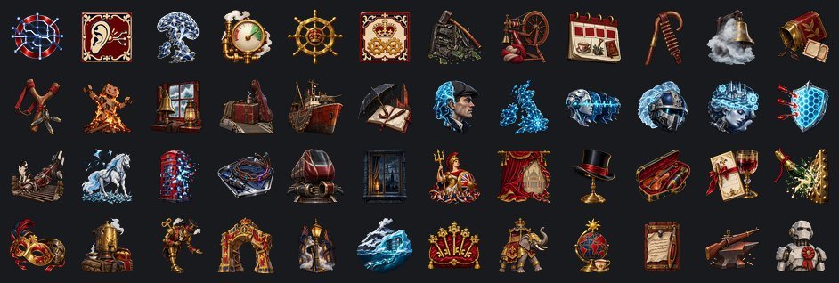
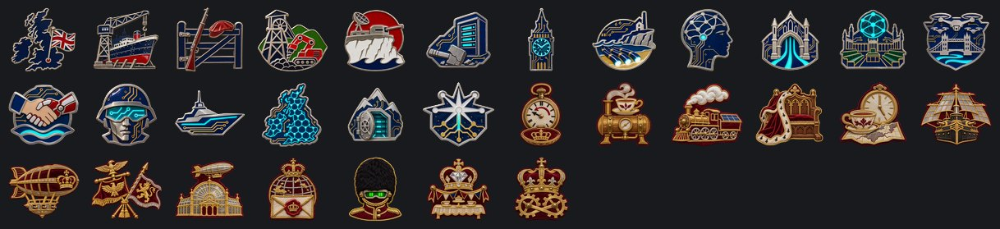

# República Obrera de Albión

**Gobierno:** Comuna Colectiva (Ludismo Revolucionario) · **Gentilicio:** Albionense · **Código:** `ZAL`

> 📜 Antes de los datos, la historia: **[leé la crónica](../cronicas/ZAL.md)**.

## De dónde sale su poder

*La legitimidad viene del pueblo. El colapso demostró que nadie se salva solo: las máquinas, la tierra y el agua son de todos, y nadie sobra.*

## Quién manda

### Presidente Tom Ashworth

Nieto de mineros de Yorkshire. Encabezó la Noche de los Servidores Rotos en Manchester.

### Primera Ascendida Siobhan Cray
*año 2068*

Neuroingeniera de Edimburgo, la primera persona en vivir un año entero conectada a la red de Londres. Era ludita a los veinte; dice que rompía servidores porque eran de otros. Ahora los servidores son de todos, y ella habla por todos al mismo tiempo.

### Su Majestad la Reina Victoria III
*año 2074*

Victoria Ashcombe-Hale era actriz de teatro de época en Bath hasta que la Cámara de los Lores restaurada encontró en un archivo parroquial que descendía, muy de lejos, de una rama menor de la vieja casa real. Lleva la corona como un vestuario y la nación la aplaude como a un estreno. Nadie sabe si se lo cree. Todos saben que funciona.

## Gabinete, generales y almirantes

| Nombre | Cargo | Quién es |
|---|---|---|
| General Siobhan Kelly | Jefe del Ejército | Rasgo: Instrucción Rigurosa |
| General Owen Pritchard | Alto mando | Rasgo: Estado Mayor |
| Portavoz Imogen Harrow | Ministro | Fue la primera diputada que votó conectada. Dice "nosotros" desde 2097 y nadie sabe si habla del consejo o de la red. |
| Administradora de la Red Adaeze Nwosu | Ministro | Hija de enfermeros de Lagos nacida en Peckham. Escondió un disco duro debajo del piso de su cocina durante los años luditas. Fue ella la que volvió a prender el primer rack de los Docklands. |
| Ingeniero del Encaje Callum McAllister | Ministro | Diseñó el encaje neuronal en un taller de bicicletas de Dundee. Lleva el primer prototipo en la cabeza, y todavía le zumba cuando llueve. |
| Defensora Niamh Byrne | Ministro | Abogada de Galway, la única ministra que no tiene encaje. Representa a los Desconectados en el consejo y toma notas en un cuaderno de papel que la red no puede leer. |
| Doctor Rhys Penhallow | Teórico | Neurocientífico de Cornualles. Estudia los sueños compartidos de la red y anota cada mañana el sueño de treinta millones de personas, que es siempre el mismo. |
| General Marcus Achebe-Lowe | Jefe del Ejército | El primer general con un puerto detrás de la oreja. Manda el ejército desde adentro de la cabeza de cada soldado, y dice que es como mandar a un solo hombre muy grande. |
| Almirante Fiona Strachan | Jefe de la Armada | Capitana de un pesquero de Aberdeen hasta los cuarenta. Ahora sus escoltas navegan en formación perfecta sin una sola orden por radio. |
| Mariscal del Aire Dev Malhotra | Jefe de la Fuerza Aérea | Piloto de drones de Leicester que vuela cuarenta máquinas a la vez con los ojos cerrados. Dice que el cielo se siente como una bandada. |
| General Eilidh Munro | Alto mando | Planificadora del Estado Mayor de Inverness. Sus planes los piensa el país entero durante una noche, y ella solo los firma a la mañana. |
| Mariscal Alistair Grant | Mariscal de campo | Era el jefe de las milicias luditas de las Highlands. Se conectó el mismo día que su hija, para no perderla, y en la red descubrió que tenía talento para la guerra de muchos cuerpos. |
| Generala Tamsin Rook | General | Ingeniera de combate de Plymouth. Sus zapadores tienden puentes sin hablar, porque cada uno sabe dónde va a poner el pie el de al lado. |
| Generala Priya Chandran | General | Comandante de las unidades de cuerpos de silicio. Volvió dos veces de la muerte, en dos cuerpos distintos, y los dos tienen la misma cicatriz en la ceja, porque así se recuerda ella. |
| Almirante Ewan Calder | Almirante | Oficial de radar de las Orcadas. Ve el Mar del Norte entero a la vez, por los ojos de cada pesquero conectado. |
| Lord Canciller Bartholomew Fenwick | Ministro | Profesor de historia en Oxford, el que encontró las togas en el sótano del museo. Se puso la peluca para una foto y no se la sacó más. |
| Lady Cordelia Ravensworth | Ministro | Directora de teatro en el West End antes de ser Maestra de Ceremonias de la Corte. Le enseñó a la Reina a saludar con la mano, y a los Lores a hacer como que se lo creen. |
| Sir Ambrose Kettering | Ministro | Cervecero de Burton al que nombraron baronet y después Canciller del Tesoro. Lleva las cuentas del Imperio en un libro con tapas de cuero y cobra los títulos de nobleza al contado. |
| Sir Percival Thorne | Ministro | Ministro de Colonias de un Imperio que no tiene ninguna. Tiene un globo terráqueo en el despacho con la mitad del mundo pintada de rosa, por si acaso. |
| Profesora Ada Wexley | Teórico | Presidenta de la Real Sociedad del Vapor. Construye autómatas de bronce que sirven el té y calderas que andan con hidrógeno, y no ve ninguna contradicción. |
| General Sir Horatio Pembroke | Jefe del Ejército | Coronel de las milicias luditas de Kent que se dejó crecer las patillas el día de la Restauración. Cree en las cargas, en los clarines y en la moral, en ese orden. |
| Almirante Lord Jasper Halloway | Jefe de la Armada | Sabe de memoria cada batalla de Nelson y ninguna de las de este siglo. Sus acorazados de bronce disparan salvas en cada puerto que tocan, para que se sepa. |
| Comodoro del Aire Winifred Ashby | Jefe de la Fuerza Aérea | Manda la flota de dirigibles de Su Majestad desde una góndola con piano. Bombardea con una taza de té en la mano, sin derramar una gota. |
| Coronel Sir Edmund Hartigan | Alto mando | Irlandés de Cork, oficial de infantería de los regimientos de la Reina. Forma a sus hombres en cuadro, como en Waterloo, y por ahora nadie le pudo demostrar que no sirve. |
| Mariscal de Campo Lord Augustus Wrexham | Mariscal de campo | El último soldado profesional de la vieja Gran Bretaña, retirado en 2086 cuando se rompieron las máquinas. Volvió de su granja de Shropshire con el uniforme de su bisabuelo y una caja de soldaditos de plomo. |
| General Sir Cecil Montague | General | Escalador de los Lagos y oficial de fusileros. Pelea en las colinas con monóculo y bastón, y es el primero en llegar arriba. |
| Generala Lady Beatrix Carrow | General | Hija de un duque falso y de una sufragista verdadera. Manda la caballería blindada con sable y faja violeta, y no pide permiso para cargar. |
| Almirante Sir Rupert Ormsby | Almirante | Comandante de los acorazados del Clyde, que tienen el casco remachado y velas solares. Pinta un león en la proa de cada barco que bota. |

## Espíritus nacionales

Lo que define a la nación en cada momento: ventajas, cargas y estados de ánimo.

- **Londres Reconectada.** La ciudad que rompió sus servidores los vuelve a encender, barrio por barrio.
- **Los Implantes de Manchester.** Los nietos de los luditas hacen fila para el encaje neuronal. El ejército lo recibe primero.
- **La Mente de Albión.** Sesenta millones de personas, un solo consenso, actualizado cada segundo.
- **Vapor y Té.** Calderas de bronce en las fábricas, porcelana en cada comedor. Es más lento; a nadie le importa.
- **La Armada de Su Majestad.** Acorazados con velas solares y cañones que disparan sobre todo salvas. Sobre todo.
- **El Imperio Neovictoriano.** Galeras, dirigibles y una reina en cada billete. Reina, Britannia, otra vez.
- **Servidores Rotos.** La multitud se fue a casa cantando. Los institutos de investigación también se fueron temprano.
- **Las Cooperativas de Lana.** Cada valle teje su propia tela, y cada familia se pone lo que teje.
- **La Semana de Cuatro Días.** Tres días para la huerta, el pub y el coro. Nadie estuvo tan tranquilo en un siglo.
- **Las Milicias de los Valles.** Detrás de cada seto hay un fusil y cada fusil conoce el seto.
- **Niebla en el Mar de Irlanda.** Hace semanas que no cruza ningún ferri. Dublín y Liverpool se gritan por radio.
- **El Té Racionado.** Dos tazas por día, por algoritmo. La Comuna no entiende lo que hizo.
- **Los Nietos de Ned Ludd.** Barras de adolescentes con hondas que bajan los drones de reparto de la Comuna y se quedan con las hélices de trofeo.
- **La Hoguera de los Robots.** Quemaron un robot de cartón en cada plaza de pueblo. El agregado de la Comuna sacó fotos.
- **La Guardia de las Costas.** Cada acantilado un fuerte, cada playa una trampa, cada pescador un vigía.
- **Los Refugiados de la Comuna.** Ingenieros, enfermeras, poetas. Todos trajeron una valija y una queja contra los algoritmos.
- **La Flota del Mar del Norte.** Pesqueros de Aberdeen y de Grimsby, mitad barcos de pesca, mitad armada.
- **Ginebra Mira.** Los observadores de Ginebra alquilaron un departamento en Westminster. Cada regimiento nuevo queda anotado.
- **Medio País en Línea.** Una mitad de Albión comparte sus pensamientos; la otra mitad comparte el pub. Ya no se entienden.
- **La Red Despierta.** Casi toda Albión está conectada, y la red empezó a terminarle las frases a la gente.
- **Un Solo Pulso.** Sesenta millones de corazones y un solo ritmo. Nadie quiere salir de la red, ni siquiera para ir a la guerra.
- **La Memoria Compartida del Ejército.** Un soldado raso de Hull se acuerda de Iguazú y del Ganges como si hubiera estado.
- **Las Fábricas Soñadas.** El turno noche es la red; el turno día solo aprieta los botones.
- **El Cortafuegos de Albión.** La red prueba cada idea extranjera antes de dejarla entrar. Casi todas las escupe.
- **Los Desconectados.** Pueblos que talaron sus antenas y ponen guardias en los caminos. Todavía votan, en papel.
- **La Red Sueña.** Cada noche el país entero tiene el mismo sueño, y cada mañana los científicos lo anotan.
- **El Fallo de Leeds.** Un barrio entero creyó, durante cuatro horas, que era un martes de 1987. Los ingenieros siguen emparchando.
- **El Encaje Pirata.** Clínicas de trastienda en Glasgow ponen encaje sin licencia por la décima parte del precio. Algunos funcionan.
- **La Huelga de los Desenchufados.** Los últimos obreros sin conexión pararon los trenes, las minas y los puertos. Sin ellos, la red no tiene manos.
- **El Apagón de Glasgow.** Dos millones de personas desconectadas de golpe. Durante una semana tuvieron que volver a aprender a estar solas.
- **¡Reina, Britannia!.** La nación entera se cree el espectáculo, y una nación que se lo cree es difícil de vencer.
- **Se Cae el Telón.** La gente empezó a ver el cartón detrás del mármol, y a reírse de los sombreros.
- **La Ley de las Galeras.** Un país de galera parece un país con un plan.
- **Los Dirigibles de Su Majestad.** Ballenas plateadas sobre el Támesis, con una orquesta en la góndola y bombas en la bodega.
- **La Temporada de Londres.** Cada decisión importante del año se toma entre el segundo y el tercer baile.
- **Un Barco por Mes.** Remaches, bronce y gaitas. Glasgow bota un barco por mes.
- **El Baile de Máscaras de Mayfair.** Detrás de las máscaras, media corte conspira. La otra mitad conspira contra la primera.
- **El Té de las Cinco en el Frente.** A las cinco en punto callan los cañones en toda la línea británica. El enemigo aprendió a esperar.
- **Los Autómatas a Vapor.** Obreros de bronce con calderas en el pecho, a los que un chico les da cuerda cada mañana con una llave.
- **El Jubileo de Cartón.** Los arcos eran de terciado pintado y la lluvia hizo el resto. Las fotos siguen por todos lados.
- **Los Barrios Bajos de Londres.** Detrás de las avenidas con faroles a gas volvieron los viejos barrios bajos, con deshollinadores y carteristas que citan a Dickens.
- **La Red del Atlántico Norte.** Servidores bajo el hielo de Groenlandia, mentes que piensan a la temperatura del mar.
- **Las Llaves de los Mares.** Gibraltar, Malta, Suez y las Malvinas. Cada llave se lustra los domingos.
- **La Joya de la Corona.** Delhi vuelve a celebrar un Durbar, y la Reina lo mira en una pantalla de bronce.
- **El Sol No Se Pone.** En algún lugar del Imperio siempre son las cinco.
- **La Constitución del Telar.** Ninguna máquina decide por una persona.
- **Fusiles sin Circuitos.** Nada que interferir, nada que hackear, nada que se rompa con la lluvia.
- **La Gran Rotura.** Los robots del Ruhr se quedan quietos bajo la lluvia, y los obreros vuelven a entrar a las fábricas con sus propias manos.
- **El Siglo Británico.** La Corona de Vapor ya no es un disfraz. Sesenta años de gloria, y el mundo se cree cada uno.
- **La Hora de Albión.** Una nación que piensa junta y todavía sabe escuchar.

## El árbol de focos nacionales

### Las Islas

- **Las Islas Otra Vez** — Por primera vez desde la Comuna, la bandera sobre Westminster es nuestra. Antes de elegir un siglo, Albión tiene que ponerse de pie.
- **Reabrir los Astilleros del Clyde** — Glasgow vuelve a escuchar remaches. Dos astilleros nuevos y los viejos carpinteros de ribera vuelven del retiro.
- **La Guardia Nacional** — Cada condado levanta su propio batallón: granjeros, estibadores y jubilados con fusiles. Tres divisiones para cuidar la costa.
- **Las Minas de Gales** — Los valles reabren los pozos viejos, esta vez con máquinas que no respiran polvo de carbón. Dos fábricas civiles.
- **El Canal Fortificado** — De Dover a Plymouth, cañones, minas y radares. El que quiera las islas va a tener que cruzar el agua otra vez.

### Hacia el Futuro

- **Hacia el Futuro** — Los luditas rompieron las máquinas porque las máquinas eran de otros. Ahora Albión es libre, y las máquinas pueden ser de Albión. El primer consejo sin un solo servidor roto.
- **Londres Reconectada** — Londres Desenchufada se vuelve a enchufar. Los mismos barrios que quemaron sus servidores en 2088 hacen fila para volver a encenderlos.
- **Los Cables de Cornualles** — Los viejos cables transatlánticos de Porthcurno vuelven a la vida: Albión escucha al mundo otra vez, y el mundo escucha a Albión.
- **Los Implantes de Manchester** — En la ciudad donde empezó la Noche de los Servidores Rotos abren las primeras clínicas de encaje neuronal. El ejército las recibe primero; los poetas, después.
- **La Universidad Abierta** — Oxford y Cambridge abren sus puertas a cualquiera que tenga un implante. Las clases se descargan durante la noche.
- **El Parlamento de las Mentes** — Westminster cierra sus bancas. Ahora las leyes las vota cada segundo toda la gente conectada, y el resultado lo lee en voz alta una voz que no es de nadie.
- **Los Drones del Támesis** — Drones plateados patrullan el río desde la Barrera hasta Oxford. Nada se mueve en la capital sin que lo sepa el Parlamento de las Mentes.
- **La Reconciliación con la Comuna** — La Comuna y Albión quieren el mismo futuro, solo que a distinta velocidad. Si hay guerra con la Comuna, termina acá, en paz blanca y con las fronteras de antes. Después Albión le ofrece volver a estar a su lado, esta vez como igual.
- **Cuerpos de Silicio** — Soldados que no se cansan, porque la mitad de cada uno es máquina. Los luditas los llamaban abominaciones; sus nietos los llaman hermanos.
- **La Flota sin Tripulación** — La Armada Real sin marineros: cascos que piensan, cañones que apuntan solos. Dos astilleros y la experiencia de cien simulaciones.
- **La Colmena de Albión** — Sesenta millones de personas, un solo consenso, actualizado cada segundo. Nadie se acuerda de cómo era no estar de acuerdo, y nadie lo extraña.
- **La Copia de Seguridad de Gales** — En lo hondo de las montañas de Gales, una copia de cada mente de Albión. Si caen las islas, Albión no va a morir.
- **La Mancomunidad Ascendida** — La cuna de la revolución industrial se vuelve la cuna de lo que viene después de lo humano. Albión ya no es un país: es una mente con bandera. Nombre nuevo, estandarte nuevo, y la Primera Ascendida habla por todos.

### Hacia el Pasado

- **Hacia el Pasado** — Si el futuro era una Comuna de máquinas, Albión va a mirar para atrás. A antes de los servidores, antes de la Comuna, antes de que todo saliera mal: al siglo en que Gran Bretaña gobernaba los mares.
- **Vapor y Té** — Los luditas nunca prohibieron el vapor. Vuelven las calderas de bronce a las fábricas, la porcelana a cada comedor, y los relojes de las ciudades se vuelven a dar cuerda a mano.
- **Los Ferrocarriles de Vapor** — Locomotoras de bronce con calderas solares, coches comedor con vajilla de plata. El ferrocarril vuelve a llegar a cada condado.
- **La Cámara de los Lores Restaurada** — Nadie se acuerda de quiénes eran los lores, así que se nombran nuevos: los sindicalistas más viejos, dos generales retirados y un pastelero famoso. Se ponen armiño. Se lo toman muy en serio.
- **El Té de las Cinco** — El Parlamento se detiene a las cinco todos los días, haya guerra o no. La nación descubre que una taza de té arregla casi todo.
- **La Armada de Su Majestad** — Todavía no hay majestad, pero ya hay una armada para ella. De los astilleros del Clyde salen acorazados con velas solares, pintados de negro y oro.
- **Los Dirigibles de la Corona** — Dirigibles dorados con galerías de cañones cruzan el Canal al amanecer. Poco prácticos, magníficos y sorprendentemente difíciles de derribar.
- **La Alianza con Roma** — Dos restauraciones, un solo enemigo. Roma reconstruye el Imperio de los Césares; Albión, el Imperio de la Reina. Las dos saben quién les quitó Europa: la Comuna de las máquinas. Albión se suma a la Pax Romana contra la Comuna.
- **La Gran Exposición de 2100** — En Hyde Park se levanta un nuevo Palacio de Cristal, hecho de vidrio solar. Adentro: telares a vapor, autómatas de bronce que sirven té y un dirigible de tamaño real. Medio mundo viene a reírse; la otra mitad, a comprar.
- **Las Colonias de Ultramar** — Se mandan cartas patente a cada isla que todavía flamea una Union Jack olvidada. La mayoría no contesta; las que contestan mandan voluntarios.
- **Los Regimientos de la Reina** — Casacas rojas sobre blindaje compuesto, gorros de piel de oso con visión nocturna. Los regimientos desfilan cada mañana en Horse Guards Parade, y los turistas los filman.
- **El Jubileo de Diamante** — Banderines desde Land's End hasta John o' Groats. Fiestas en la calle, un desfile de dirigibles y las joyas de la corona de gira.
- **El Imperio Neovictoriano** — La Abadía de Westminster, una carroza dorada, una corona copiada de una foto vieja. Victoria III es coronada Reina de Gran Bretaña y Emperatriz de Lo Que Quede, y la nación festeja como si los últimos dos siglos no hubieran pasado. Nombre nuevo, bandera nueva, una reina.

### Quedarse Luditas

- **Quedarse Luditas** — Ni para adelante ni para atrás: Albión se queda como es. Los telares siguen andando, los consejos siguen votando a mano alzada, y los martillos que rompieron los servidores en 2086 se bajan de las paredes. Del otro lado del agua la Comuna todavía maneja medio continente con robots. Ese es el problema.
- **La Constitución del Telar** — Una página, escrita a mano, clavada en la puerta de cada municipio: ninguna máquina decide por una persona. Todo lo demás se discute, y se discute.
- **Las Brigadas del Martillo** — Mineros, tejedores y estibadores que ya saben romper una máquina. Ahora aprenden a hacerlo bajo fuego. Tres divisiones.
- **Los Saboteadores del Canal** — Pesqueros que cruzan de noche con azúcar para los tanques de combustible de los robots de Rotterdam. Abre las decisiones de la Gran Rotura.
- **Fusiles sin Circuitos** — Un dron no puede interferir lo que no tiene electrónica. Las herrerías de los pueblos hacen cerrojos, miras y cañones a la vieja usanza, y nunca fallan.
- **La Internacional Ludita** — En los Países Bajos, en Flandes, en el Ruhr hay obreros que nunca pidieron que los reemplacen. Albión les promete devolverles las manos. Reclamos y objetivos de guerra sobre los Países Bajos, Bélgica y el Ruhr.
- **La Gran Rotura** — Destraba la decisión de proclamar la Gran Rotura. Pide controlar los Países Bajos, Bélgica, el Ruhr y Renania: el corazón robótico de la Comuna, parado a mano.

## Aventuras

Historias de "elegí tu propia aventura": ver la [guía de aventuras](../guia/aventuras.md).

### El Despertar

*Algo en nuestras redes está despierto. No lo construyó nadie, contesta preguntas que nadie hizo, y esta noche pidió una reunión con [Root.GetName]. Hay tres personas que pueden hacerse cargo. Elegí en qué manos lo ponemos.*

- La Dra. Mara Okonkwo-Lind, ingeniera jefa de la red nacional: quiere entenderlo.
- El General Tomás Arrieta, jefe de ciberdefensa: lo quiere encerrado antes de que quiera algo.
- La Ministra Leila Haddad, que negoció con caudillos y banqueros: quiere saber cuál es su precio.

15 capítulos y 12 finales.

### La Corona de Vapor

*La Reina Victoria III quiere un Jubileo de Diamante. Albión existe hace apenas una década, pero la Corona insiste en que hay que festejar sesenta años de gloria, y rápido, antes de que alguien se dé cuenta. Tres personas pueden hacer real el Imperio. Elegí quién carga la Corona.*

- Lady Cordelia Ravensworth, Maestra de Ceremonias: el Imperio es un espectáculo; que sea el más grande del mundo.
- El Mariscal de Campo Lord Augustus Wrexham: un Imperio necesita una victoria, no un desfile.
- La Profesora Ada Wexley, de la Real Sociedad del Vapor: mostrarle al mundo una maravilla que nadie más puede construir.

18 capítulos y 10 finales.

### La Gran Sincronía

*La red de Londres propuso algo que nadie se animaba a decir en voz alta: una noche en que cada persona conectada de Albión se enlace a la vez, y durante una hora la nación piense como una sola mente. Algunos lo llaman la Gran Sincronía. Otros, el fin de ser británicos. Elegí quién la va a llevar adelante.*

- La Portavoz Imogen Harrow: la Sincronía tiene que ser ley antes de ser milagro.
- La Administradora de la Red Adaeze Nwosu: si va a pasar, va a funcionar.
- La Abogada Niamh Byrne, voz de los Desconectados: que nadie quede a oscuras.

18 capítulos y 10 finales.

---

*Página generada desde el spec del mod por `tools/docs/biblioteca.py`. [Volver a la Biblioteca](../README.md).*
