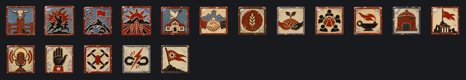

# Las Tierras Sin Ley

**Gobierno:** Mandato Trascendente (Caudillismo) · **Gentilicio:** Sin Ley · **Código:** `ZAN`

> 📜 Antes de los datos, la historia: **[leé la crónica](../cronicas/TIERRAS_SIN_LEY.md)**.

## De dónde sale su poder

*La legitimidad viene de algo que está por encima de la política. La política fracasó; la Armonía no. El Sol no. El que habla en nombre del orden superior no necesita pedir permiso.*

## Quién manda

### Los Señores de la Guerra

Nadie gobierna las Tierras Sin Ley. El "líder" es el nombre que les dan las meganaciones a los cientos de caudillos que se reparten cada valle.

## Las Leyendas

Las Tierras Sin Ley nunca tuvieron héroes: tuvieron al que seguía en pie. Estos dos siguen en pie.

| Nombre | Cargo | Cómo llega | Quién es |
|---|---|---|---|
| **Prefecto Ozyman** | Mariscal: La Muralla del Estoico | Llega con el foco La Milicia de los Ciudadanos (la República Última). | Cultivaba maíz en Nebraska hasta que la Unión dejó de comprarlo. Entonces levantó una muralla alrededor de su pueblo, después alrededor del siguiente, y nunca perdió uno. Les cita a Epicteto a sus soldados y a Marco Aurelio a sus enemigos, y su nombre es la broma de una maestra que a los doce años le dijo "rey de reyes": mirad sus obras y desesperad. |
| **Khavier Svoboda** | General: El Capitán | Llega con el foco Voluntarios por Convicción (Liberculto). | Nadie sabe de dónde salió: apareció en Kiev con una capa, predicando el Evangelio del Contrato desde el techo de un tranvía. Al año los ciberpredicadores le decían el Capitán, y las milicias lo siguieron a cada pelea que eligió. Nunca perdió una discusión y nunca dejó que nadie terminara una. |

## Gabinete, generales y almirantes

| Nombre | Cargo | Quién es |
|---|---|---|
| Mariscal Hank Dalloway | Jefe del Ejército | Rasgo: Instrucción Rigurosa |
| General Nkechi Obi | Alto mando | Rasgo: Guerra de Guerrillas |

## Espíritus nacionales

Lo que define a la nación en cada momento: ventajas, cargas y estados de ánimo.

- **La Frontera Armada.** Cada rancho tiene un armero y cada pueblo su lista de milicianos. El que viene por la frontera pelea contra toda la frontera. Cada zona vive de su propia tierra y no necesita línea de suministro.
- **La Gran Ofensiva.** Noventa días en que las Tierras Sin Ley pegan como una gran potencia.
- **Contra el Mundo.** Un año en que la frontera cree que le puede ganar a todos.
- **La Frontera Triunfante.** Las tierras que nadie quería ahora son las más productivas del mundo.
- **El Estado que Nadie Esperaba.** En paz con todos, por ahora. Justificarnos una guerra tarda el doble.
- **Contratos de Palabra.** Un apretón de manos delante del pueblo.
- **La Moneda de Cada Pueblo.** Grano, balas y horas de trabajo.
- **De Todos y de Nadie.** La tierra la trabajan todos.
- **Las Asambleas de la Llanura.** Cada silo su asamblea.
- **Soportar y Abstenerse.** Nada es nuestro salvo la voluntad.
- **Los Silos de la República.** Que nos sitien.
- **La Última República.** La última en pie.
- **Los Ciberpredicadores.** El Evangelio del Contrato en todas las frecuencias.
- **Voluntarios por Convicción.** Todos quieren pelear.
- **Drones de la Fe.** Bendecidos y pagados.
- **Ataque Preventivo por la Libertad.** La libertad no puede esperar.
- **Liberculto Triunfante.** De a una conquista por vez.

## El árbol de focos nacionales

### La Frontera

- **La Frontera se Cuenta** — El primer censo de las Tierras Sin Ley: más gente, más fusiles y más manos de lo que nadie pensaba.
- **Pueblos de Frontera** — Los puestos de comercio se vuelven pueblos, los pueblos se vuelven fábricas.
- **El Pacto de la Frontera** — Sheriffs, caciques y guardianes firman un pacto: nadie más va a decidir por la frontera.
- **Fuertes en Cada Camino** — Cada camino, paso y cruce de río se fortifica. Y nace la Guardia de la Frontera.
- **Ajustar Cuentas con la Unión** — La Unión nos quitó las tierras durante un siglo. Ahora la frontera va por ellos.
- **Contra el Mundo** — Todas las grandes potencias le hicieron daño a la frontera. Todas van a pagar.
- **La Frontera Triunfante** — Siete años después del colapso, las tierras que nadie quería son las más ricas de la Tierra. Fusiles, trenes y barcos caen como lluvia.

## Aventuras

Historias de "elegí tu propia aventura": ver la [guía de aventuras](../guia/aventuras.md).

### El Censo

*Hace cincuenta y ocho años que la Unidad Censal 7 camina. La vieja Oficina del Censo de los Estados Unidos la mandó en 2042 a contar a los habitantes de Nebraska, y nadie le avisó nunca que el país se había terminado. Así que siguió contando: las Dakotas, Alaska, Sonora, Guatemala y después, como sus órdenes decían «cada hogar bajo la jurisdicción», cruzó caminando por el fondo del Atlántico y siguió contando en Senegal, en Malí y en Kiev. Casa por casa, puerta por puerta, a cuatro kilómetros por hora. Le quedan tres pueblos. Y su código dice que cuando el censo esté completo hay que convocar un Congreso, y que su número es la ley. Cada caudillo de las Tierras Sin Ley quiere que ese número diga su nombre. Tres personas van a estar ahí cuando lo diga. Elegí en qué sombrero, o en qué chasis, te metés.*

- Lola Benavides, la falsificadora de Hermosillo, que puede hacer que cualquier papel diga cualquier cosa.
- El Sheriff Amos Kettleby, de Bismarck, que todavía lleva la Constitución en el bolsillo de la camisa.
- La Unidad Censal 7 en persona, que lleva cincuenta y ocho años contando y quiere, por una vez, que le dé bien la cuenta.

23 capítulos y 20 finales.

## Lo que puede pasar: eventos

3 eventos propios. Algunos títulos:

*La Unión Quiere la Frontera de Vuelta* · *La Federación Mira al Oeste* · *El Estado que Nadie Esperaba*

## Frases

> La ley llegó hasta acá una vez. Todavía estamos buscando su cuerpo.
> — *Los Señores de la Guerra*

---

*Página generada desde el spec del mod por `tools/docs/biblioteca.py`. [Volver a la Biblioteca](../README.md).*
