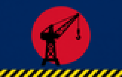
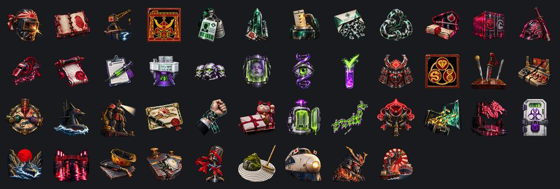
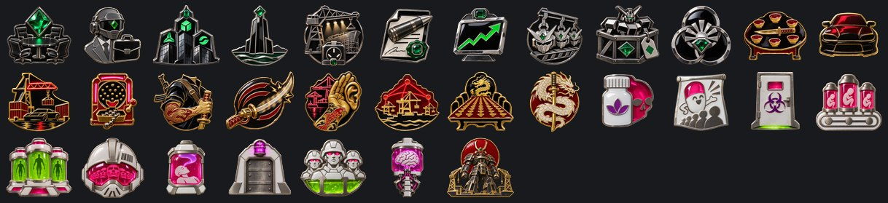

# El Shogunato de los Astilleros

**Gobierno:** Régimen de Restauración (Restauración Imperial) · **Gentilicio:** del Shogunato · **Código:** `ZJP`

> 📜 Antes de los datos, la historia: **[leé la crónica](../cronicas/ZJP.md)**.

## De dónde sale su poder

*La legitimidad viene de lo que existía antes del colapso: la Tierra viva, el imperio perdido, la vieja nación. Alguna vez hubo un orden. Se lo va a restaurar, cueste lo que les cueste a los vivos.*

## Quién manda

### Shōgun Almirante Kaede Mori
*año 2061*

Almirante de la base de Yokosuka. Cuando Singapur ordenó entregar la flota de Kanto, apagó la radio, izó una bandera vieja y les dijo a los astilleros que desde ese día respondían a ella.

### CyberShogun Daisuke Kanemura
*año 2058*

Heredero de la más vieja de las familias zaibatsu de Kanto: traje negro, anteojos verdes, el logo de la corporación en la solapa. Habla en trimestres y en toneladas. Al final del camino su mente se sube al Mecha más grande del mundo y la corporación se vuelve el Estado.

### CyberShogun Ryūji Sakaguchi
*año 2055*

Oyabun del clan que maneja los muelles de Osaka desde hace tres generaciones: tatuajes de dragón hasta el cuello, katana en la oficina, neón rojo en la puerta. Le faltan dos falanges y le sobran amigos en cada puerto. Al final del camino su mente se sube al Mecha y el código del clan se vuelve la ley.

### CyberShogun Kenzō Akabane
*año 2063*

Presidente de SRS, la farmacéutica más respetada de Sendai. Bata blanca impecable y una sonrisa de propaganda; en los sótanos crecen clones y se hacen experimentos que ningún comité aprobaría, por eso no tiene comité. Al final del camino es el primero en subir su propia mente a la máquina.

## Gabinete, generales y almirantes

| Nombre | Cargo | Quién es |
|---|---|---|
| Chambelana Aiko Hoshino | Ministro | Era la secretaria del puerto de Yokosuka. La noche de la bandera vieja fue la que guardó los libros de cuentas en una caja fuerte y la llave en el bolsillo. Desde entonces el Shogunato le paga a quien ella dice. |
| Maestro de Diques Goro Kitamura | Ministro | Cuarenta años soldando cascos para el Mercado de Alta Mar. Conoce cada dique de Kanto por el ruido que hace cuando se llena. Dice que los barcos se construyen con paciencia y se pierden con prisa. |
| Directora Yui Kanemura | Ministro | La hermana menor de Daisuke Kanemura, la que lleva las cuentas que él no mira. Si gobierna otra Casa, devuelve la llave de la tesorería y se lleva la contabilidad en la cabeza. |
| Wakagashira Tetsuo Mizuno | Ministro | El segundo de Ryūji Sakaguchi, el que cobra en los muelles de Osaka. Nunca levanta la voz; los comerciantes pagan antes de que llegue. Si gobierna otra Casa, se vuelve a Osaka a esperar. |
| Doctora Emi Shirogane | Ministro | Jefa de las cubas de clonación de Sendai. Firma cada lote con su nombre, como un pintor. Si gobierna otra Casa, apaga las cubas una por una y se lleva las claves. |
| Ingeniera Sachiko Ōno | Teórico | Diseñó el primer Mecha de Yokosuka en un cuaderno de dibujo, con piezas de grúa. Le dicen a cada Casa que el próximo modelo será suyo. Los dibuja a todos igual. |
| General Tsuyoshi Kuroda | Jefe del Ejército | Hermano jurado de Sakaguchi desde los quince años. Manda el ejército como mandaba a los cobradores, de frente y sin papeles. |
| Almirante Kiyoshi Okada | Jefe de la Armada | El oficial más viejo de la flota de Kanto. Le apagó la radio a Singapur junto con Kaede Mori, y fue él quien encontró la bandera vieja en un cajón del museo naval. |
| Comandante del Aire Mariko Fujiwara | Jefe de la Fuerza Aérea | Dirigía la división de drones de Kanemura Industrias Pesadas. Sus enjambres vuelan con el logo de la empresa pintado debajo de las alas. |
| Coronel Doctor Jun Sakamoto | Alto mando | Médico militar de SRS. Cuenta los regimientos de clones por lote y por fecha de vencimiento, y nunca se equivoca en ninguna de las dos. |
| General Rei Tachibana | Alto mando | Fortificó Kanto con contenedores llenos de hormigón cuando la flota del Mercado vino a buscar a sus barcos. No volvieron. |
| Mariscal Kazuo Inoue | Mariscal de campo | Último oficial de las viejas Fuerzas de Autodefensa que todavía se acuerda de los reglamentos. Le juró lealtad a Kaede Mori con la mano sobre un manual de 2040. |
| Mariscal Masaru Endō | Mariscal de campo | Jefe de seguridad de las cuatro familias zaibatsu. Hace la guerra con planillas, por trimestre, y la cierra cuando deja de dar ganancia. |
| Mariscal Shōta Kuze | Mariscal de campo | Le dicen el Dragón de Kobe. Tomó el puerto con trescientos hombres y ningún plan escrito. Su clan le tatuó la batalla en la espalda, cuadra por cuadra. |
| Mariscal Nao Fujita | Mariscal de campo | Es el primer oficial de SRS criado en una cuba que llegó a mariscal. Nadie se anima a preguntarle cuántas hermanas tiene, ni en qué regimiento sirven. |
| Generala Rin Yamada | General | Infante de marina de Yokosuka. Desembarca con la ola de la mañana y siempre en la playa que nadie esperaba. |
| Generala Kaori Nishimura | General | Piloto de pruebas de los Mechas de Kanemura. Manda los blindados desde la cabina del suyo, a doce metros del suelo. |
| General Daichi Arai | General | Creció en los callejones de Shinjuku. Pelea en las ciudades como en una riña de bar, con lo que tenga a mano y por la espalda. |
| General Isamu Hayashi | General | Manda la infantería de clones de SRS. Les aprendió el nombre a todos, aunque se repitan. |
| Almirante Yumi Nakagawa | Almirante | Manda las Lobas de Kure, los submarinos que nunca aparecieron en ningún registro del Mercado. Duerme de día. |
| Almirante Takeshi Shimizu | Almirante | Reflotó tres cruceros hundidos en la bahía de Tokio y los volvió a hacer navegar. La tripulación dice que todavía tienen agua del fondo en las bodegas. |

## Espíritus nacionales

Lo que define a la nación en cada momento: ventajas, cargas y estados de ánimo.

- **Fervor del Shogunato.** Los diques se levantaron. Cada soldador es un soldado y cada grúa una torre de vigía.
- **Deudas de Sangre.** Demasiado Giri debido y nunca pagado: los clanes empiezan a cobrar por su cuenta.
- **Los Diques Dudan.** No queda Giri: los astilleros se preguntan para quién trabajan en realidad.
- **La Línea de Mechas.** Tres turnos, una línea de montaje, un Mecha cada mañana.
- **Empleados, No Ciudadanos.** Cada japonés está ahora en una nómina. Las fábricas rugen; nadie deja la línea para ir al frente.
- **Las Megacorporaciones de Kanto.** Cuatro familias, cuarenta torres, un directorio. Las horas extra son patriotismo; las huelgas, traición.
- **Astilleros a Tres Turnos.** Yokosuka no vuelve a dormir, y nadie que trabaje ahí tampoco.
- **Mechas en Serie.** La empresa por fin paga bonos: en piezas de Mecha, pero bonos.
- **El Keiretsu Eterno.** Cada empresa es dueña de un pedazo de las demás, y todas son dueñas del Estado. Nadie cae solo, y nadie cae.
- **La Ley de los Clanes.** La policía ahora recibe órdenes de los oyabun. Todo funciona, por una comisión.
- **Los Puertos de Noche.** Cada contenedor paga dos veces. Cada fábrica paga protección.
- **Los Hermanos Juramentados.** Estibadores tatuados con katanas y fusiles de asalto. Valientes, leales, y nadie se anima a auditarlos.
- **La Red de los Muelles.** Un silbido en Osaka, una respuesta en Sapporo. Los clanes empiezan a pagar impuestos, a su manera.
- **El Código del Dragón.** El honor entre ladrones se volvió la ley del país, y es una ley estricta.
- **Voluntarios para Ensayos.** La farmacia paga bien a los voluntarios. No todos vuelven.
- **Los Laboratorios Sin Ética.** Debajo de la farmacia, el trabajo de verdad. Nadie pregunta de dónde salen los sujetos de prueba.
- **Los Clones de Combate.** Soldados idénticos de a miles, crecidos en cubas. Obedecen; no improvisan.
- **El Experimento Prohibido.** Las puertas del sótano no tienen picaporte del lado de afuera, pero los clones por fin aprendieron a pensar.
- **La Mente en la Máquina.** El último experimento de SRS funcionó: mentes que no necesitan cuerpo, clones que no necesitan dormir.
- **El Experimento Funcionó.** Nadie pregunta cuánto costó. Los resultados están en todos los escritorios.
- **El CyberShogunato.** Una mente en una máquina, y la máquina gobierna las islas.
- **Las Tres Casas en Paz.** La plata de los Zaibatsu, el músculo de la Yakuza, la ciencia de SRS, todo tirando para el mismo lado. No va a durar; aprovechalo.
- **Las Casas Afilan los Cuchillos.** Una Casa se siente traicionada, y en Japón una Casa traicionada no se queja: espera.
- **Rehenes de Honor.** Tres herederos jóvenes toman el té en la corte de Yokosuka cada tarde. Sus padres se portan bien.
- **Consejo de Guerra de las Casas.** Por una vez las tres Casas pelean la misma guerra.
- **Las Lobas de Kure.** Cada semana un casco negro se desliza al agua. Sus capitanes las llaman las lobas.
- **Mechas en los Muelles.** Cada muelle termina en un Mecha con el reflector prendido.
- **El Shogunato en la Bolsa.** Todos tienen un pedacito del Estado, y todos miran su cotización cada mañana.
- **Contratos de por Vida.** Una empresa, un empleado, una vida.
- **El Impuesto de Protección.** El sobre llega cada viernes. Hace meses que no roban a nadie.
- **Clones de Emergencia.** Caras idénticas en cada cuartel. Las madres de Sendai cruzan la calle cuando los ven.
- **El Ensayo Clínico Masivo.** El país entero es un laboratorio, y los resultados son excelentes. Por ahora.
- **Las Mil Voces.** La misma voz en cada parlante de cada puerto, amable e incansable.
- **El Capital en Fuga.** Los Zaibatsu se llevaron la plata a cuentas que la Shōgun no puede ver.
- **Puertos sin Ley.** Sin los clanes, cada muelle es del que tenga más cuchillos esta noche.
- **Laboratorios Cerrados.** SRS cerró sus puertas en Sendai. Sus científicos solo le responden a la empresa.
- **La Doctrina de Tsushima.** Golpear primero, golpear en el punto más angosto y nunca dejar que la flota enemiga llegue a mar abierto.
- **Neón sobre Osaka.** Los clanes iluminaron toda la ciudad de carmesí. El delito bajó; la noche nunca estuvo mejor.
- **El Rencor de los Soldadores.** La huelga terminó, pero los soldadores trabajan exactamente tan lento como permite el contrato.
- **Luto en Kanto.** La tierra se movió noventa segundos. La reconstrucción va a llevar años.
- **Idols del Frente.** Cuatro cantantes con uniforme de marinero les cantan a las tropas en todos los canales. El alistamiento se triplicó.
- **Los Monjes de Kioto.** En los templos viejos alguien todavía barre la grava cada mañana, y el país respira un poco más lento.
- **El Último Tren Bala.** La línea vieja vuelve a correr de Kyushu a Hokkaido, con soldados en los asientos de los turistas.
- **El Mecha Insomne.** A las tres de la mañana el gran Mecha de Yokosuka gira la cabeza hacia el mar, y nadie se lo ordenó.
- **El Mar del Shogun.** Cada barco que pasa por Malaca ahora le hace una reverencia a Yokosuka.
- **La Empresa Honesta.** Los únicos libros de Asia que dicen la verdad.
- **Cada Chico, un Piloto.** Cascos de Mecha de cartón en cada escuela.
- **La Fiesta Tranquila.** Trajes grises y uniformes azules en las mismas esquinas.
- **El Dragón de Osaka.** Todos los clanes cargaron el mismo dragón.
- **La Canción de la Enfermera.** Algo de una persona sobrevive en las cubas.
- **El Regimiento que Canta.** Cantan antes de cada batalla. El enemigo aprendió a temerle.
- **Dueño del Mercado.** Los barcos que se llevaron en 2089 volvieron a casa, con sus nombres viejos.
- **El Juramento Renovado.** Los clanes de Kansai quedan atados al Shogunato por otra generación.
- **Ciudadanos de la Cuba.** Pelean por un país que los llamó por su nombre.

## El árbol de focos nacionales

### Ruta Zaibatsu

- **El Consejo de los Zaibatsu** — Cuatro familias industriales ocupan las sillas del consejo y ponen a cada japonés en una nómina. Fábricas +20%, pero población reclutable -30%, estabilidad -15% y poder político -20%: los empleados no van a la guerra. LA META DE LA CASA: los diques del continente. Reclamos y objetivos de guerra sobre Corea entera, con Okinawa y Kitakyushu. Con eso y 35 de Giri, el CyberShogun.
- **Los Soldados Asalariados** — Seguridad corporativa con traje gris y chaleco antibalas: tres divisiones que responden al directorio antes que al Shogun.
- **Las Megacorporaciones de Kanto** — Torres de vidrio con los logos de las familias sobre cada ciudad. Fábricas +25% y astilleros +20%; estabilidad -20% y apoyo a la guerra -15%. Abre el Contrato con la Megacorporación.
- **La Torre Kanemura** — Doscientos pisos de vidrio negro sobre la bahía de Tokio, un logo verde arriba que se ve desde la órbita. Dos fábricas civiles.
- **Astilleros a Tres Turnos** — Yokosuka, Kure y Sasebo no vuelven a dormir. Astilleros +35%; estabilidad -25% y menos nacimientos: nadie tiene tiempo para una familia.
- **Contratos de Defensa** — Cada familia quiere un pedazo del presupuesto de guerra. Tres fábricas militares, entregadas a tiempo y con sobreprecio.
- **La Bolsa de Osaka** — Las acciones del Shogunato cotizan en Osaka y suben todos los días. Nadie pregunta quién compra.
- **Mechas en Serie** — Lo que se hacía a mano y en secreto ahora se estampa de a miles. La empresa por fin paga bonos: los castigos casi desaparecen (estabilidad -5%, población reclutable -10%) y la eficiencia crece 25% más rápido.
- **Mechas de Exportación** — Medio mundo quiere un Mecha y solo Kanto los fabrica. Dos astilleros pagados con los primeros pedidos.
- **El Keiretsu Eterno** — Cada empresa es dueña de un pedazo del Estado. No quedan castigos: fábricas +30%, astilleros +35%, estabilidad +10%.

### Ruta Yakuza

- **El Pacto de los Oyabun** — Los clanes que manejaban los puertos para Singapur ahora manejan el país para el Shogun. Poder político +30%, pero estabilidad -20%, fábricas -10% (la protección se paga) e investigación -10%. LA META DE LA CASA: los puertos de noche, de Kyushu a Hong Kong. Reclamos y objetivos de guerra sobre Okinawa, Kitakyushu, Taiwán y Hong Kong. Con eso y 35 de Giri, el CyberShogun.
- **Autos sin Luces** — Autos negros y bajos recorren la ruta de la costa de noche con las luces apagadas. Mensajes, armas y hombres llegan antes del amanecer.
- **Los Puertos de Noche** — Neón rojo sobre los muelles, autos bajos sin luces, contenedores que nunca pasan por la aduana. Poder político +40%, ataque +10%; fábricas -15%, investigación -15%. Abre el Tributo de los Puertos.
- **Los Salones de Pachinko** — Mil salones de bolitas de acero y neón. Cada moneda que cae paga un fusil.
- **Los Hermanos Juramentados** — Estibadores tatuados con katanas y fusiles prestan juramento: 60.000 hombres y 4 divisiones. Ataque +20%, organización +15%; estabilidad -25%, investigación -20%.
- **Katanas de Vibración** — Las viejas hojas, rehechas en los astilleros con un motor en la empuñadura. Cortan el blindaje como si fuera papel.
- **Los Tatuajes Hablan** — Cada clan tiene ojos en cada puerto. Lo que la Alta Mar planea en el desayuno, el Shogun lo sabe al mediodía.
- **La Red de los Muelles** — Los clanes empiezan a pagar sus impuestos, a su manera. Los castigos casi desaparecen (fábricas e investigación -5%) y la defensa sube 15%.
- **El Consejo de los Cien Clanes** — Por primera vez todos los clanes se sientan a la misma mesa. Cuatro divisiones más de hermanos juramentados y cuarenta mil hombres.
- **El Código del Dragón** — El honor entre ladrones se vuelve la ley del país. No quedan castigos: ataque +25%, defensa +20%, estabilidad +15%, apoyo a la guerra +20%.

### Ruta Científicos SRS

- **La Farmacéutica de Sendai** — Para el público, SRS fabrica medicamentos; el doctor Akabane ahora asesora al Shogun. Investigación +20% y un espacio de investigación, pero la farmacia les paga a voluntarios para sus ensayos: menos nacimientos, estabilidad -10%, apoyo a la guerra -15%. LA META DE LA CASA: chips y voluntarios. Reclamos y objetivos de guerra sobre Okinawa, Kitakyushu, las fundiciones de chips de Taiwán y las Filipinas. Con eso y 35 de Giri, el CyberShogun.
- **Los Voluntarios Pagos** — Carteles en cada estación: un mes de comida por una semana de pruebas. Las filas dan la vuelta a la manzana.
- **Los Laboratorios Sin Ética** — Batas, puertas con el símbolo de riesgo biológico y cubas en el sótano. Investigación +30%; estabilidad -20% y todavía menos nacimientos. Abre los Clones de Sendai.
- **La Línea Genética** — Una línea de montaje donde el producto es una persona. Dos fábricas civiles para alimentar las cubas.
- **Los Clones de Combate** — Soldados idénticos crecidos en cubas: 50.000 hombres y 3 divisiones. Población reclutable +30%, pero organización -10%: los clones obedecen, no improvisan.
- **Pilotos Clonados** — Un piloto que no le teme a la muerte, porque hay cien más como él. La aviación crece de un día para el otro.
- **Los Sueños de las Cubas** — Los clones sueñan todos a la vez el mismo sueño. Los médicos lo anotan y lo llaman progreso.
- **El Experimento Prohibido** — Los clones por fin aprenden a pensar. Los castigos casi desaparecen (estabilidad -5%); investigación +35%. Abre el Experimento Prohibido.
- **El Ejército que No Duerme** — Tres divisiones más de clones, crecidas en una sola noche, y treinta mil más en las cubas.
- **La Mente en la Máquina** — El último experimento de SRS funciona: mentes sin cuerpo, clones sin sueño. No quedan castigos: investigación +40%, organización +10%, estabilidad +10% y otro espacio de investigación.
- **CyberShogun** — El Mecha más grande jamás construido espera en el dique seco número uno de Yokosuka, alto como una torre. Adentro, en vez de un piloto, una mente: la del jefe de nuestra Casa, subida, multiplicada y conectada a cada grúa, cada buque y cada Mecha de las islas. Pide la meta de nuestra Casa cumplida y cuesta 35 de Giri. El país toma el nombre de su nuevo amo, bandera nueva, y el jefe se vuelve el CyberShogun. Después el Shogunato va por el cuello de la Alta Mar: Singapur y el estrecho de Malaca.

## Unidades únicas

### Mecha

Diez metros de blindaje sobre dos piernas, un piloto conectado a la columna y la velocidad de un auto de carrera. Los astilleros de Kanto los construyeron en secreto durante treinta años, diciéndole a Singapur que eran grúas. No eran grúas.

## Aventuras

Historias de "elegí tu propia aventura": ver la [guía de aventuras](../guia/aventuras.md).

### El Despertar

*Algo en nuestras redes está despierto. No lo construyó nadie, contesta preguntas que nadie hizo, y esta noche pidió una reunión con [Root.GetName]. Hay tres personas que pueden hacerse cargo. Elegí en qué manos lo ponemos.*

- La Dra. Mara Okonkwo-Lind, ingeniera jefa de la red nacional: quiere entenderlo.
- El General Tomás Arrieta, jefe de ciberdefensa: lo quiere encerrado antes de que quiera algo.
- La Ministra Leila Haddad, que negoció con caudillos y banqueros: quiere saber cuál es su precio.

15 capítulos y 12 finales.

### La Junta de Accionistas

*Gobiernan los Zaibatsu, y vence el primer informe trimestral del nuevo Japón. Los inversores extranjeros que huyeron de la HSN quieren ver una ganancia, un Mecha y una sonrisa. Dos personas pueden darles lo que quieren.*

- La Directora Yui Kanemura: libros honestos, el truco más viejo de los negocios.
- La General Kaori Nishimura: doce metros de acero hablan más fuerte que un balance.

6 capítulos y 6 finales.

### La OPA Hostil

*Daisuke Kanemura decidió que Japón no va a pelear contra el Mercado de Alta Mar. Lo va a comprar. Acción por acción, puerto por puerto, hasta que la HSN se despierte una mañana siendo propiedad de Kanto. Tres personas van a llevar adelante el negocio más peligroso de la historia de Asia.*

- Reiko Aoki, la tiburona: se quedó con once empresas y le dispararon dos veces.
- El Viejo Haga, el arreglador: cuarenta años comprando gente que nadie más podía comprar.
- Sora Fujiwara, el sobrino de Mariko: los drones se van a asegurar de que nadie rechace el trato.

15 capítulos y 12 finales.

### La Fiesta del Puerto

*Gobierna la Yakuza, y Ryūji Sakaguchi quiere que el país entero vea que los clanes pueden mantener la paz. La gran fiesta del puerto de Osaka es la prueba. Dos personas la van a manejar.*

- El Wakagashira Tetsuo Mizuno: orden, en silencio.
- El General Daichi Arai: una fiesta que Osaka no olvide nunca.

6 capítulos y 6 finales.

### El Último Oyabun

*El viejo padrino de Ryūji Sakaguchi, el hombre que lo hizo, se está muriendo en un hospital de Kobe. Cuando muera, los viejos clanes de Kansai van a elegir si mantienen su juramento al Shogunato o lo rompen. Tres personas pueden decidir qué pasa en los próximos dos años.*

- Hana Tadokoro, la nieta: nunca una mujer encabezó los clanes.
- El Inspector Shin Goto: la ley, aunque la ley sea la Yakuza.
- Kenji Ota, el tatuador: cada secreto de Kansai está en la espalda de alguien.

15 capítulos y 12 finales.

### El Lote 2101

*Gobierna SRS, y las cubas de Sendai producen los soldados del Shogunato. Pero el Lote 2101, trescientos clones, hizo algo que ningún lote hizo nunca: de noche, sin que nadie les enseñara, cantaron. Dos personas tienen que decidir qué significa eso.*

- La Doctora Emi Shirogane: averiguar por qué, antes que nadie.
- El General Isamu Hayashi, que se sabe todos sus nombres: son soldados, y son suyos.

6 capítulos y 6 finales.

### Los Hijos de la Cuba

*Después del Lote que Canta, una pregunta se extiende por los cuarteles del ejército de clones, de regimiento en regimiento: ¿qué somos? ¿Soldados, propiedad, o ciudadanos del Shogunato? Tres personas van a decidir la respuesta, y algunas lo van a pagar.*

- Nanami 117, la chica de la cicatriz del Lote 2101: el primer clon con nombre.
- La Abogada Mio Kurosawa, la mejor de SRS: escribió los contratos y conoce sus puntos débiles.
- El Doctor Ichiro Tanabe, inventor de las cubas: los hizo, y quiere saber qué hizo.

15 capítulos y 12 finales.

---

*Página generada desde el spec del mod por `tools/docs/biblioteca.py`. [Volver a la Biblioteca](../README.md).*
