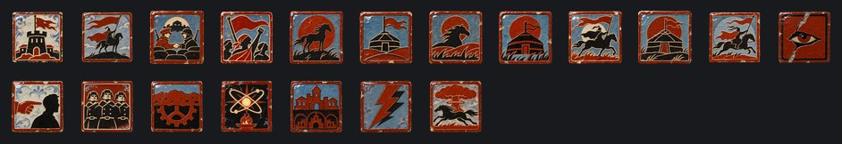
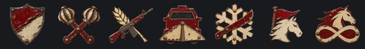

# Señores de la Guerra de Eurasia

**Gobierno:** Mandato Trascendente (Caudillismo) · **Gentilicio:** Euroasiático · **Código:** `ZWE`

> 📜 Antes de los datos, la historia: **[leé la crónica](../cronicas/TIERRAS_SIN_LEY.md)**.

## De dónde sale su poder

*La legitimidad viene de algo que está por encima de la política. La política fracasó; la Armonía no. El Sol no. El que habla en nombre del orden superior no necesita pedir permiso.*

## Quién manda

### Atamán Oleksandr Grigorenko

Excomandante de una guarnición del Dniéper. Controla los silos de grano entre Kiev y el Volga y cobra peaje en cada puente que sigue en pie.

## Gabinete, generales y almirantes

| Nombre | Cargo | Quién es |
|---|---|---|
| Atamán Grigori Voronov | Jefe del Ejército | Rasgo: Moral de Hierro |
| General Darya Kozlova | Alto mando | Rasgo: Guerra de Guerrillas |
| Hetman Stepan Bulava | Mariscal de campo | Era sargento de la última guarnición rusa de Smolensk. Cuando se fue el último oficial, los soldados lo eligieron a los gritos y desde entonces nadie se animó a desdecirse. |
| General Olena Zarubina | General | Hace la guerra en enero. Deja que el enemigo avance por la nieve y le corta la retirada cuando se le congela el combustible. |
| Atamán Bohdan Tkachenko | General | Asalta trenes blindados con camiones y escaleras. Tiene tres trenes robados que pintó de verde y les puso nombres de santos. |
| Coronel Matvei Sokolov | General | Cambia trigo por balas en cada pueblo del Volga. Sus columnas nunca pasan hambre porque llegan a los silos antes que la cosecha. |
| Atamán Ruslan Bekov | General | Sus jinetes andan en motos de nieve en invierno y a caballo el resto del año. Dice que los caballos no se quedan sin combustible. |
| Doctora Ilona Kurchatova | Ministro | La única que sabe prender los reactores viejos. Duerme al lado del núcleo y dice que el zumbido la tranquiliza. |
| Mayor Pavlo Sych | General | Manda a los Desoladores. Nunca se saca la máscara; algunos dicen que ya no puede. |

## Espíritus nacionales

Lo que define a la nación en cada momento: ventajas, cargas y estados de ánimo.

- **Los Señores de la Guerra Euroasiáticos.** Cada aldea es una fortaleza y cada señor de la guerra, un general. Conquistarlos es fácil; retenerlos, no.
- **El Caudillo Supremo.** Un hombre, un ejército, una región. Más difícil de romper que cien bandas.
- **La Tregua de los Caudillos.** Viejos enemigos comparten trincheras contra el invasor.
- **¡Liberar los Emiratos!.** Todo el país marcha contra la codicia de Roma.
- **La Estepa Aguanta I.** Cuanto más sobreviven los señores de la guerra, más difíciles son de romper.
- **La Estepa Aguanta II.** Cuanto más sobreviven los señores de la guerra, más difíciles son de romper.
- **La Estepa Aguanta III.** Cuanto más sobreviven los señores de la guerra, más difíciles son de romper.
- **La Estepa Aguanta IV.** Cuanto más sobreviven los señores de la guerra, más difíciles son de romper.
- **La Estepa Aguanta V.** Cuanto más sobreviven los señores de la guerra, más difíciles son de romper.
- **La Estepa Aguanta VI.** Cuanto más sobreviven los señores de la guerra, más difíciles son de romper.
- **La Horda Eterna.** Cinco años de guerra forjaron a las bandas en una sola horda. Ya no defiende la estepa: sale de ella.
- **La Paranoia Atómica.** Todos son enemigos hasta que se demuestre lo contrario. Nunca se demuestra.
- **Todos son Espías.** Denunciá a tu vecino.
- **La Leva Atómica.** Sé muchos.
- **Fábricas Bajo Tierra.** Lejos de la vista, lejos de las bombas.
- **El Culto del Átomo.** La estepa tiene un dios nuevo, y brilla.
- **Ciudades Refugio.** Una ciudad debajo de cada ciudad.
- **La Doctrina del Primer Golpe.** El que golpea segundo no golpea nunca.
- **La Horda Atómica.** La estepa marcha hacia el oeste bajo un hongo atómico.

## El árbol de focos nacionales

### Resistir

- **Sobrevivimos** — Medio año, y la Comuna no nos rompió. Disponible después de medio año de sobrevivir.
- **El Consejo de los Atamanes** — Los atamanes están de acuerdo en una sola cosa: nadie se lleva la estepa. Disponible después de un año de sobrevivir.
- **Trigo y Fusiles** — Los graneros del Dniéper alimentan a las bandas. Disponible después de un año y medio de sobrevivir.
- **Los Asaltantes del Tren** — Cada tren que cruza la estepa paga, en carga o en sangre. Disponible después de dos años de sobrevivir.
- **La Hueste del Invierno** — Peleamos mejor cuando los demás se congelan. Disponible después de tres años de sobrevivir.
- **La Gran Leva** — Cada aldea manda a sus jinetes. Disponible después de cuatro años de sobrevivir.
- **La Horda Eterna** — Cinco años de guerra forjaron a las bandas en una sola horda. Ya no defiende la estepa: sale de ella. Disponible después de cinco años de sobrevivir.

## Aventuras

Historias de "elegí tu propia aventura": ver la [guía de aventuras](../guia/aventuras.md).

### La Semilla Madre

*Hace dos semanas el tren blindado Matushka salió de Poltava con la Semilla Madre: el último trigo limpio de antes del Gran Desarme, trescientos kilos que alimentan a toda Eurasia el año que viene. Nunca llegó a Járkov. Los rieles siguen ahí. El tren, no. El Atamán Grigorenko colgó a dos jefes de estación por las dudas y le prometió un silo entero a quien lo traiga de vuelta. Tres personas están metidas en esto. Elegí en qué botas te metés.*

- Yarina, la guardavías de 16 años que vio lo que nadie vio.
- Bohdan Moroz, poeta y cuatrero, que le debe una cabeza al Atamán. La suya.
- La Hermana Olena, que lleva la mandíbula de un santo en el bolsillo.

23 capítulos y 20 finales.

## Lo que puede pasar: eventos

9 eventos propios. Algunos títulos:

*Saqueo de los Señores de la Guerra de Eurasia* · *Se Alza un Caudillo* · *Un Solo Caudillo* · *La Tregua de los Caudillos* · *Cayó la Gran Capital* · *Eurasia Propone una Unión* · *Otro Señor se Suma* · *Un Señor se Niega* · *El Atamán Baja al Búnker*

## Frases

> Nadie se lleva la estepa. La estepa se lleva a todos.
> — *Atamán Oleksandr Grigorenko*

> El primer reactor lo prendimos por miedo. El segundo, por costumbre.
> — *Doctora Ilona Kurchatova*

---

*Página generada desde el spec del mod por `tools/docs/biblioteca.py`. [Volver a la Biblioteca](../README.md).*
