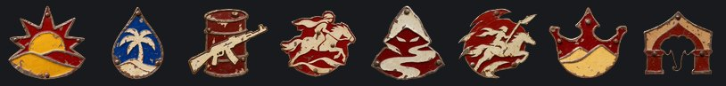

# Emiratos del Desierto

**Gobierno:** Mandato Trascendente (Caudillismo) · **Gentilicio:** Emiratí · **Código:** `ZWM`

> 📜 Antes de los datos, la historia: **[leé la crónica](../cronicas/TIERRAS_SIN_LEY.md)**.

## De dónde sale su poder

*La legitimidad viene de algo que está por encima de la política. La política fracasó; la Armonía no. El Sol no. El que habla en nombre del orden superior no necesita pedir permiso.*

## Quién manda

### Emir Khalid al-Rashid

Señor de los pozos muertos. Cuando se acabó el petróleo le quedó el desierto, los camiones y los hombres que sabían usarlos.

### Basileus Antíoco Rashid-Varma
*año 2056*

Hijo de un camionero del Golfo y de una princesa sin reino de Rajputana. Se hizo coronar con una diadema de chapa dorada y una falange de fusileros; dice que Seleuco hizo lo mismo con menos.

## Gabinete, generales y almirantes

| Nombre | Cargo | Quién es |
|---|---|---|
| Caíd Tariq al-Hashimi | Jefe del Ejército | Rasgo: Ofensiva Implacable |
| General Layla Haddad | Alto mando | Rasgo: Guerra de Guerrillas |
| Emir de los Ejércitos Yusuf al-Mazrui | Mariscal de campo | Comandó la guardia de un jeque que ya no tiene reino. Ahora manda los ejércitos de cuarenta oasis y cobra en agua. |
| Caíd Salim al-Harbi | General | Sus técnicas cruzan el Rub al-Jali de noche, sin luces, guiándose por las estrellas como su abuelo con los camellos. |
| Sardar Dariush Kamali | General | Pinta tanques en las dunas con espejos y lona. Una vez una división del Imperio bombardeó un día entero a un ejército que no existía. |
| Caída Nour al-Obeidi | General | Ataca con la tormenta de arena a la espalda. Sus hombres pelean con la cara tapada y los ojos cerrados la mitad del tiempo. |
| Coronel Elias Khoury | General | Lleva la cuenta de cada pozo que todavía da algo. Con eso mueve camiones que el resto del mundo daba por chatarra. |
| Estratego Kiran Seleukides | General | Domador de elefantes de guerra y lector obsesivo de Polibio. Forma a sus milicias en falange porque, dice, funciona igual con fusiles. |
| Dioceta Meera Varma | Ministro | Administra el agua del Tigris al Ganges con un libro de cuentas en griego, persa e hindi. Nadie sabe leer los tres; ella sí. |

## Espíritus nacionales

Lo que define a la nación en cada momento: ventajas, cargas y estados de ánimo.

- **Los Señores de la Guerra del Desierto.** Cada aldea es una fortaleza y cada señor de la guerra, un general. Conquistarlos es fácil; retenerlos, no.
- **La Guerra del Desierto.** Arena, calor y ningún camino: los Emiratos pelean donde nadie más puede.
- **El Caudillo Supremo.** Un hombre, un ejército, una región. Más difícil de romper que cien bandas.
- **La Tregua de los Caudillos.** Viejos enemigos comparten trincheras contra el invasor.
- **El Desierto Aguanta I.** Cuanto más sobreviven los señores de la guerra, más difíciles son de romper.
- **El Desierto Aguanta II.** Cuanto más sobreviven los señores de la guerra, más difíciles son de romper.
- **El Desierto Aguanta III.** Cuanto más sobreviven los señores de la guerra, más difíciles son de romper.
- **El Desierto Aguanta IV.** Cuanto más sobreviven los señores de la guerra, más difíciles son de romper.
- **El Desierto Aguanta V.** Cuanto más sobreviven los señores de la guerra, más difíciles son de romper.
- **El Desierto Aguanta VI.** Cuanto más sobreviven los señores de la guerra, más difíciles son de romper.
- **El Califato de las Arenas.** Los emires coronaron a un solo soberano del desierto. La arena misma pelea por él.

## El árbol de focos nacionales

### Resistir

- **Sobrevivimos** — Medio año, y la arena todavía se traga ejércitos. Disponible después de medio año de sobrevivir.
- **El Consejo de los Oasis** — Quien tiene los pozos tiene el desierto. Disponible después de un año de sobrevivir.
- **Petróleo por Fusiles** — Cada barril compra un fusil. Disponible después de un año y medio de sobrevivir.
- **Los Jinetes de las Dunas** — Rápidos, livianos, y lejos antes de que el enemigo se entere. Disponible después de dos años de sobrevivir.
- **La Guerra del Espejismo** — Donde el enemigo ve un ejército, no hay nada. Donde no ve nada, estamos esperando. Disponible después de tres años de sobrevivir.
- **La Leva de la Tormenta** — Cabalgan todas las tribus. Disponible después de cuatro años de sobrevivir.
- **El Califato de las Arenas** — Los emires coronaron a un solo soberano del desierto. La arena misma pelea por él. Disponible después de cinco años de sobrevivir.

### El Puente de Persia

- **El Puente de Persia** — Seleuco gobernó de Babilonia al Indo, y los reyes de la India le pagaron con elefantes de guerra. Los señores del Indostán también sobrevivieron. Si tendemos la mano primero, el imperio es nuestro para nombrarlo.

## Aventuras

Historias de "elegí tu propia aventura": ver la [guía de aventuras](../guia/aventuras.md).

### El Águila de Arbogast

*Hace un mes, el Legado Flavius Arbogast sacó a la Legio I Italica del desierto: tres mil legionarios, doscientos camellos mecánicos y un humor de perros. Se llevó a sus muertos. Se olvidó el Águila. No es un pájaro. Es el estandarte de la legión: tres metros de bronce dorado con un núcleo de fusión en el pecho y los códigos de mando de cada máquina de guerra romana al este de Damasco. En Roma, perder el Águila es peor que perder la guerra. En la Corte de los Emires, encontrarla es mejor que ganar una. El Emir Khalid al-Rashid prometió su peso en agua a quien se la traiga. Tres personas ya salieron a buscarla. Elegí en qué sandalias, o en qué cáligas claveteadas, te metés.*

- Nour al-Hadid, chatarrera del Mar de Vidrio, con un brazo de dron romano que a veces hace la venia solo.
- Gaius Severo, el aquilífero que perdió el Águila y tiene un año para encontrarla antes de que Roma lo encuentre a él.
- Umm Jabbar, la matriarca ciega de los contrabandistas, que oye cantar a la arena y quiere el Águila por su hijo muerto.

26 capítulos y 20 finales.

## Lo que puede pasar: eventos

4 eventos propios. Algunos títulos:

*Saqueo de los Emiratos del Desierto* · *Se Alza un Caudillo* · *Un Solo Caudillo* · *La Tregua de los Caudillos*

## Frases

> El petróleo se acabó. La arena no.
> — *Emir Khalid al-Rashid*

> Los elefantes vienen de la India. El oro para darles de comer sale de acá.
> — *Emir Khalid al-Rashid*

---

*Página generada desde el spec del mod por `tools/docs/biblioteca.py`. [Volver a la Biblioteca](../README.md).*
