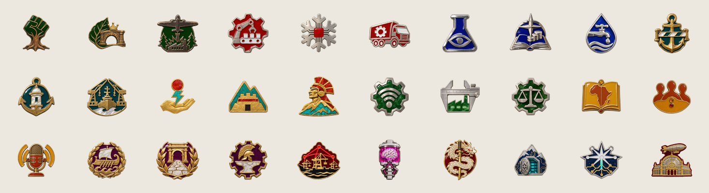
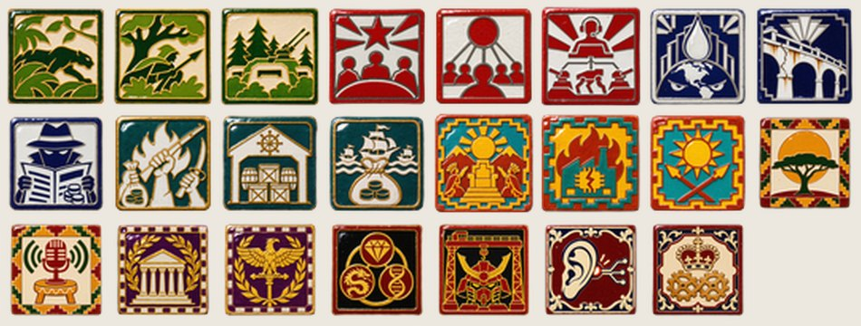

# Merch

Dos catálogos. El primero es del mundo de 2100: lo que se vende en los puertos francos de la Alta
Mar a quien tenga con qué pagar. El segundo es de verdad: lo que se puede fabricar hoy con el arte
del mod.

---

## I. Catálogo de Ultramarinos de Malaca

*Temporada de primavera, 2100. Envíos a las ocho meganaciones y a las Tierras Sin Ley (con
seguro de la Cámara de Compensación; la Cámara no responde por saqueos de caudillos).*

### Del Imperio Ecofascista

- **Semillero de lapacho certificado.** Un plantín con su certificado de la Guardia Verde. Si lo
  plantás demasiado cerca de la pared, un guardaparques te lo cambia de lugar. *Sin cargo.*
- **Pulsera de Bioacero.** Cultivada en las cubas de la Pampa, se ajusta sola a la muñeca y
  cicatriza los rayones. *Advertencia: no usar durante una fiebre de las cubas.*
- **Mate de Gaia.** Calabaza curada en el Santuario Amazónico, bombilla de Bioacero. *El Imperio no
  exporta yerba; la yerba la ponés vos.*

### De la Comuna

- **Taza térmica "La Red Fría".** Mantiene el café a la temperatura que el Plan considera óptima
  para tu productividad. No se puede cambiar.
- **Ficha de sorteo del Consejo.** Réplica en bronce de la ficha con la que se sortearon los
  primeros cuarenta y un delegados en Berlín, en 2061. Trae un número. *Puede salir el tuyo.*

### De la Unión

- **Acción enmarcada.** Una acción ordinaria de la Unión, enmarcada y firmada por la Presidenta
  Castellane. *Incluye ciudadanía. No incluye devolución.*
- **Set de copas conmemorativas de la Carta de Filadelfia.** Cuatro copas, una por corporación.
  *Si se rompe una, las otras tres siguen funcionando, pero no se llevan bien.*

### De la Alta Mar

- **Póliza de bolsillo.** Seguro contra todo riesgo por un viaje. Cubre naufragios, piratas y
  tormentas. No cubre guerras declaradas por potencias con buques estacionados frente a un
  estrecho.
- **Brújula de la Hermandad.** Siempre apunta al puerto más cercano que no te cobra peaje. Suele
  dar vueltas.

### Del Reino Neoandino

- **Lámpara del Inti-Soma.** Junta luz durante el día y la reza a la noche. *Rinde más en altura.*
- **Calendario del Sol 2100.** Con el Raymi marcado en dorado y el Solsticio de Guerra en rojo.

### Del Directorio

- **Sello de bronce con pez.** Réplica del sello número diecinueve de la Oficina de Caudales
  Secundarios. El pez nada contra la corriente. *Nadie sabe por qué. Es tradición.*
- **Formulario 7-C en blanco, edición de coleccionista.** Cuarenta casilleros para cuarenta
  sellos. *Llenarlo lleva entre cuatro y siete meses.*

### De la Federación

- **Chapa del turno del agua.** Réplica de la tabla de Tillabéri, rayada con un clavo, con el error
  de ortografía en el apellido Diallo incluido. *Lo más vendido del catálogo.*
- **Radio comunitaria a manivela.** Sintoniza solo las asambleas. Cada consejo tiene un micrófono.

### De Roma

- **Águila de escritorio.** Bronce dorado, diez centímetros. Sin núcleo de fusión. *Si encontrás
  la de la Legio I, la Legio I quiere hablar con vos.*
- **Kit del Triunfo.** Corona de laurel, toga y un esclavo que te susurra al oído que sos mortal.
  *El esclavo se vende por separado. En Roma no hay esclavos, oficialmente. Es un actor.*

### Del Shogunato (pedidos con demora: la Alta Mar no entrega a Kanto)

- **Figura de Mecha en papel.** La que se repartió en el desfile de Ginza. Doce centímetros. Los
  chicos de Japón la llevan a la escuela.
- **Hilo rojo de Sendai.** Para la muñeca. Los clones de Japón lo llevan desde lo de Nanami. SRS no
  se animó a prohibirlo.

### De Albión

- **Té de las Cinco, mezcla de la Corona.** Viene con una cucharita de bronce y una instrucción de
  Lady Ravensworth sobre cómo sostener la taza.
- **Martillo de la Noche de los Servidores Rotos.** Réplica a escala. *Para colgar en la pared. No
  romper servidores ajenos con él; la Comuna se ofende.*

### De las Tierras Sin Ley

- **Formularios del censo de 2040, en blanco, con marca de agua.** Con una pila de estos podés
  contar a quien quieras, donde quieras. *La Unidad Censal 7 los acepta.*
- **Motosierra Dona Fátima.** Modelo imperial de 2070 con cadena de diamante. *Origen: robado.
  Garantía: ninguna.*

---

## II. Merch de verdad

El mod tiene cientos de dibujos hechos para parecer objetos reales: pines de metal y esmalte,
azulejos de cerámica, banderas y retratos. Casi todos se pueden fabricar tal cual.

### Pines de foco

Más de seiscientos, uno por cada foco nacional, cada nación con su material: bronce y esmalte
verde para el Imperio, acero y esmalte rojo para la Comuna, ónix y esmeralda para los Zaibatsu,
laca urushi y oro para la Yakuza, bordado victoriano para la Albión del pasado.

**Ideas:**

- **Set de la nación:** los cinco pines de la rama de un destino, en una cajita con el nombre de
  la nación grabado.
- **El pin del Destino:** uno solo, el último de cada árbol (el CyberShogun, el Destino de Gaia,
  el Mare Nostrum), en edición numerada.
- **Pin de la partida:** el que corresponde al foco que completaste primero en tu última partida.

### Azulejos de los espíritus

Cada espíritu nacional es un azulejo de cerámica esmaltada con el color de su nación.

**Ideas:**

- **Posavasos de cerámica:** sets de cuatro por nación.
- **Panel de pared:** los espíritus de una nación armados como un mural, como los azulejos de un
  zaguán.
- **Imanes de heladera:** los que más se reconocen (el jaguar del Mandato Verde, el águila de las
  legiones, el sol de los Hijos del Sol).

### Láminas

Las pinturas de las aventuras están pensadas como óleos de museo en formato 2,35:1. Son
candidatas naturales a **posters** y **láminas impresas**, con el relato de la Lámina al pie, como
una placa de museo.

### Otras ideas

- **Estampillas del mundo de 2100:** una por nación, para coleccionar.
- **Remera de la Unidad Censal 7:** *"Residente, estado desconocido"*.
- **La chapa de Tillabéri:** réplica en lata, con el error de ortografía.
- **Libro de bolsillo:** *Cuentos de 2100*, con los cuentos de esta biblioteca.

> El arte de los pines, azulejos y láminas se pidió a generadores de imágenes con descripciones
> escritas para este mod. Antes de fabricar y vender algo, conviene revisar las condiciones de
> uso de la herramienta con la que se hizo cada imagen.

---

[Volver a la Biblioteca](../README.md)
